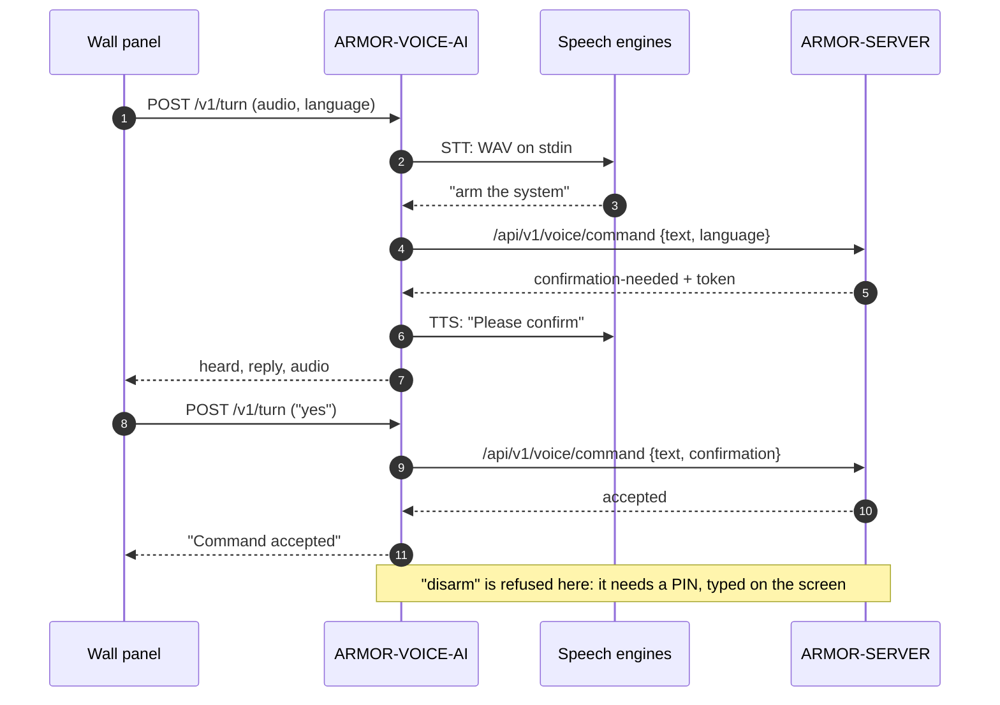

<p align="center">
  
</p>

# 🎙️ ARMOR-VOICE-AI

<p align="center">
  🇺🇸 <b>English</b> |
  <a href="README_spa.md">🇪🇸 Español</a> |
  <a href="README_fra.md">🇫🇷 Français</a> |
  <a href="README_ita.md">🇮🇹 Italiano</a> |
  <a href="README_deu.md">🇩🇪 Deutsch</a> |
  <a href="README_zho.md">🇨🇳 简体中文</a> |
  <a href="README_jpn.md">🇯🇵 日本語</a> |
  <a href="README_por.md">🇵🇹 Português</a>
</p>

### Offline voice intents in eight languages, with a confirmation the caller cannot forge

<p align="center">
  
  
  
  
  
  
  
</p>

---

**Honesty check - what runs today:** The intent rules, the eight languages, the signed confirmation tied to its speaker, the silence policy, the local service, the turn endpoint and the audit are real and tested (114 tests), and the server asks the service on the CM5 test bench. **No speech recognition or synthesis engine is part of this repository**: `/v1/turn` runs the commands you configure for them, and none has been tried with a real microphone yet; the touch panel that is meant to carry the assistant has not run on a board.

---

## 📋 At a glance

| | |
|---|---|
| Version | `0.3.1` |
| Maturity | Established |
| Role | Offline speech and intent gateway (family: Core Services, parent: ARMOR-SERVER) |
| Stack | Python 3.11+, standard library only |
| Tests | 114 (`python -m unittest discover -s tests`) |
| Commands | 15 (10 that ask, 5 that act), 420 phrases, 8 languages |
| Listens on | `127.0.0.1:18090` (loopback only), with a token |
| Runs on | The CM5 test bench (as a service) or any computer |
| On real hardware | Running as a service on the CM5 test bench, asked by the server; no microphone or speech engine has been tried |
| License | GPL-3.0-or-later |

**Jump to:** [Overview](#-overview) · [Architecture](#-architecture) · [Features](#-features) · [Security](#-security--safety) · [Interfaces](#-interfaces) · [Configuration](#-configuration) · [Quick start](#-quick-start) · [Testing](#-testing) · [Troubleshooting](#-troubleshooting) · [Structure](#-repository-structure) · [Related](#-related-projects)

## 🚦 Project status

Each line is one part of this repository and the light says how far it is today. It is written from what the repository can show (tests, builds, runs), not from what is planned.

🟢 Done and verified · 🟡 Works, with known limits · 🟠 Partly done or not verified yet · 🔴 Not done or not working

| Area | State | What it means here |
|---|---|---|
| Software | 🟡 | The intent rules, the local service and the turn endpoint run as a service on the CM5 test bench, but no speech recognition or synthesis engine is part of the repository: it runs the commands you configure for them. |
| Tests | 🟢 | 114 tests pass (`python -m unittest discover -s tests`): the intent rules, the eight languages, the signed confirmation tied to its speaker, the silence policy, the local service, the turn endpoint and the audit. |
| Hardware | 🔴 | No microphone or speech engine has been tried, and the touch panel that is meant to carry the assistant has not run on a board. |
| Security | 🟡 | The confirmation is signed and tied to its speaker, and the audit is tested on the host; there has been no independent review. |
| Integration | 🟡 | The server asks the service on the CM5 test bench; the voice flow with the touch panel has not run. |
| Documentation | 🟢 | Eight languages and the changelog are up to date. |

## 🎯 Overview

ARMOR-VOICE-AI is the part of A.R.M.O.R. that turns **what a person says into one of fifteen commands, or into nothing**. It never does anything by itself: it decides, and [ARMOR-SERVER](https://github.com/JuanenRac/ARMOR-SERVER) authenticates, authorises and carries out what was accepted, exactly as it would a click in the console.

The text that comes out of a speech recogniser is *untrusted input*. So it is not interpreted, searched for keywords or forwarded as a command: it is cleaned (accents, punctuation, polite filler) and must then be **exactly** one of 420 known phrases. Anything else, anything too long and any phrase that could mean two commands is *not understood*.

**What it does**

* Understands fifteen commands in **eight languages** (English, Spanish, German, French, Italian, Japanese, Chinese and Portuguese).
* Makes `arm` and `disarm` need a **second turn with a token the service signed**, tied to the intent and to the person who asked.
* Can make `silence` need a spoken **PIN** or a second confirming turn, when ARMOR-SERVER asks for it.
* Runs as a **local HTTP service** and as a **JSON-lines gateway** for adapters and tests.
* Takes the **audio of a turn** from the wall panel, runs the speech engines you configure and answers in text and, with a speech synthesiser, in audio.
* Records **decisions, never audio or words**: a SHA-256 of the transcript.

**What it does not do**

* It does not recognise or synthesise speech: those are programs the installation chooses.
* It does not arm, disarm or silence anything: an accepted command is a recommendation to ARMOR-SERVER.
* It does not disarm from the wall panel at all: the PIN is typed on the screen, never said aloud.

## 🧩 Role in A.R.M.O.R.

[ARMOR-SERVER](https://github.com/JuanenRac/ARMOR-SERVER) asks this service, then authenticates and authorises the command as it would a click in [ARMOR-STUDIO](https://github.com/JuanenRac/ARMOR-STUDIO). It is meant to live behind the microphone of the [ARMOR-NODE-HMI](https://github.com/JuanenRac/ARMOR-NODE-HMI) wall panel (push to talk) and it answers the written and spoken assistant of [ARMOR-ANDROID-CONTROL](https://github.com/JuanenRac/ARMOR-ANDROID-CONTROL). On the test bench it is installed by [ARMOR-DEVOPS](https://github.com/JuanenRac/ARMOR-DEVOPS) (`scripts/install_cm5.sh --with-voice`).

| It talks to | How | What for |
|---|---|---|
| ARMOR-SERVER | `POST /v1/command`, `POST /v1/turn` in; `/api/v1/voice/command` out | Decide a phrase; hand the words of a spoken turn to the server's own voice route |
| ARMOR-NODE-HMI | audio of one turn (16 kHz mono PCM) | The wall panel's microphone and speaker |
| ARMOR-ANDROID-CONTROL | through the server | The written and spoken assistant |
| Speech engines | standard input and output | Hearing (e.g. whisper.cpp, Vosk) and speaking (e.g. Piper); chosen by the installation |

## 🏛️ Architecture

<p align="center">
  
</p>

**A spoken turn that arms the system** (the panel is asked twice, and disarming is refused):

<p align="center">
  
</p>

<details>
<summary>Text version of the diagram (Mermaid)</summary>



</details>

**Why it is built this way**

* **Why a closed list and not intent classification.** A recogniser makes mistakes and anyone can speak near a microphone. With 420 exact phrases the worst a wrong transcript can do is be ignored, and a test checks that no phrase belongs to two commands.
* **Why the service only decides.** Authentication, authorisation, the audit trail and the action stay in one place, ARMOR-SERVER; a bug here can wrongly accept a phrase but cannot touch an alarm.
* **Why the confirmation is a signed token the service issues.** A flag the caller sets (`confirmed: true`) proves nothing, so it is refused. The token is HMAC-SHA-256 signed, tied to the command and to the person, valid for 30 seconds and good once.
* **Why the speech engines are separate programs.** Models change faster than a security gateway should. They are run without a shell, with a short environment and a time limit, and the service's own secrets never reach them.
* **Why nothing is kept.** The log shows what was decided without keeping what was said.

## ✨ Features

### The fifteen commands

| Command | Kind | Meaning | Confirmation |
|---|---|---|---|
| `status` | asks | The state of the system | no |
| `alarms` | asks | The alarms that are active | no |
| `nodes` | asks | The state of the nodes | no |
| `cameras` | asks | The state of the cameras | no |
| `radar` | asks | The state of the radars | no |
| `solar` | asks | The state of the solar system | no |
| `electrical` | asks | The electrical consumption | no |
| `network` | asks | The state of the network | no |
| `time` | asks | The time | no |
| `help` | asks | What can be said | no |
| `silence` | acts | Silence (acknowledge) the alarms | only if the server's policy asks (see below) |
| `lights_on` | acts | Turn the lights on | no |
| `lights_off` | acts | Turn the lights off | no |
| `arm` | acts | Arm the perimeter | **yes** |
| `disarm` | acts | Disarm the perimeter | **yes** |

The ten that *ask* change nothing. The five that *act* are carried out by ARMOR-SERVER with the session of the person who spoke, never by this service.

### Eight languages

English, Spanish, German, French, Italian, Japanese, Chinese and European Portuguese: the phrases (420 in all), the yes and no of a confirmation, the digit words of a spoken PIN and every sentence the service says back. Phrases are written the way a person says them and normalised when the module loads with the same function that normalises what is heard, so the two cannot drift apart. Polite filler (`please`, `por favor`, `bitte`, `s'il vous plaît`, `per favore`...) is dropped before comparing; Japanese and Chinese, written without spaces, list their phrases with and without the polite ending.

### The two-turn confirmation

1. The first turn for `arm` or `disarm` returns **no acceptance** and a `confirmation_token`.
2. The second turn echoes that token for the same intent, **for the same person**, within 30 seconds.
3. The token is signed with a secret the caller does not have, so it cannot be forged, altered, moved to another intent or another person; it works once and the nonces of the unexpired ones are never forgotten to make room for new ones (when there are too many at once, the new token is refused).

### Silencing by voice, with an optional PIN

"Silence" is accepted at once unless the installation asks for more. ARMOR-SERVER holds the setting `voice.silence_confirmation` and sends it as a policy:

| Mode | What happens on "silence" |
|---|---|
| `off` (default, and when no policy arrives) | Passed on at once |
| `double_turn` | Not carried out; the service asks to say yes, and a yes within 15 s from the same panel passes the original command on |
| `pin` | Not carried out; the service asks for the PIN, spoken as digits or as digit words in the eight languages; the right PIN within 20 s passes the command on |
| unreadable or unknown policy | `double_turn`: a broken setting never switches a protection off |

The PIN (4 to 12 digits, `ARMOR_VOICE_SILENCE_PIN`) is compared in constant time and is never logged, kept or echoed back. Three wrong PINs lock silencing by voice for **every** panel for five minutes; with `pin` asked for and no PIN set up, nothing is silenced by voice. The full contract is in [docs/SILENCE_POLICY.md](docs/SILENCE_POLICY.md).

### The wall-panel turn

`POST /v1/turn` takes the audio of one turn, runs the speech-to-text command, gives the words to ARMOR-SERVER's voice route, and answers with what was heard, what to say and, when a text-to-speech command is configured, a recording of it. The panel has no keyboard, so the question of `arm` is remembered per panel for 30 seconds and the next turn that says *yes* (in the language of the panel) confirms it and the next that says *no* cancels it. If the server answers `disarm`, the turn answers that disarming needs the PIN on the screen. Past nine seconds of listening nothing is asked of the server (the panel gives up at twelve), so what the person was told and what the house did cannot disagree.

### Decisions on record

With `--audit-file`, one JSON line per decision: time, intent, outcome and the SHA-256 of the transcript. Never audio and never the words.

## 🔒 Security & Safety

| Threat | Defence |
|---|---|
| A wrong or hostile transcript | Untrusted input: normalised, exact match against a closed list, 200 characters at most, ambiguous means *not understood*; never forwarded as a shell or device command |
| A caller claims a confirmation | `confirmed` is refused; only a token the service signed counts |
| A token is stolen, replayed or reused | Signed with HMAC-SHA-256, bound to intent and person, 30 s, single use; a token cannot outlive its issue time even if the clock jumps back |
| Another person uses someone's token | `wrong-subject` |
| Guessing the silence PIN | Constant-time comparison, 3 tries then 5 minutes locked for every panel, fails closed without a PIN |
| Someone on the network reaches the service | Loopback only (refuses another address without `--allow-remote`); token of at least 16 characters compared in constant time; 2 KB per request; a connection that stalls is closed after 15 s |
| A speech engine leaks or abuses secrets | Run without a shell, with a short environment (`PATH`, `HOME`, `LANG`, `TMPDIR`, `ARMOR_VOICE_ENGINE_*`), a time limit and a size limit; the service and server tokens never reach it |
| Exhausting the machine | At most two turns at once (a third gets 503); audio capped at 480 000 bytes |
| Logs reveal what was said | Never logged; the audit has a hash only |
| A stale turn acts late | Past nine seconds nothing is executed (504) |

Disarming by voice is **never** done from the wall panel. From the app it follows the server's `ARMOR_DISARM_PIN` (set it to `required`). Nothing here is a safety function: an accepted command is a recommendation that ARMOR-SERVER still authenticates and authorises. Read [docs/SAFETY.md](docs/SAFETY.md) for the full rules and [SECURITY.md](SECURITY.md) to report a vulnerability.

## 🔌 Interfaces

### HTTP service

| Route | Auth | What it does |
|---|---|---|
| `GET /healthz` | none | `{"ok": true, "service": "armor-voice"}` |
| `POST /v1/command` | header `X-Armor-Voice-Token` | Body `{text, language?, confirmation?, subject?, policy?, pin?}` (2 KB at most). Answers what was understood, a `confirmation_token` when a second turn is needed and `speech` in the language asked for |
| `POST /v1/turn` | same header | Body: raw 16 kHz 16-bit mono PCM, `Content-Type: audio/L16;rate=16000`, up to 480 000 bytes; headers `X-Armor-Language`, `X-Armor-Client`, `X-Armor-Policy`. Answers `{heard, reply, audio?}` |

A real exchange (the token is shortened):

```json
{"text": "arm the system", "subject": "u-1"}
{"accepted": false, "requires_confirmation": true, "intent": "arm", "outcome": "confirmation-needed", "confirmation_token": "eyJpIjoiYXJt...", "reason": "say it again with the confirmation within 30 s", "speech": "Please confirm"}

{"text": "arm the system", "subject": "u-1", "confirmation": "eyJpIjoiYXJt..."}
{"accepted": true, "requires_confirmation": false, "intent": "arm", "outcome": "accepted", "speech": "Command accepted"}

{"text": "open the garage"}
{"accepted": false, "requires_confirmation": false, "intent": null, "outcome": "not-understood", "reason": "the phrase is not one of the known commands", "speech": "Command not recognised"}
```

Outcomes: `accepted`, `confirmation-needed`, `confirmation-refused`, `pin-needed`, `pin-refused`, `not-understood`. A confirmation is refused as `invalid`, `expired`, `wrong-intent`, `wrong-subject` or `replayed`.

### Status codes of `/v1/turn`

| Code | Error | Meaning |
|---|---|---|
| 200 | | `{heard, reply, audio?}` |
| 401 | `unauthorized` | Missing or wrong token |
| 411 / 413 | `bad audio length` | No length, or more than 480 000 bytes |
| 415 | | Not `audio/L16;rate=16000` |
| 422 | `invalid language` | Not one of `en es de fr it ja zh pt` |
| 501 | `stt_unavailable` / `server_not_configured` | No speech-to-text command, or no server address |
| 502 | `engine_failed` / `server_<code>` / `server_not_answering` | A speech engine or the server failed |
| 503 | `busy` | Two turns are already running |
| 504 | `turn_too_slow` | The speech engine took so long that the server was not asked; nothing was executed |

### JSON-lines gateway

`python -m armor_voice_ai.gateway` reads one JSON object per line on standard input and writes the answer on standard output (2 KB per line; a line with bytes that are not UTF-8 is a line like any other). It is the same closed gateway, for speech adapters and tests.

### Contract with ARMOR-SERVER

* The server sends the silence policy on every request: `policy` in the body of `/v1/command` (and `pin` for the `pin` mode), the header `X-Armor-Policy` (a JSON object of at most 256 bytes) on `/v1/turn`.
* The server's voice route receives the words of a spoken turn at `/api/v1/voice/command` with the operator token of the installation, under the name of each panel (`X-Armor-Client`).
* Details: [docs/SERVICE.md](docs/SERVICE.md), [docs/SILENCE_POLICY.md](docs/SILENCE_POLICY.md).

## ⚙️ Configuration

### Environment

| Variable | Needed | What it sets |
|---|---|---|
| `ARMOR_VOICE_TOKEN` | yes (16+ characters) | The token callers send in `X-Armor-Voice-Token` (or a line `ARMOR_VOICE_TOKEN=...` in the file of `--token-file`) |
| `ARMOR_VOICE_CONFIRM_SECRET` | recommended (16+ bytes) | Signs the confirmations. Without it a random secret is used and pending confirmations are lost when the process stops |
| `ARMOR_VOICE_STT_COMMAND` | for `/v1/turn` | The speech-to-text program: audio (WAV) on stdin, the words on stdout |
| `ARMOR_VOICE_TTS_COMMAND` | optional | The text-to-speech program: text on stdin, a 16 kHz 16-bit mono WAV on stdout |
| `ARMOR_VOICE_SERVER_URL`, `ARMOR_VOICE_SERVER_TOKEN` | for `/v1/turn` | ARMOR-SERVER and the operator token for its voice route |
| `ARMOR_VOICE_SILENCE_PIN` | for the `pin` mode | 4 to 12 digits. An invalid value stops the service at start-up without printing it |
| `ARMOR_VOICE_ENGINE_*` | optional | Passed on to the speech engines (together with `ARMOR_VOICE_LANGUAGE`, set per turn) |

### Command line

| Flag | Default | |
|---|---|---|
| `--host` | `127.0.0.1` | Address to listen on; anything but loopback is refused without `--allow-remote` |
| `--port` | `18090` | |
| `--token-file` | | File with a line `ARMOR_VOICE_TOKEN=...` |
| `--audit-file` | | Append one line per decision |
| `--allow-remote` | off | Listen on a non-loopback address (not recommended; only behind TLS) |

### Limits that are in the code

| Limit | Value |
|---|---|
| Confirmation validity | 30 s |
| Spoken question remembered per panel | 30 s |
| "Yes" after a silence question / PIN after asking | 15 s / 20 s |
| PIN tries before the lock / lock time | 3 / 5 min |
| Turn budget / panel gives up | 9 s / 12 s |
| Speech engine time limit | 25 s |
| Largest audio / largest reply audio | 480 000 bytes / 190 000 bytes |
| Request body (`/v1/command`) | 2 KB |
| Transcript length | 200 characters |
| Turns at once | 2 |

The service never writes what was said to a log, whatever the settings.

## 🚀 Quick start

**Requirements:** Python 3.11+ (standard library only). Optional: a speech-to-text and a text-to-speech program for `/v1/turn`.

```powershell
$env:PYTHONPATH = "src"

# 1. the tests
python -m unittest discover -s tests                      # 114 tests

# 2. the gateway, one JSON object per line
echo '{"text":"arm the system"}' | python -m armor_voice_ai.gateway

# 3. the local HTTP service (loopback only)
$env:ARMOR_VOICE_TOKEN = "a-token-of-at-least-16-characters"
python -m armor_voice_ai.service --port 18090
```

```sh
curl -s http://127.0.0.1:18090/v1/command \
  -H "X-Armor-Voice-Token: $ARMOR_VOICE_TOKEN" \
  -d '{"text":"status","language":"de"}'
# {"accepted":true,"requires_confirmation":false,"intent":"status","outcome":"accepted","speech":"Befehl akzeptiert"}
```

To hear and speak (`/v1/turn`), point the service at your engines and at the server:

```sh
export ARMOR_VOICE_STT_COMMAND="/opt/armor/bin/hear"        # WAV on stdin, words on stdout
export ARMOR_VOICE_TTS_COMMAND="/opt/armor/bin/speak"       # text on stdin, WAV on stdout
export ARMOR_VOICE_SERVER_URL="https://armor-server.local"
export ARMOR_VOICE_SERVER_TOKEN="..."
python -m armor_voice_ai.service --token-file /opt/armor/etc/armor.voice.env
```

The wall panel is a device on the network and the service listens on the loopback only: either a proxy of the server forwards the turn, or `--allow-remote` is used behind TLS. The token and the audio must not cross the network in clear.

`run.bat` / `run.sh` and `build.bat` / `build.sh` start the shared project workflow of [ARMOR-COMMON](https://github.com/JuanenRac/ARMOR-COMMON) (the repositories sit side by side). Pip users get the command `armor-voice-gateway`.

## 🧪 Testing

```powershell
$env:PYTHONPATH = "src"
python -m unittest discover -s tests
python -I tools/armor_ci_validate.py        # manifest, version, changelog and README parity
```

| Test file | Tests | What it covers |
|---|---|---|
| `test_silence.py` | 31 | The silence policy, the spoken PIN in eight languages, the lock |
| `test_edges.py` | 29 | The line protocol, the service settings, the link to the server (a stand-in on the loopback), the engines' limits |
| `test_gateway.py` | 23 | The gateway, the confirmation, replays and forgeries |
| `test_turn.py` | 15 | The turn, the engines, the spoken yes and no, the time budget |
| `test_languages.py` | 11 | Phrases in normal form, no phrase for two commands, each language arms, disarms, asks and silences |
| `test_service.py` | 5 | The HTTP routes |

GitHub Actions runs the A.R.M.O.R. baseline on every push and pull request: the validation of the manifest, version, changelog and README parity, then the project's own build and tests.

## 🏗️ Build & Release

It is plain Python: nothing to compile. The version lives in `pyproject.toml`, in `armor.project.json` and in the README badge (read from the manifest); each version has its entry in [CHANGELOG.md](CHANGELOG.md). Releases are published on GitHub.

## 🩺 Troubleshooting

| You see | Because | Do |
|---|---|---|
| `refusing to listen on a non-loopback address without --allow-remote` | `--host` is not `127.0.0.1`, `::1` or `localhost` | Keep loopback and let the server's proxy forward, or add `--allow-remote` behind TLS |
| `a token of at least 16 characters is needed` | `ARMOR_VOICE_TOKEN` is missing or short | Set it, or use `--token-file` |
| `ARMOR_VOICE_SILENCE_PIN is not valid` | Not 4 to 12 ASCII digits | Fix the value (it is never printed) |
| `ARMOR_VOICE_CONFIRM_SECRET is not set` (warning) | A random secret is in use | Set a secret of 16+ bytes if confirmations must survive a restart |
| 401 `unauthorized` | Missing or wrong `X-Armor-Voice-Token` | Send the token |
| 501 `stt_unavailable` | `ARMOR_VOICE_STT_COMMAND` is not set | Configure a speech-to-text program |
| 501 `server_not_configured` | No server address or token | Set `ARMOR_VOICE_SERVER_URL` and `ARMOR_VOICE_SERVER_TOKEN` |
| 502 `engine_failed` | The engine failed, timed out or answered too much (or a TTS WAV that is not 16 kHz 16-bit mono) | Run it by hand with the same input |
| 504 `turn_too_slow` | The speech engine took more than nine seconds | Use a faster model; nothing was executed |
| "Disarming needs your PIN" | Disarming is never done by voice from the panel | Use the screen |
| A spoken "yes" does nothing | The question was not remembered (it took over 12 s to ask, more than 30 s passed, or another panel answered) | Say the command again |

## 📂 Repository Structure

<p align="center">
  
</p>

<details>
<summary>Text version of the tree</summary>

```text
ARMOR-VOICE-AI/
├── src/armor_voice_ai/        the code (standard library only)
│   ├── phrases.py             the 420 phrases of the fifteen commands, in eight languages
│   ├── intent.py              normalising and exact matching: the closed allow-list
│   ├── confirmation.py        signed, single-use, per-person confirmation tokens
│   ├── silence_policy.py      off / pin / double_turn, the spoken PIN, the lock
│   ├── session.py             the two-turn rule for each command
│   ├── gateway.py             JSON lines on stdin/stdout, the audit, the sentences said back
│   ├── service.py             the local HTTP service (/healthz, /v1/command, /v1/turn)
│   └── turn.py                one spoken turn: engines, yes/no, time budget
├── tests/                     114 tests: silence, edges, gateway, turn, languages, service
├── docs/                      SAFETY.md, SERVICE.md, SILENCE_POLICY.md
├── tools/                     the shared CI checks and project tooling
├── images/                    banner and icon
├── .github/                   CI workflow, dashboard notice, issue and pull-request templates
├── armor.project.json         manifest: version, role, maturity, build command
├── pyproject.toml             package metadata and the `armor-voice-gateway` command
├── run.sh run.bat             start through the shared project workflow
├── build.sh build.bat         build and test through the shared project workflow
├── CHANGELOG.md               what changed in each version
└── SECURITY.md SUPPORT.md CONTRIBUTING.md CODE_OF_CONDUCT.md LICENSE
```

</details>

## 🗺️ Roadmap & Known limits

**Known limits today**

* No speech engine ships with it, and none has been tried with a real microphone.
* The touch panel that is meant to carry the assistant has not run on a board; there is no wake word, it is push to talk.
* The turn does not say *which panel or which person* spoke: ARMOR-SERVER decides with the token it was given. Adding them to the request is a change of the contract between the server and the panel.
* No independent security review.

**Next**

* Try a real microphone and a real speech engine on the CM5 test bench.
* Run the voice flow with the touch panel once it has run on a board.
* Optional authenticated speaker or physical confirmation. A later deployment may add it, but the signed confirmation will not be removed without a documented risk review.

## 🌍 Languages

README and texts exist in English, Spanish, French, Italian, German, Chinese, Japanese and European Portuguese. Every sentence the service says back, every spoken command, every yes and no and every digit word of a PIN exists in all eight languages.

## 🔗 Related Projects

**A.R.M.O.R.** (Autonomous Radar & Multimodal Observation Range) is a perimeter-security system made of independent repositories. Each one has its own version, its own tests and its own README; this is the family:

* **[ARMOR-COMMON](https://github.com/JuanenRac/ARMOR-COMMON)** - Message contracts, validators, conformance vectors and generated types
* **[ARMOR-NODE-RADAR](https://github.com/JuanenRac/ARMOR-NODE-RADAR)** - Field-node firmware for ESP32-S3 with three radars and its own web panel
* **[ARMOR-NODE-SOLAR](https://github.com/JuanenRac/ARMOR-NODE-SOLAR)** - Solar inverter and battery protocols and the messages of a gateway node
* **[ARMOR-NODE-ELECTRICAL](https://github.com/JuanenRac/ARMOR-NODE-ELECTRICAL)** - Electrical node: meters, the message of the network's readings and the rules for switching
* **[ARMOR-NODE-ALARM](https://github.com/JuanenRac/ARMOR-NODE-ALARM)** - Alarm node and panel: zones, arming, delays, siren and PIN, with the server or without it
* **[ARMOR-NODE-HMI](https://github.com/JuanenRac/ARMOR-NODE-HMI)** - Touch panel: the state of the system on a wall screen, arming and acknowledging, and the home of the voice assistant
* **[ARMOR-NETWORK](https://github.com/JuanenRac/ARMOR-NETWORK)** - The local network: its devices, the internet and what changes
* **[ARMOR-SERVER](https://github.com/JuanenRac/ARMOR-SERVER)** - Central coordinator: telemetry, alarms, devices, solar readings and cameras
* **[ARMOR-STUDIO](https://github.com/JuanenRac/ARMOR-STUDIO)** - Web console: cameras, radar, alarms, solar energy and the 2D/3D site designer
* **[ARMOR-ANDROID-CONTROL](https://github.com/JuanenRac/ARMOR-ANDROID-CONTROL)** - Android operator client with a live 2D/3D radar
* **[ARMOR-IOS-CONTROL](https://github.com/JuanenRac/ARMOR-IOS-CONTROL)** - iPhone operator client
* **[ARMOR-SERVER-AI](https://github.com/JuanenRac/ARMOR-SERVER-AI)** - Visual inference policy that explains its decisions and never actuates
* **[ARMOR-VISION](https://github.com/JuanenRac/ARMOR-VISION)** - Camera zones, masks and detection rules for the Jetson Orin NX
* **ARMOR-VOICE-AI** (this repository) - Offline voice intents with a confirmation that cannot be forged
* **[ARMOR-HARDWARE](https://github.com/JuanenRac/ARMOR-HARDWARE)** - Enclosures, electronics and the bench acceptance matrix
* **[ARMOR-DEVOPS](https://github.com/JuanenRac/ARMOR-DEVOPS)** - Deployment, the CM5 test bench, backup and TLS
* **[ARMOR-SIMULATOR](https://github.com/JuanenRac/ARMOR-SIMULATOR)** - Offline telemetry simulator with repeatable faults
* **[ARMOR-UPDATER](https://github.com/JuanenRac/ARMOR-UPDATER)** - Detects, installs and updates the ecosystem's own repositories
* **[ARMOR-DOCS](https://github.com/JuanenRac/ARMOR-DOCS)** - Architecture, security baseline and the capability matrix

## 📚 Documentation

* [Voice safety](docs/SAFETY.md): what is understood, the confirmation, the wall-panel turn, what is recorded
* [The service](docs/SERVICE.md): routes, status codes and settings
* [Silencing by voice](docs/SILENCE_POLICY.md): the policy contract and the PIN
* [Capability matrix: what is proven and what is not](https://github.com/JuanenRac/ARMOR-DOCS/blob/main/docs/CAPABILITY_MATRIX.md)
* [Project catalogue: versions and how the repositories depend on each other](https://github.com/JuanenRac/ARMOR-DOCS/blob/main/docs/PROJECT_CATALOG.md)
* [Changelog of this repository](CHANGELOG.md)

## 🤝 Contributing & Community

* Before a pull request run `python -I tools/armor_ci_validate.py` and the tests: both must pass. See [CONTRIBUTING.md](CONTRIBUTING.md) and the [code of conduct](CODE_OF_CONDUCT.md).
* The README exists in eight languages and is generated from the sources in ARMOR-DOCS: a change to the text is made there.
* A change to a message between components starts in ARMOR-COMMON.
* Do not describe as working on a board what has only been built.
* Report a vulnerability privately: [SECURITY.md](SECURITY.md). Questions, ideas and reports: electrohobby3d@gmail.com ([SUPPORT.md](SUPPORT.md)).

## 👤 AUTHOR

**JuanenRac (Electro Hobby 3D)** · electrohobby3d@gmail.com

## 📜 LICENSE

GPL-3.0-or-later - see [LICENSE](LICENSE).
