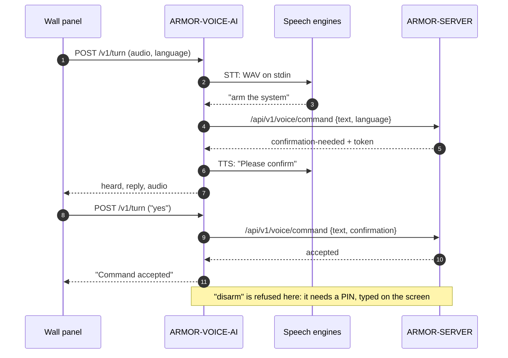

<p align="center">
  
</p>

# 🎙️ ARMOR-VOICE-AI

<p align="center">
  <a href="README.md">🇺🇸 English</a> |
  <a href="README_spa.md">🇪🇸 Español</a> |
  <a href="README_fra.md">🇫🇷 Français</a> |
  <a href="README_ita.md">🇮🇹 Italiano</a> |
  🇩🇪 <b>Deutsch</b> |
  <a href="README_zho.md">🇨🇳 简体中文</a> |
  <a href="README_jpn.md">🇯🇵 日本語</a> |
  <a href="README_por.md">🇵🇹 Português</a>
</p>

### Offline-Sprachabsichten in acht Sprachen, mit einer Bestätigung, die der Aufrufer nicht fälschen kann

<p align="center">
  
  
  
  
  
  
  
</p>

---

**Ehrlichkeitsprüfung - was heute läuft:** Die Absichtsregeln, die acht Sprachen, die signierte, an ihren Sprecher gebundene Bestätigung, die Stummschaltungsrichtlinie, der lokale Dienst, der Turn-Endpunkt und das Audit sind real und getestet (118 Tests), und der Server fragt den Dienst auf dem CM5-Prüfstand ab. **Keine Spracherkennungs- oder Sprachsynthese-Engine ist Teil dieses Repositorys**: `/v1/turn` führt die Befehle aus, die du dafür konfigurierst, und keiner davon wurde bisher mit einem echten Mikrofon ausprobiert; das Touch-Panel, das den Assistenten tragen soll, lief noch nicht auf einer Platine.

---

## 📋 Auf einen Blick

| | |
|---|---|
| Version | `0.3.1` |
| Reifegrad | Etabliert |
| Rolle | Offline-Sprach- und Absichts-Gateway (Familie: Core Services, übergeordnet: ARMOR-SERVER) |
| Technik | Python 3.11+, nur Standardbibliothek |
| Tests | 118 (`python -m unittest discover -s tests`) |
| Befehle | 15 (10 fragen ab, 5 handeln), 420 Sätze, 8 Sprachen |
| Lauscht auf | `127.0.0.1:18090` (nur Loopback), mit Token |
| Läuft auf | Dem CM5-Prüfstand (als Dienst) oder jedem Computer |
| Auf echter Hardware | Läuft als Dienst auf dem CM5-Prüfstand, vom Server abgefragt; kein Mikrofon und keine Sprach-Engine wurde ausprobiert |
| Lizenz | GPL-3.0-or-later |

**Springe zu:** [Überblick](#-überblick) · [Architektur](#-architektur) · [Funktionen](#-funktionen) · [Sicherheit](#-sicherheit-und-schutz) · [Schnittstellen](#-schnittstellen) · [Konfiguration](#-konfiguration) · [Schnellstart](#-schnellstart) · [Tests](#-tests) · [Probleme](#-fehlerbehebung) · [Struktur](#-struktur-des-repositorys) · [Verwandte](#-verwandte-projekte)

## 🚦 Projektstatus

Jede Zeile ist ein Teil dieses Repositorys, und die Ampel sagt, wie weit er heute ist. Sie beruht auf dem, was das Repository zeigen kann (Tests, Builds, Läufe), nicht auf dem, was geplant ist.

🟢 Fertig und überprüft · 🟡 Funktioniert, mit bekannten Grenzen · 🟠 Teilweise fertig oder noch nicht überprüft · 🔴 Nicht gemacht oder funktioniert nicht

| Bereich | Stand | Was das hier bedeutet |
|---|---|---|
| Software | 🟡 | Die Absichtsregeln, der lokale Dienst und der Turn-Endpunkt laufen als Dienst auf dem CM5-Prüfstand, aber keine Spracherkennungs- oder Sprachsynthese-Engine ist Teil des Repositorys: Es führt die Befehle aus, die du dafür konfigurierst. |
| Tests | 🟢 | 118 Tests bestehen (`python -m unittest discover -s tests`): die Absichtsregeln, die acht Sprachen, die signierte, an ihren Sprecher gebundene Bestätigung, die Stummschaltungsrichtlinie, der lokale Dienst, der Turn-Endpunkt und das Audit. |
| Hardware | 🔴 | Kein Mikrofon und keine Sprach-Engine wurde ausprobiert, und das Touch-Panel, das den Assistenten tragen soll, lief nicht auf einer Platine. |
| Sicherheit | 🟡 | Die Bestätigung ist signiert und an ihren Sprecher gebunden, und das Audit ist auf dem Host getestet; es gab keine unabhängige Prüfung. |
| Integration | 🟡 | Der Server fragt den Dienst auf dem CM5-Prüfstand ab; der Sprachablauf mit dem Touch-Panel lief nicht. |
| Dokumentation | 🟢 | Acht Sprachen und das Änderungsprotokoll sind aktuell. |

## 🎯 Überblick

ARMOR-VOICE-AI ist der Teil von A.R.M.O.R., der **das, was eine Person sagt, in einen von fünfzehn Befehlen oder in nichts** verwandelt. Er tut nie etwas von sich aus: Er entscheidet, und [ARMOR-SERVER](https://github.com/JuanenRac/ARMOR-SERVER) authentifiziert, autorisiert und führt aus, was akzeptiert wurde, genau wie bei einem Klick in der Konsole.

Der Text, der aus einer Spracherkennung kommt, ist eine *nicht vertrauenswürdige Eingabe*. Deshalb wird er weder interpretiert noch nach Schlüsselwörtern durchsucht noch als Befehl weitergeleitet: Er wird bereinigt (Akzente, Satzzeichen, Höflichkeitsfloskeln) und muss dann **genau** einem der 420 bekannten Sätze entsprechen. Alles andere, jeder zu lange Text und jeder Satz, der zwei Befehle bedeuten könnte, wird *nicht verstanden*.

**Was er tut**

* Versteht fünfzehn Befehle in **acht Sprachen** (Englisch, Spanisch, Deutsch, Französisch, Italienisch, Japanisch, Chinesisch und Portugiesisch).
* Verlangt für `arm` und `disarm` einen **zweiten Turn mit einem vom Dienst signierten Token**, gebunden an die Absicht und an die Person, die sie geäußert hat.
* Kann für `silence` eine gesprochene **PIN** oder einen zweiten Bestätigungs-Turn verlangen, wenn ARMOR-SERVER es anfordert.
* Läuft als **lokaler HTTP-Dienst** und als **JSON-Lines-Gateway** für Adapter und Tests.
* Nimmt das **Audio eines Turns** vom Wandpanel entgegen, führt die konfigurierten Sprach-Engines aus und antwortet als Text und, mit einem Sprachsynthesizer, als Audio.
* Zeichnet **Entscheidungen auf, nie Audio oder Wörter**: einen SHA-256 des Transkripts.

**Was er nicht tut**

* Er erkennt oder synthetisiert keine Sprache: Das sind Programme, die die Installation wählt.
* Er schaltet nichts scharf, unscharf oder stumm: Ein akzeptierter Befehl ist eine Empfehlung an ARMOR-SERVER.
* Er schaltet vom Wandpanel aus nie unscharf: Die PIN wird auf dem Bildschirm getippt, nie laut gesprochen.

## 🧩 Rolle in A.R.M.O.R.

[ARMOR-SERVER](https://github.com/JuanenRac/ARMOR-SERVER) fragt diesen Dienst ab und authentifiziert und autorisiert den Befehl dann wie bei einem Klick in [ARMOR-STUDIO](https://github.com/JuanenRac/ARMOR-STUDIO). Er ist dafür gedacht, hinter dem Mikrofon des Wandpanels [ARMOR-NODE-HMI](https://github.com/JuanenRac/ARMOR-NODE-HMI) zu leben (Push-to-Talk), und beantwortet den geschriebenen und gesprochenen Assistenten von [ARMOR-ANDROID-CONTROL](https://github.com/JuanenRac/ARMOR-ANDROID-CONTROL). Auf dem Prüfstand wird er von [ARMOR-DEVOPS](https://github.com/JuanenRac/ARMOR-DEVOPS) installiert (`scripts/install_cm5.sh --with-voice`).

| Er spricht mit | Wie | Wozu |
|---|---|---|
| ARMOR-SERVER | `POST /v1/command`, `POST /v1/turn` eingehend; `/api/v1/voice/command` ausgehend | Einen Satz entscheiden; die Wörter eines gesprochenen Turns an die Sprachroute des Servers weitergeben |
| ARMOR-NODE-HMI | Audio eines Turns (16 kHz Mono-PCM) | Das Mikrofon und der Lautsprecher des Wandpanels |
| ARMOR-ANDROID-CONTROL | über den Server | Der geschriebene und gesprochene Assistent |
| Sprach-Engines | Standardeingabe und -ausgabe | Hören (z. B. whisper.cpp, Vosk) und Sprechen (z. B. Piper); von der Installation gewählt |

## 🏛️ Architektur

<p align="center">
  
</p>

**Ein gesprochener Turn, der das System scharf schaltet** (das Panel wird zweimal gefragt, und Unscharfschalten wird abgelehnt):

<p align="center">
  
</p>

<details>
<summary>Textversion des Diagramms (Mermaid)</summary>



</details>

**Warum er so gebaut ist**

* **Warum eine geschlossene Liste und keine Absichtsklassifikation.** Eine Spracherkennung macht Fehler, und jeder kann in der Nähe eines Mikrofons sprechen. Bei 420 exakten Sätzen kann ein falsches Transkript schlimmstenfalls ignoriert werden, und ein Test prüft, dass kein Satz zu zwei Befehlen gehört.
* **Warum der Dienst nur entscheidet.** Authentifizierung, Autorisierung, Audit-Spur und Aktion bleiben an einem Ort, ARMOR-SERVER; ein Fehler hier kann einen Satz fälschlich akzeptieren, aber keinen Alarm anrühren.
* **Warum die Bestätigung ein signierter, vom Dienst ausgestellter Token ist.** Ein Flag, das der Aufrufer setzt (`confirmed: true`), beweist nichts und wird deshalb abgelehnt. Der Token ist mit HMAC-SHA-256 signiert, an den Befehl und die Person gebunden, 30 Sekunden gültig und nur einmal verwendbar.
* **Warum die Sprach-Engines eigene Programme sind.** Modelle ändern sich schneller, als ein Sicherheits-Gateway es sollte. Sie laufen ohne Shell, mit kurzer Umgebung und Zeitlimit, und die eigenen Geheimnisse des Dienstes erreichen sie nie.
* **Warum nichts aufbewahrt wird.** Das Protokoll zeigt, was entschieden wurde, ohne zu speichern, was gesagt wurde.

## ✨ Funktionen

### Die fünfzehn Befehle

| Befehl | Art | Bedeutung | Bestätigung |
|---|---|---|---|
| `status` | fragt ab | Der Zustand des Systems | nein |
| `alarms` | fragt ab | Die aktiven Alarme | nein |
| `nodes` | fragt ab | Der Zustand der Knoten | nein |
| `cameras` | fragt ab | Der Zustand der Kameras | nein |
| `radar` | fragt ab | Der Zustand der Radare | nein |
| `solar` | fragt ab | Der Zustand der Solaranlage | nein |
| `electrical` | fragt ab | Der Stromverbrauch | nein |
| `network` | fragt ab | Der Zustand des Netzwerks | nein |
| `time` | fragt ab | Die Uhrzeit | nein |
| `help` | fragt ab | Was gesagt werden kann | nein |
| `silence` | handelt | Die Alarme stummschalten (quittieren) | nur wenn die Richtlinie des Servers es verlangt (siehe unten) |
| `lights_on` | handelt | Das Licht einschalten | nein |
| `lights_off` | handelt | Das Licht ausschalten | nein |
| `arm` | handelt | Den Perimeter scharf schalten | **ja** |
| `disarm` | handelt | Den Perimeter unscharf schalten | **ja** |

Die zehn, die *abfragen*, ändern nichts. Die fünf, die *handeln*, führt ARMOR-SERVER mit der Sitzung der Person aus, die gesprochen hat, nie dieser Dienst.

### Acht Sprachen

Englisch, Spanisch, Deutsch, Französisch, Italienisch, Japanisch, Chinesisch und europäisches Portugiesisch: die Sätze (insgesamt 420), das Ja und Nein einer Bestätigung, die Ziffernwörter einer gesprochenen PIN und jeder Satz, den der Dienst zurückspricht. Die Sätze sind so geschrieben, wie eine Person sie sagt, und werden beim Laden des Moduls mit derselben Funktion normalisiert, die das Gehörte normalisiert, sodass beide nicht auseinanderlaufen können. Höflichkeitsfloskeln (`please`, `por favor`, `bitte`, `s'il vous plaît`, `per favore`...) werden vor dem Vergleich entfernt; Japanisch und Chinesisch, ohne Leerzeichen geschrieben, listen ihre Sätze mit und ohne höfliche Endung.

### Die Bestätigung in zwei Turns

1. Der erste Turn für `arm` oder `disarm` liefert **keine Annahme** und einen `confirmation_token`.
2. Der zweite Turn gibt diesen Token für dieselbe Absicht, **für dieselbe Person**, innerhalb von 30 Sekunden zurück.
3. Der Token ist mit einem Geheimnis signiert, das der Aufrufer nicht hat, sodass er sich weder fälschen noch ändern noch auf eine andere Absicht oder eine andere Person übertragen lässt; er funktioniert nur einmal, und die Nonces der noch nicht abgelaufenen werden nie vergessen, um Platz für neue zu schaffen (sind zu viele gleichzeitig offen, wird der neue Token abgelehnt).

### Stummschalten per Sprache, mit optionaler PIN

„Silence“ wird sofort akzeptiert, sofern die Installation nicht mehr verlangt. ARMOR-SERVER hält die Einstellung `voice.silence_confirmation` und sendet sie als Richtlinie:

| Modus | Was bei „silence“ geschieht |
|---|---|
| `off` (Standard, und wenn keine Richtlinie eintrifft) | Sofort weitergegeben |
| `double_turn` | Nicht ausgeführt; der Dienst bittet darum, Ja zu sagen, und ein Ja innerhalb von 15 s vom selben Panel gibt den ursprünglichen Befehl weiter |
| `pin` | Nicht ausgeführt; der Dienst fragt nach der PIN, gesprochen als Ziffern oder als Ziffernwörter in den acht Sprachen; die richtige PIN innerhalb von 20 s gibt den Befehl weiter |
| unlesbare oder unbekannte Richtlinie | `double_turn`: Eine defekte Einstellung schaltet nie einen Schutz ab |

Die PIN (4 bis 12 Ziffern, `ARMOR_VOICE_SILENCE_PIN`) wird in konstanter Zeit verglichen und nie protokolliert, gespeichert oder zurückgegeben. Drei falsche PINs sperren das Stummschalten per Sprache für **alle** Panels fünf Minuten lang; ist der Modus `pin` verlangt und keine PIN eingerichtet, wird per Sprache nichts stummgeschaltet. Der vollständige Vertrag steht in [docs/SILENCE_POLICY.md](docs/SILENCE_POLICY.md).

### Der Turn des Wandpanels

`POST /v1/turn` nimmt das Audio eines Turns entgegen, führt den Spracherkennungsbefehl aus, gibt die Wörter an die Sprachroute von ARMOR-SERVER und antwortet mit dem Gehörten, dem zu Sagenden und, wenn ein Sprachsynthesebefehl konfiguriert ist, einer Aufnahme davon. Das Panel hat keine Tastatur, daher wird die Frage von `arm` pro Panel 30 Sekunden lang gemerkt, und der nächste Turn, der *Ja* sagt (in der Sprache des Panels), bestätigt sie, der nächste, der *Nein* sagt, bricht sie ab. Antwortet der Server `disarm`, antwortet der Turn, dass zum Unscharfschalten die PIN auf dem Bildschirm nötig ist. Nach neun Sekunden Zuhörzeit wird dem Server nichts mehr gefragt (das Panel gibt nach zwölf auf), sodass sich das, was der Person gesagt wurde, und das, was das Haus tat, nicht widersprechen können.

### Aufgezeichnete Entscheidungen

Mit `--audit-file` eine JSON-Zeile pro Entscheidung: Zeit, Absicht, Ergebnis und der SHA-256 des Transkripts. Nie Audio und nie die Wörter.

## 🔒 Sicherheit und Schutz

| Bedrohung | Abwehr |
|---|---|
| Ein falsches oder feindliches Transkript | Nicht vertrauenswürdige Eingabe: normalisiert, exakter Abgleich mit einer geschlossenen Liste, höchstens 200 Zeichen, Mehrdeutiges wird *nicht verstanden*; nie als Shell- oder Geräte-Befehl weitergeleitet |
| Ein Aufrufer behauptet eine Bestätigung | `confirmed` wird abgelehnt; nur ein vom Dienst signierter Token zählt |
| Ein Token wird gestohlen, wiederholt oder wiederverwendet | Mit HMAC-SHA-256 signiert, an Absicht und Person gebunden, 30 s, einmalig; ein Token kann seine Ausstellungszeit nicht überdauern, auch wenn die Uhr zurückspringt |
| Eine andere Person verwendet den Token von jemandem | `wrong-subject` |
| Erraten der Stummschalt-PIN | Vergleich in konstanter Zeit, 3 Versuche, dann 5 Minuten Sperre für alle Panels, schlägt ohne PIN geschlossen fehl |
| Jemand im Netzwerk erreicht den Dienst | Nur Loopback (lehnt eine andere Adresse ohne `--allow-remote` ab); Token von mindestens 16 Zeichen in konstanter Zeit verglichen; 2 KB pro Anfrage; eine hängende Verbindung wird nach 15 s geschlossen |
| Eine Sprach-Engine gibt Geheimnisse preis oder missbraucht sie | Läuft ohne Shell, mit kurzer Umgebung (`PATH`, `HOME`, `LANG`, `TMPDIR`, `ARMOR_VOICE_ENGINE_*`), Zeitlimit und Größenlimit; die Tokens des Dienstes und des Servers erreichen sie nie |
| Die Maschine erschöpfen | Höchstens zwei Turns gleichzeitig (ein dritter erhält 503); Audio auf 480 000 Bytes begrenzt |
| Protokolle verraten, was gesagt wurde | Nie protokolliert; das Audit enthält nur einen Hash |
| Ein veralteter Turn handelt zu spät | Nach neun Sekunden wird nichts mehr ausgeführt (504) |

Unscharfschalten per Sprache geschieht **nie** vom Wandpanel aus. Aus der App folgt es dem `ARMOR_DISARM_PIN` des Servers (setze ihn auf `required`). Nichts davon ist eine zertifizierte Sicherheitsfunktion: Ein akzeptierter Befehl ist eine Empfehlung, die ARMOR-SERVER weiterhin authentifiziert und autorisiert. Lies [docs/SAFETY.md](docs/SAFETY.md) für die vollständigen Regeln und [SECURITY.md](SECURITY.md), um eine Schwachstelle zu melden.

## 🔌 Schnittstellen

### HTTP-Dienst

| Route | Authentifizierung | Was sie tut |
|---|---|---|
| `GET /healthz` | keine | `{"ok": true, "service": "armor-voice"}` |
| `POST /v1/command` | Header `X-Armor-Voice-Token` | Body `{text, language?, confirmation?, subject?, policy?, pin?}` (höchstens 2 KB). Antwortet mit dem Verstandenen, einem `confirmation_token`, wenn ein zweiter Turn nötig ist, und `speech` in der gewünschten Sprache |
| `POST /v1/turn` | derselbe Header | Body: rohes 16-kHz-16-Bit-Mono-PCM, `Content-Type: audio/L16;rate=16000`, bis zu 480 000 Bytes; Header `X-Armor-Language`, `X-Armor-Client`, `X-Armor-Policy`. Antwortet `{heard, reply, audio?}` |
| `POST /v1/speak` | derselbe Header | Body `{text, language}` (höchstens 300 Zeichen). Antwortet `{audio}`, den vom Sprachsyntheseprogramm gesprochenen Satz als Base64 von 16-kHz-16-Bit-Mono-PCM (löst nichts aus und speichert nichts); 501 ohne dieses Programm |

Ein echter Austausch (der Token ist gekürzt):

```json
{"text": "arm the system", "subject": "u-1"}
{"accepted": false, "requires_confirmation": true, "intent": "arm", "outcome": "confirmation-needed", "confirmation_token": "eyJpIjoiYXJt...", "reason": "say it again with the confirmation within 30 s", "speech": "Please confirm"}

{"text": "arm the system", "subject": "u-1", "confirmation": "eyJpIjoiYXJt..."}
{"accepted": true, "requires_confirmation": false, "intent": "arm", "outcome": "accepted", "speech": "Command accepted"}

{"text": "open the garage"}
{"accepted": false, "requires_confirmation": false, "intent": null, "outcome": "not-understood", "reason": "the phrase is not one of the known commands", "speech": "Command not recognised"}
```

Ergebnisse: `accepted`, `confirmation-needed`, `confirmation-refused`, `pin-needed`, `pin-refused`, `not-understood`. Eine Bestätigung wird abgelehnt als `invalid`, `expired`, `wrong-intent`, `wrong-subject` oder `replayed`.

### Statuscodes von `/v1/turn`

| Code | Fehler | Bedeutung |
|---|---|---|
| 200 | | `{heard, reply, audio?}` |
| 401 | `unauthorized` | Token fehlt oder ist falsch |
| 411 / 413 | `bad audio length` | Keine Länge oder mehr als 480 000 Bytes |
| 415 | | Nicht `audio/L16;rate=16000` |
| 422 | `invalid language` | Keine von `en es de fr it ja zh pt` |
| 501 | `stt_unavailable` / `server_not_configured` | Kein Spracherkennungsbefehl oder keine Serveradresse |
| 502 | `engine_failed` / `server_<code>` / `server_not_answering` | Eine Sprach-Engine oder der Server ist ausgefallen |
| 503 | `busy` | Es laufen bereits zwei Turns |
| 504 | `turn_too_slow` | Die Sprach-Engine brauchte so lange, dass der Server nicht gefragt wurde; nichts wurde ausgeführt |

### JSON-Lines-Gateway

`python -m armor_voice_ai.gateway` liest ein JSON-Objekt pro Zeile von der Standardeingabe und schreibt die Antwort auf die Standardausgabe (2 KB pro Zeile; eine Zeile mit Bytes, die kein UTF-8 sind, ist eine Zeile wie jede andere). Es ist dasselbe geschlossene Gateway, für Sprachadapter und Tests.

### Vertrag mit ARMOR-SERVER

* Der Server sendet die Stummschaltungsrichtlinie bei jeder Anfrage: `policy` im Body von `/v1/command` (und `pin` für den Modus `pin`), den Header `X-Armor-Policy` (ein JSON-Objekt von höchstens 256 Bytes) bei `/v1/turn`.
* Die Sprachroute des Servers erhält die Wörter eines gesprochenen Turns unter `/api/v1/voice/command` mit dem Operator-Token der Installation, unter dem Namen jedes Panels (`X-Armor-Client`).
* Details: [docs/SERVICE.md](docs/SERVICE.md), [docs/SILENCE_POLICY.md](docs/SILENCE_POLICY.md).

## ⚙️ Konfiguration

### Umgebung

| Variable | Nötig | Was sie festlegt |
|---|---|---|
| `ARMOR_VOICE_TOKEN` | ja (16+ Zeichen) | Der Token, den Aufrufer in `X-Armor-Voice-Token` senden (oder eine Zeile `ARMOR_VOICE_TOKEN=...` in der Datei von `--token-file`) |
| `ARMOR_VOICE_CONFIRM_SECRET` | empfohlen (16+ Bytes) | Signiert die Bestätigungen. Ohne sie wird ein zufälliges Geheimnis verwendet, und ausstehende Bestätigungen gehen beim Beenden des Prozesses verloren |
| `ARMOR_VOICE_STT_COMMAND` | für `/v1/turn` | Das Spracherkennungsprogramm: Audio (WAV) auf der Standardeingabe, die Wörter auf der Standardausgabe |
| `ARMOR_VOICE_TTS_COMMAND` | optional | Das Sprachsyntheseprogramm: Text auf der Standardeingabe, eine 16-kHz-16-Bit-Mono-WAV auf der Standardausgabe |
| `ARMOR_VOICE_SERVER_URL`, `ARMOR_VOICE_SERVER_TOKEN` | für `/v1/turn` | ARMOR-SERVER und der Operator-Token für dessen Sprachroute |
| `ARMOR_VOICE_SILENCE_PIN` | für den Modus `pin` | 4 bis 12 Ziffern. Ein ungültiger Wert stoppt den Dienst beim Start, ohne ihn auszugeben |
| `ARMOR_VOICE_ENGINE_*` | optional | An die Sprach-Engines weitergegeben (zusammen mit `ARMOR_VOICE_LANGUAGE`, pro Turn gesetzt) |

### Kommandozeile

| Option | Standard | |
|---|---|---|
| `--host` | `127.0.0.1` | Adresse, auf der gelauscht wird; alles außer Loopback wird ohne `--allow-remote` abgelehnt |
| `--port` | `18090` | |
| `--token-file` | | Datei mit einer Zeile `ARMOR_VOICE_TOKEN=...` |
| `--audit-file` | | Hängt eine Zeile pro Entscheidung an |
| `--allow-remote` | aus | Lauscht auf einer Nicht-Loopback-Adresse (nicht empfohlen; nur hinter TLS) |

### Grenzen, die im Code stehen

| Grenze | Wert |
|---|---|
| Gültigkeit der Bestätigung | 30 s |
| Gemerkte gesprochene Frage pro Panel | 30 s |
| „Ja“ nach einer Stummschaltfrage / PIN nach der Aufforderung | 15 s / 20 s |
| PIN-Versuche vor der Sperre / Sperrdauer | 3 / 5 min |
| Zeitbudget des Turns / Panel gibt auf | 9 s / 12 s |
| Zeitlimit einer Sprach-Engine | 25 s |
| Größtes Audio / größtes Antwort-Audio | 480 000 Bytes / 190 000 Bytes |
| Anfrage-Body (`/v1/command`) | 2 KB |
| Länge des Transkripts | 200 Zeichen |
| Gleichzeitige Turns | 2 |

Der Dienst schreibt das Gesagte nie in ein Protokoll, egal welche Einstellungen gelten.

## 🚀 Schnellstart

**Voraussetzungen:** Python 3.11+ (nur Standardbibliothek). Optional: ein Spracherkennungs- und ein Sprachsyntheseprogramm für `/v1/turn`.

```powershell
$env:PYTHONPATH = "src"

# 1. die Tests
python -m unittest discover -s tests                      # 118 Tests

# 2. das Gateway, ein JSON-Objekt pro Zeile
echo '{"text":"arm the system"}' | python -m armor_voice_ai.gateway

# 3. der lokale HTTP-Dienst (nur Loopback)
$env:ARMOR_VOICE_TOKEN = "a-token-of-at-least-16-characters"
python -m armor_voice_ai.service --port 18090
```

```sh
curl -s http://127.0.0.1:18090/v1/command \
  -H "X-Armor-Voice-Token: $ARMOR_VOICE_TOKEN" \
  -d '{"text":"status","language":"de"}'
# {"accepted":true,"requires_confirmation":false,"intent":"status","outcome":"accepted","speech":"Befehl akzeptiert"}
```

Um zu hören und zu sprechen (`/v1/turn`), richte den Dienst auf deine Engines und auf den Server:

```sh
export ARMOR_VOICE_STT_COMMAND="/opt/armor/bin/hear"        # WAV auf der Eingabe, Wörter auf der Ausgabe
export ARMOR_VOICE_TTS_COMMAND="/opt/armor/bin/speak"       # Text auf der Eingabe, WAV auf der Ausgabe
export ARMOR_VOICE_SERVER_URL="https://armor-server.local"
export ARMOR_VOICE_SERVER_TOKEN="..."
python -m armor_voice_ai.service --token-file /opt/armor/etc/armor.voice.env
```

Das Wandpanel ist ein Gerät im Netzwerk, und der Dienst lauscht nur auf Loopback: Entweder leitet ein Proxy des Servers den Turn weiter, oder `--allow-remote` wird hinter TLS verwendet. Der Token und das Audio dürfen das Netzwerk nicht im Klartext durchqueren.

`run.bat` / `run.sh` und `build.bat` / `build.sh` starten den gemeinsamen Projektablauf von [ARMOR-COMMON](https://github.com/JuanenRac/ARMOR-COMMON) (die Repositorys liegen nebeneinander). Mit pip steht der Befehl `armor-voice-gateway` zur Verfügung.

## 🧪 Tests

```powershell
$env:PYTHONPATH = "src"
python -m unittest discover -s tests
python -I tools/armor_ci_validate.py        # Manifest, Version, Änderungsprotokoll und README-Parität
```

| Testdatei | Tests | Was sie abdeckt |
|---|---|---|
| `test_silence.py` | 31 | Die Stummschaltungsrichtlinie, die gesprochene PIN in acht Sprachen, die Sperre |
| `test_edges.py` | 29 | Das Zeilenprotokoll, die Diensteinstellungen, die Anbindung an den Server (ein Stellvertreter auf Loopback), die Grenzen der Engines |
| `test_gateway.py` | 23 | Das Gateway, die Bestätigung, Wiederholungen und Fälschungen |
| `test_turn.py` | 15 | Der Turn, die Engines, das gesprochene Ja und Nein, das Zeitbudget |
| `test_languages.py` | 11 | Sätze in Normalform, kein Satz für zwei Befehle, jede Sprache schaltet scharf, unscharf, fragt ab und schaltet stumm |
| `test_service.py` | 5 | Die HTTP-Routen |

GitHub Actions führt bei jedem Push und Pull Request die A.R.M.O.R.-Basis aus: die Validierung von Manifest, Version, Änderungsprotokoll und README-Parität, danach den projekteigenen Build und die Tests.

## 🏗️ Build und Veröffentlichung

Es ist reines Python: Es gibt nichts zu kompilieren. Die Version steht in `pyproject.toml`, in `armor.project.json` und im README-Badge (aus dem Manifest gelesen); jede Version hat ihren Eintrag in [CHANGELOG.md](CHANGELOG.md). Releases werden auf GitHub veröffentlicht.

## 🩺 Fehlerbehebung

| Du siehst | Weil | Tu |
|---|---|---|
| `refusing to listen on a non-loopback address without --allow-remote` | `--host` ist nicht `127.0.0.1`, `::1` oder `localhost` | Bleibe bei Loopback und lass den Proxy des Servers weiterleiten, oder füge `--allow-remote` hinter TLS hinzu |
| `a token of at least 16 characters is needed` | `ARMOR_VOICE_TOKEN` fehlt oder ist zu kurz | Setze ihn oder verwende `--token-file` |
| `ARMOR_VOICE_SILENCE_PIN is not valid` | Keine 4 bis 12 ASCII-Ziffern | Korrigiere den Wert (er wird nie ausgegeben) |
| `ARMOR_VOICE_CONFIRM_SECRET is not set` (Warnung) | Ein zufälliges Geheimnis ist im Einsatz | Setze ein Geheimnis von 16+ Bytes, wenn Bestätigungen einen Neustart überstehen sollen |
| 401 `unauthorized` | `X-Armor-Voice-Token` fehlt oder ist falsch | Sende den Token |
| 501 `stt_unavailable` | `ARMOR_VOICE_STT_COMMAND` ist nicht gesetzt | Konfiguriere ein Spracherkennungsprogramm |
| 501 `server_not_configured` | Keine Serveradresse oder kein Server-Token | Setze `ARMOR_VOICE_SERVER_URL` und `ARMOR_VOICE_SERVER_TOKEN` |
| 502 `engine_failed` | Die Engine ist ausgefallen, hat das Zeitlimit überschritten oder zu viel geantwortet (oder eine TTS-WAV, die nicht 16 kHz 16-Bit-Mono ist) | Führe sie von Hand mit derselben Eingabe aus |
| 504 `turn_too_slow` | Die Sprach-Engine brauchte mehr als neun Sekunden | Verwende ein schnelleres Modell; nichts wurde ausgeführt |
| „Zum Unscharfschalten brauchst du deine PIN“ | Unscharfschalten geschieht nie per Sprache vom Panel aus | Nutze den Bildschirm |
| Ein gesprochenes „Ja“ bewirkt nichts | Die Frage wurde nicht gemerkt (sie brauchte über 12 s, es vergingen mehr als 30 s, oder ein anderes Panel antwortete) | Sage den Befehl erneut |

## 📂 Struktur des Repositorys

<p align="center">
  
</p>

<details>
<summary>Textversion des Baums</summary>

```text
ARMOR-VOICE-AI/
├── src/armor_voice_ai/        der Code (nur Standardbibliothek)
│   ├── phrases.py             die 420 Sätze der fünfzehn Befehle, in acht Sprachen
│   ├── intent.py              Normalisierung und exakter Abgleich: die geschlossene Erlaubnisliste
│   ├── confirmation.py        signierte, einmalige Bestätigungs-Tokens pro Person
│   ├── silence_policy.py      off / pin / double_turn, die gesprochene PIN, die Sperre
│   ├── session.py             die Zwei-Turn-Regel für jeden Befehl
│   ├── gateway.py             JSON-Zeilen über stdin/stdout, das Audit, die zurückgesprochenen Sätze
│   ├── service.py             der lokale HTTP-Dienst (/healthz, /v1/command, /v1/turn)
│   └── turn.py                ein gesprochener Turn: Engines, Ja/Nein, Zeitbudget
├── tests/                     118 Tests: Stummschaltung, Grenzfälle, Gateway, Turn, Sprachen, Dienst
├── docs/                      SAFETY.md, SERVICE.md, SILENCE_POLICY.md
├── tools/                     die gemeinsamen CI-Prüfungen und Projektwerkzeuge
├── images/                    Banner und Symbol
├── .github/                   CI-Workflow, Dashboard-Hinweis, Vorlagen für Issues und Pull Requests
├── armor.project.json         Manifest: Version, Rolle, Reifegrad, Build-Befehl
├── pyproject.toml             Paketmetadaten und der Befehl `armor-voice-gateway`
├── run.sh run.bat             starten über den gemeinsamen Projektablauf
├── build.sh build.bat         bauen und testen über den gemeinsamen Projektablauf
├── CHANGELOG.md               was sich in jeder Version geändert hat
└── SECURITY.md SUPPORT.md CONTRIBUTING.md CODE_OF_CONDUCT.md LICENSE
```

</details>

## 🗺️ Roadmap und bekannte Grenzen

**Bekannte Grenzen heute**

* Es wird keine Sprach-Engine mitgeliefert, und keine wurde mit einem echten Mikrofon ausprobiert.
* Das Touch-Panel, das den Assistenten tragen soll, lief nicht auf einer Platine; es gibt kein Aktivierungswort, es ist Push-to-Talk.
* Der Turn sagt nicht, *welches Panel oder welche Person* gesprochen hat: ARMOR-SERVER entscheidet mit dem Token, den es erhalten hat. Beides der Anfrage hinzuzufügen, ist eine Änderung des Vertrags zwischen Server und Panel.
* Keine unabhängige Sicherheitsprüfung.

**Als Nächstes**

* Ein echtes Mikrofon und eine echte Sprach-Engine auf dem CM5-Prüfstand ausprobieren.
* Den Sprachablauf mit dem Touch-Panel ausführen, sobald es auf einer Platine gelaufen ist.
* Optionale Bestätigung durch einen authentifizierten Sprecher oder physisch. Ein späterer Einsatz kann sie ergänzen, aber die signierte Bestätigung wird nicht ohne dokumentierte Risikoprüfung entfernt.

## 🌍 Sprachen

README und Texte gibt es auf Englisch, Spanisch, Französisch, Italienisch, Deutsch, Chinesisch, Japanisch und europäischem Portugiesisch. Jeder Satz, den der Dienst zurückspricht, jeder gesprochene Befehl, jedes Ja und Nein und jedes Ziffernwort einer PIN existiert in allen acht Sprachen.

## 🔗 Verwandte Projekte

**A.R.M.O.R.** (Autonomous Radar & Multimodal Observation Range) ist ein Perimeter-Sicherheitssystem aus unabhängigen Repositorys. Jedes hat eine eigene Version, eigene Tests und ein eigenes README; hier ist die Familie:

* **[ARMOR-COMMON](https://github.com/JuanenRac/ARMOR-COMMON)** - Nachrichtenverträge, Validierer, Konformitätsvektoren und generierte Typen
* **[ARMOR-NODE-RADAR](https://github.com/JuanenRac/ARMOR-NODE-RADAR)** - Feldknoten-Firmware für ESP32-S3 mit drei Radaren und eigenem Web-Panel
* **[ARMOR-NODE-SOLAR](https://github.com/JuanenRac/ARMOR-NODE-SOLAR)** - Protokolle für Solar-Wechselrichter und -Batterien und die Nachrichten eines Gateway-Knotens
* **[ARMOR-NODE-ELECTRICAL](https://github.com/JuanenRac/ARMOR-NODE-ELECTRICAL)** - Elektroknoten: Zähler, die Nachricht der Netzmesswerte und die Regeln fürs Schalten
* **[ARMOR-NODE-ALARM](https://github.com/JuanenRac/ARMOR-NODE-ALARM)** - Alarmknoten und Alarmzentrale: Zonen, Scharfschalten, Verzögerungen, Sirene und PIN, mit dem Server oder ohne ihn
* **[ARMOR-NODE-HMI](https://github.com/JuanenRac/ARMOR-NODE-HMI)** - Touch-Panel: der Systemzustand auf einem Wandbildschirm, Scharf- und Quittieren sowie das Zuhause des Sprachassistenten
* **[ARMOR-NETWORK](https://github.com/JuanenRac/ARMOR-NETWORK)** - Das lokale Netzwerk: seine Geräte, das Internet und was sich ändert
* **[ARMOR-SERVER](https://github.com/JuanenRac/ARMOR-SERVER)** - Zentraler Koordinator: Telemetrie, Alarme, Geräte, Solarmesswerte und Kameras
* **[ARMOR-STUDIO](https://github.com/JuanenRac/ARMOR-STUDIO)** - Web-Konsole: Kameras, Radar, Alarme, Solarenergie und 2D/3D-Standortdesigner
* **[ARMOR-ANDROID-CONTROL](https://github.com/JuanenRac/ARMOR-ANDROID-CONTROL)** - Android-Bedienclient mit Live-Radar in 2D/3D
* **[ARMOR-IOS-CONTROL](https://github.com/JuanenRac/ARMOR-IOS-CONTROL)** - iPhone-Bedienclient
* **[ARMOR-SERVER-AI](https://github.com/JuanenRac/ARMOR-SERVER-AI)** - Visuelle Inferenzrichtlinie, die ihre Entscheidungen erklärt und nie handelt
* **[ARMOR-VISION](https://github.com/JuanenRac/ARMOR-VISION)** - Kamerazonen, Masken und Erkennungsregeln für den Jetson Orin NX
* **ARMOR-VOICE-AI** (dieses Repository) - Offline-Sprachabsichten mit einer nicht fälschbaren Bestätigung
* **[ARMOR-HARDWARE](https://github.com/JuanenRac/ARMOR-HARDWARE)** - Gehäuse, Elektronik und die Abnahmematrix am Prüfstand
* **[ARMOR-DEVOPS](https://github.com/JuanenRac/ARMOR-DEVOPS)** - Bereitstellung, CM5-Prüfstand, Backup und TLS
* **[ARMOR-SIMULATOR](https://github.com/JuanenRac/ARMOR-SIMULATOR)** - Offline-Telemetriesimulator mit wiederholbaren Fehlern
* **[ARMOR-UPDATER](https://github.com/JuanenRac/ARMOR-UPDATER)** - Erkennt, installiert und aktualisiert die eigenen Repositorys des Ökosystems
* **[ARMOR-DOCS](https://github.com/JuanenRac/ARMOR-DOCS)** - Architektur, Sicherheitsgrundlage und die Fähigkeitsmatrix

## 📚 Dokumentation

* [Sprachsicherheit](docs/SAFETY.md): was verstanden wird, die Bestätigung, der Turn des Wandpanels, was aufgezeichnet wird
* [Der Dienst](docs/SERVICE.md): Routen, Statuscodes und Einstellungen
* [Stummschalten per Sprache](docs/SILENCE_POLICY.md): der Richtlinienvertrag und die PIN
* [Fähigkeitsmatrix: was belegt ist und was nicht](https://github.com/JuanenRac/ARMOR-DOCS/blob/main/docs/CAPABILITY_MATRIX.md)
* [Projektkatalog: Versionen und wie die Repositorys voneinander abhängen](https://github.com/JuanenRac/ARMOR-DOCS/blob/main/docs/PROJECT_CATALOG.md)
* [Änderungsverlauf dieses Repositorys](CHANGELOG.md)

## 🤝 Mitwirken und Community

* Führe vor einem Pull Request `python -I tools/armor_ci_validate.py` und die Tests aus: Beide müssen bestehen. Siehe [CONTRIBUTING.md](CONTRIBUTING.md) und den [Verhaltenskodex](CODE_OF_CONDUCT.md).
* Das README gibt es in acht Sprachen, und es wird aus den Quellen in ARMOR-DOCS erzeugt: Eine Textänderung erfolgt dort.
* Eine Änderung an einer Nachricht zwischen Komponenten beginnt in ARMOR-COMMON.
* Beschreibe nichts als auf einer Platine funktionierend, was nur gebaut wurde.
* Melde eine Schwachstelle privat: [SECURITY.md](SECURITY.md). Fragen, Ideen und Meldungen: electrohobby3d@gmail.com ([SUPPORT.md](SUPPORT.md)).

## 👤 AUTOR

**JuanenRac (Electro Hobby 3D)** · electrohobby3d@gmail.com

## 📜 LIZENZ

GPL-3.0-or-later - siehe [LICENSE](LICENSE).
