<p align="center">
  
</p>

# 🎙️ ARMOR-VOICE-AI

<p align="center">
  <a href="README.md">🇺🇸 English</a> |
  <a href="README_spa.md">🇪🇸 Español</a> |
  <a href="README_fra.md">🇫🇷 Français</a> |
  <a href="README_ita.md">🇮🇹 Italiano</a> |
  🇩🇪 <b>Deutsch</b> |
  <a href="README_zho.md">🇨🇳 简体中文</a> |
  <a href="README_jpn.md">🇯🇵 日本語</a> |
  <a href="README_por.md">🇵🇹 Português</a>
</p>

### Offline-Sprachbefehle in acht Sprachen, mit einer Bestätigung, die der Aufrufer nicht fälschen kann

<p align="center">
  
  
  
  
  
  
  
</p>

---

**Ehrlichkeitsprüfung - was heute läuft:** Die Absichtsregeln, die acht Sprachen, die signierte Bestätigung, die an ihren Sprecher gebunden ist, der lokale Dienst, der Turn-Endpunkt und das Audit sind real und getestet (83 Tests), und der Server fragt den Dienst am CM5-Testaufbau ab. **Keine Spracherkennungs- oder Synthese-Engine ist Teil dieses Repositorys**: `/v1/turn` führt die Befehle aus, die Sie dafür einstellen, und keiner wurde bisher mit einem echten Mikrofon erprobt; das Touchpanel, das den Assistenten tragen soll, lief noch nicht auf einer Platine.

---

## 📋 Auf einen Blick

| | |
|---|---|
| Version | `0.3.0` |
| Reifegrad | Etabliert |
| Tests | 83 (`python -m unittest discover -s tests`) |
| Technik | Python 3.11+ |
| Auf echter Hardware | Läuft als Dienst am CM5-Testaufbau, vom Server abgefragt; weder Mikrofon noch Sprach-Engine wurden erprobt |

## 🎯 Überblick

* **Eine geschlossene Liste von fünfzehn Befehlen:** `status`, `silence`, `arm`, `disarm` und die fragenden - `alarms`, `nodes`, `cameras`, `radar`, `solar`, `electrical`, `network`, `time`, `help` - sowie Licht an und aus, in **acht Sprachen** (Englisch, Spanisch, Deutsch, Französisch, Italienisch, Japanisch, Chinesisch und Portugiesisch), nach Normalisierung von Akzenten, Zeichensetzung und Höflichkeitsfloskeln. Alles andere oder Mehrdeutige wird nicht verstanden.
* **Eine vom Dienst ausgestellte Bestätigung:** `arm` und `disarm` liefern im ersten Zug ein signiertes Token und werden nur akzeptiert, wenn ein späterer Zug es für dieselbe Absicht innerhalb von 30 s zurückgibt, **vom selben Benutzer**. Der Aufrufer kann sie nicht fälschen, eine abgelaufene wird abgelehnt und die Nonces der nicht abgelaufenen werden nie vergessen, um Platz zu schaffen.
* **Ein lokaler HTTP-Dienst:** `python -m armor_voice_ai.service` lauscht nur auf der Loopback-Adresse, verlangt ein Token und beantwortet `POST /v1/command` mit der Entscheidung in der gewünschten Sprache; das Menü Dienste des Servers zeigt, welche Version läuft.
* **Ein Turn-Endpunkt:** `POST /v1/turn` nimmt eine Aufnahme entgegen, führt den von Ihnen eingestellten Sprache-zu-Text-Befehl aus, schickt den Auftrag durch die Engine und antwortet mit einer vom Text-zu-Sprache-Befehl erzeugten Aufnahme; die Befehle, die Serveradresse und ihr Token stammen aus der Umgebung.
* **Entscheidungen, kein Audio:** mit `--audit-file` hält jede Entscheidung die Absicht, das Ergebnis und einen SHA-256 des Transkripts fest, nie Audio oder die rohen Worte.
* **Nur Empfehlungen:** ein akzeptierter Befehl wird an ARMOR-SERVER weitergegeben, der ihn weiterhin authentifiziert und autorisiert; vom Wandpanel aus ist Unscharfschalten per Sprache nie möglich (die PIN wird auf dem Bildschirm eingegeben); in der App folgt es `ARMOR_DISARM_PIN` des Servers (auf `required` setzen).

## 🧩 Rolle in A.R.M.O.R.

ARMOR-VOICE-AI macht aus dem Gesagten einen Befehl aus einer geschlossenen Liste und tut nie etwas von selbst: [ARMOR-SERVER](https://github.com/JuanenRac/ARMOR-SERVER) fragt es ab und authentifiziert und autorisiert den Befehl dann genau wie einen Klick in [ARMOR-STUDIO](https://github.com/JuanenRac/ARMOR-STUDIO). Es soll hinter dem Mikrofon des Wandpanels [ARMOR-HMI](https://github.com/JuanenRac/ARMOR-HMI) leben und bedient den geschriebenen und gesprochenen Assistenten der Android-App.

## 📂 Struktur des Repositorys

```text
ARMOR-VOICE-AI/
├── src/armor_voice_ai/   phrases, intent, confirmation, session, gateway (stdin), service (HTTP), turn (speech to text, order, text to speech)
├── tests/                gateway, languages, service and turn tests
└── docs/                 SAFETY.md, SERVICE.md
```

## 🛠️ Entwicklungsumgebung

**Voraussetzungen:** Python 3.11+ (standard library only), optional: a speech-to-text and a text-to-speech command for `/v1/turn`

```powershell
$env:PYTHONPATH="src"
python -m unittest discover -s tests   # 83 tests
echo '{"text":"arm the system"}' | python -m armor_voice_ai.gateway
python -m armor_voice_ai.service        # the local HTTP service the server asks (loopback only)
```

Siehe die [Sprachsicherheit](docs/SAFETY.md) und den [Dienst](docs/SERVICE.md).

## 🔗 Verwandte Projekte

**A.R.M.O.R.** (Autonomous Radar & Multimodal Observation Range) ist ein Perimeter-Sicherheitssystem aus unabhängigen Repositorys. Jedes hat eine eigene Version, eigene Tests und ein eigenes README; hier ist die Familie:

* **[ARMOR-COMMON](https://github.com/JuanenRac/ARMOR-COMMON)** - Nachrichtenverträge, Validierer, Konformitätsvektoren und generierte Typen
* **[ARMOR-RADAR](https://github.com/JuanenRac/ARMOR-RADAR)** - Feldknoten-Firmware für ESP32-S3 mit drei Radaren und eigenem Web-Panel
* **[ARMOR-SOLAR](https://github.com/JuanenRac/ARMOR-SOLAR)** - Protokolle für Solar-Wechselrichter und -Batterien und die Nachrichten eines Gateway-Knotens
* **[ARMOR-ELECTRICAL](https://github.com/JuanenRac/ARMOR-ELECTRICAL)** - Elektroknoten: Zähler, die Nachricht der Netzmesswerte und die Regeln fürs Schalten
* **[ARMOR-ALARM](https://github.com/JuanenRac/ARMOR-ALARM)** - Alarmknoten und Alarmzentrale: Zonen, Scharfschalten, Verzögerungen, Sirene und PIN, mit dem Server oder ohne ihn
* **[ARMOR-HMI](https://github.com/JuanenRac/ARMOR-HMI)** - Touch-Panel: der Systemzustand auf einem Wandbildschirm, Scharf- und Quittieren sowie das Zuhause des Sprachassistenten
* **[ARMOR-NETWORK](https://github.com/JuanenRac/ARMOR-NETWORK)** - Das lokale Netzwerk: seine Geräte, das Internet und was sich ändert
* **[ARMOR-SERVER](https://github.com/JuanenRac/ARMOR-SERVER)** - Zentraler Koordinator: Telemetrie, Alarme, Geräte, Solarmesswerte und Kameras
* **[ARMOR-STUDIO](https://github.com/JuanenRac/ARMOR-STUDIO)** - Web-Konsole: Kameras, Radar, Alarme, Solarenergie und 2D/3D-Standortdesigner
* **[ARMOR-ANDROID-CONTROL](https://github.com/JuanenRac/ARMOR-ANDROID-CONTROL)** - Android-Bedienclient mit Live-Radar in 2D/3D
* **[ARMOR-SERVER-AI](https://github.com/JuanenRac/ARMOR-SERVER-AI)** - Visuelle Inferenzrichtlinie, die ihre Entscheidungen erklärt und nie handelt
* **[ARMOR-VISION](https://github.com/JuanenRac/ARMOR-VISION)** - Kamerazonen, Masken und Erkennungsregeln für den Jetson Orin NX
* **ARMOR-VOICE-AI** (dieses Repository) - Offline-Sprachabsichten mit einer nicht fälschbaren Bestätigung
* **[ARMOR-HARDWARE](https://github.com/JuanenRac/ARMOR-HARDWARE)** - Gehäuse, Elektronik und die Abnahmematrix am Prüfstand
* **[ARMOR-DEVOPS](https://github.com/JuanenRac/ARMOR-DEVOPS)** - Bereitstellung, CM5-Prüfstand, Backup und TLS
* **[ARMOR-SIMULATOR](https://github.com/JuanenRac/ARMOR-SIMULATOR)** - Offline-Telemetriesimulator mit wiederholbaren Fehlern
* **[ARMOR-UPDATER](https://github.com/JuanenRac/ARMOR-UPDATER)** - Erkennt, installiert und aktualisiert die eigenen Repositories des Ökosystems
* **[ARMOR-DOCS](https://github.com/JuanenRac/ARMOR-DOCS)** - Architektur, Sicherheitsgrundlage und die Fähigkeitsmatrix

## 📚 Dokumentation und Community

Hier gibt es mehr zu lesen:

* [Fähigkeitsmatrix: was belegt ist und was nicht](https://github.com/JuanenRac/ARMOR-DOCS/blob/main/docs/CAPABILITY_MATRIX.md)
* [Projektkatalog: Versionen und wie die Repositorys voneinander abhängen](https://github.com/JuanenRac/ARMOR-DOCS/blob/main/docs/PROJECT_CATALOG.md)
* [Änderungsverlauf dieses Repositorys](CHANGELOG.md)
* [Lizenz (GPL-3.0-or-later)](LICENSE)
* Fragen, Ideen und Meldungen: electrohobby3d@gmail.com

## 👤 AUTOR

**JuanenRac (Electro Hobby 3D)** · electrohobby3d@gmail.com

## 📜 LIZENZ

GPL-3.0-or-later - siehe [LICENSE](LICENSE).
