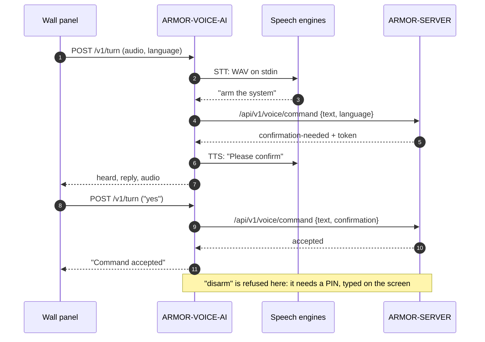

<p align="center">
  
</p>

# 🎙️ ARMOR-VOICE-AI

<p align="center">
  <a href="README.md">🇺🇸 English</a> |
  <a href="README_spa.md">🇪🇸 Español</a> |
  🇫🇷 <b>Français</b> |
  <a href="README_ita.md">🇮🇹 Italiano</a> |
  <a href="README_deu.md">🇩🇪 Deutsch</a> |
  <a href="README_zho.md">🇨🇳 简体中文</a> |
  <a href="README_jpn.md">🇯🇵 日本語</a> |
  <a href="README_por.md">🇵🇹 Português</a>
</p>

### Intentions vocales hors ligne en huit langues, avec une confirmation que l'appelant ne peut pas falsifier

<p align="center">
  
  
  
  
  
  
  
</p>

---

**Vérification d'honnêteté - ce qui fonctionne aujourd'hui :** Les règles d'intention, les huit langues, la confirmation signée liée à son locuteur, la politique de mise en silence, le service local, le point d'entrée des tours et l'audit sont réels et testés (118 tests), et le serveur interroge le service sur le banc d'essai CM5. **Aucun moteur de reconnaissance ni de synthèse vocale ne fait partie de ce dépôt** : `/v1/turn` exécute les commandes que vous configurez pour cela, et aucune n'a encore été essayée avec un vrai microphone ; le panneau tactile censé porter l'assistant n'a pas tourné sur une carte.

---

## 📋 En un coup d'œil

| | |
|---|---|
| Version | `0.3.1` |
| Maturité | Établi |
| Rôle | Passerelle vocale et d'intentions hors ligne (famille : Core Services, parent : ARMOR-SERVER) |
| Technologie | Python 3.11+, bibliothèque standard uniquement |
| Tests | 118 (`python -m unittest discover -s tests`) |
| Commandes | 15 (10 qui interrogent, 5 qui agissent), 420 phrases, 8 langues |
| Écoute sur | `127.0.0.1:18090` (boucle locale uniquement), avec un jeton |
| Fonctionne sur | Le banc d'essai CM5 (comme service) ou n'importe quel ordinateur |
| Sur matériel réel | Fonctionne comme service sur le banc d'essai CM5, interrogé par le serveur ; aucun microphone ni moteur vocal n'a été essayé |
| Licence | GPL-3.0-or-later |

**Aller à :** [Présentation](#-présentation) · [Architecture](#-architecture) · [Fonctionnalités](#-fonctionnalités) · [Sécurité](#-sécurité-et-protection) · [Interfaces](#-interfaces) · [Configuration](#-configuration) · [Démarrage rapide](#-démarrage-rapide) · [Tests](#-tests) · [Dépannage](#-dépannage) · [Structure](#-structure-du-dépôt) · [Liés](#-projets-liés)

## 🚦 État du projet

Chaque ligne est une partie de ce dépôt et le feu dit où elle en est aujourd'hui. Elle est écrite d'après ce que le dépôt peut montrer (tests, compilations, exécutions), pas d'après ce qui est prévu.

🟢 Fait et vérifié · 🟡 Fonctionne, avec des limites connues · 🟠 À moitié fait ou pas encore vérifié · 🔴 Pas fait ou ne fonctionne pas

| Domaine | État | Ce que cela veut dire ici |
|---|---|---|
| Logiciel | 🟡 | Les règles d'intention, le service local et le point d'entrée des tours tournent comme service sur le banc d'essai CM5, mais aucun moteur de reconnaissance ni de synthèse vocale ne fait partie du dépôt : il exécute les commandes que vous configurez pour cela. |
| Tests | 🟢 | 118 tests réussissent (`python -m unittest discover -s tests`) : les règles d'intention, les huit langues, la confirmation signée liée à son locuteur, la politique de mise en silence, le service local, le point d'entrée des tours et l'audit. |
| Matériel | 🔴 | Aucun microphone ni moteur vocal n'a été essayé, et le panneau tactile censé porter l'assistant n'a pas tourné sur une carte. |
| Sécurité | 🟡 | La confirmation est signée et liée à son locuteur, et l'audit est testé sur la machine hôte ; il n'y a pas eu de revue indépendante. |
| Intégration | 🟡 | Le serveur interroge le service sur le banc d'essai CM5 ; le flux vocal avec le panneau tactile n'a pas tourné. |
| Documentation | 🟢 | Huit langues et le journal des modifications sont à jour. |

## 🎯 Présentation

ARMOR-VOICE-AI est la partie d'A.R.M.O.R. qui transforme **ce qu'une personne dit en l'une de quinze commandes, ou en rien**. Il ne fait jamais rien par lui-même : il décide, et [ARMOR-SERVER](https://github.com/JuanenRac/ARMOR-SERVER) authentifie, autorise et exécute ce qui a été accepté, exactement comme pour un clic dans la console.

Le texte produit par un moteur de reconnaissance vocale est une *entrée non fiable*. Il n'est donc ni interprété, ni fouillé à la recherche de mots-clés, ni transmis comme commande : il est nettoyé (accents, ponctuation, formules de politesse) puis doit correspondre **exactement** à l'une des 420 phrases connues. Tout le reste, tout texte trop long et toute phrase qui pourrait signifier deux commandes *n'est pas compris*.

**Ce qu'il fait**

* Comprend quinze commandes en **huit langues** (anglais, espagnol, allemand, français, italien, japonais, chinois et portugais).
* Exige pour `arm` et `disarm` un **second tour avec un jeton signé par le service**, lié à l'intention et à la personne qui l'a demandée.
* Peut exiger pour `silence` un **code PIN** prononcé ou un second tour de confirmation, quand ARMOR-SERVER le demande.
* Fonctionne comme **service HTTP local** et comme **passerelle en lignes JSON** pour les adaptateurs et les tests.
* Reçoit l'**audio d'un tour** depuis le panneau mural, exécute les moteurs vocaux que vous configurez et répond en texte et, avec un synthétiseur vocal, en audio.
* Enregistre des **décisions, jamais l'audio ni les mots** : un SHA-256 de la transcription.

**Ce qu'il ne fait pas**

* Il ne reconnaît ni ne synthétise la parole : ce sont des programmes que choisit l'installation.
* Il n'arme, ne désarme ni ne met rien en silence : une commande acceptée est une recommandation pour ARMOR-SERVER.
* Il ne désarme jamais depuis le panneau mural : le PIN se saisit sur l'écran, il n'est jamais dit à voix haute.

## 🧩 Rôle dans A.R.M.O.R.

[ARMOR-SERVER](https://github.com/JuanenRac/ARMOR-SERVER) interroge ce service, puis authentifie et autorise la commande comme pour un clic dans [ARMOR-STUDIO](https://github.com/JuanenRac/ARMOR-STUDIO). Il est conçu pour vivre derrière le microphone du panneau mural [ARMOR-NODE-HMI](https://github.com/JuanenRac/ARMOR-NODE-HMI) (appuyer pour parler) et il répond à l'assistant écrit et vocal d'[ARMOR-ANDROID-CONTROL](https://github.com/JuanenRac/ARMOR-ANDROID-CONTROL). Sur le banc d'essai, il est installé par [ARMOR-DEVOPS](https://github.com/JuanenRac/ARMOR-DEVOPS) (`scripts/install_cm5.sh --with-voice`).

| Il parle à | Comment | Pour quoi faire |
|---|---|---|
| ARMOR-SERVER | `POST /v1/command`, `POST /v1/turn` en entrée ; `/api/v1/voice/command` en sortie | Décider d'une phrase ; transmettre les mots d'un tour vocal à la route vocale du serveur |
| ARMOR-NODE-HMI | audio d'un tour (PCM mono 16 kHz) | Le microphone et le haut-parleur du panneau mural |
| ARMOR-ANDROID-CONTROL | via le serveur | L'assistant écrit et vocal |
| Moteurs vocaux | entrée et sortie standard | Écouter (p. ex. whisper.cpp, Vosk) et parler (p. ex. Piper) ; choisis par l'installation |

## 🏛️ Architecture

<p align="center">
  
</p>

**Un tour vocal qui arme le système** (le panneau est interrogé deux fois, et le désarmement est refusé) :

<p align="center">
  
</p>

<details>
<summary>Version texte du diagramme (Mermaid)</summary>



</details>

**Pourquoi il est construit ainsi**

* **Pourquoi une liste fermée et non une classification d'intentions.** Un moteur de reconnaissance se trompe et n'importe qui peut parler près d'un microphone. Avec 420 phrases exactes, le pire qu'une mauvaise transcription puisse provoquer est d'être ignorée, et un test vérifie qu'aucune phrase n'appartient à deux commandes.
* **Pourquoi le service ne fait que décider.** L'authentification, l'autorisation, la piste d'audit et l'action restent en un seul endroit, ARMOR-SERVER ; un bogue ici peut accepter une phrase à tort, mais ne peut pas toucher à une alarme.
* **Pourquoi la confirmation est un jeton signé émis par le service.** Un indicateur fixé par l'appelant (`confirmed: true`) ne prouve rien, il est donc refusé. Le jeton est signé en HMAC-SHA-256, lié à la commande et à la personne, valable 30 secondes et utilisable une seule fois.
* **Pourquoi les moteurs vocaux sont des programmes séparés.** Les modèles évoluent plus vite qu'une passerelle de sécurité ne devrait le faire. Ils sont exécutés sans shell, avec un environnement réduit et une limite de temps, et les secrets propres au service ne leur parviennent jamais.
* **Pourquoi rien n'est conservé.** Le journal montre ce qui a été décidé sans conserver ce qui a été dit.

## ✨ Fonctionnalités

### Les quinze commandes

| Commande | Type | Signification | Confirmation |
|---|---|---|---|
| `status` | interroge | L'état du système | non |
| `alarms` | interroge | Les alarmes actives | non |
| `nodes` | interroge | L'état des nœuds | non |
| `cameras` | interroge | L'état des caméras | non |
| `radar` | interroge | L'état des radars | non |
| `solar` | interroge | L'état du système solaire | non |
| `electrical` | interroge | La consommation électrique | non |
| `network` | interroge | L'état du réseau | non |
| `time` | interroge | L'heure | non |
| `help` | interroge | Ce qui peut être dit | non |
| `silence` | agit | Mettre en silence (acquitter) les alarmes | seulement si la politique du serveur le demande (voir ci-dessous) |
| `lights_on` | agit | Allumer les lumières | non |
| `lights_off` | agit | Éteindre les lumières | non |
| `arm` | agit | Armer le périmètre | **oui** |
| `disarm` | agit | Désarmer le périmètre | **oui** |

Les dix qui *interrogent* ne changent rien. Les cinq qui *agissent* sont exécutées par ARMOR-SERVER avec la session de la personne qui a parlé, jamais par ce service.

### Huit langues

Anglais, espagnol, allemand, français, italien, japonais, chinois et portugais européen : les phrases (420 au total), le oui et le non d'une confirmation, les mots des chiffres d'un PIN prononcé et chaque phrase que le service répond. Les phrases sont écrites comme une personne les dit et normalisées au chargement du module avec la même fonction que celle qui normalise ce qui est entendu, de sorte que les deux ne peuvent pas diverger. Les formules de politesse (`please`, `por favor`, `bitte`, `s'il vous plaît`, `per favore`...) sont écartées avant la comparaison ; le japonais et le chinois, écrits sans espaces, listent leurs phrases avec et sans la terminaison polie.

### La confirmation en deux tours

1. Le premier tour pour `arm` ou `disarm` renvoie **aucune acceptation** et un `confirmation_token`.
2. Le second tour répète ce jeton pour la même intention, **pour la même personne**, dans les 30 secondes.
3. Le jeton est signé avec un secret que l'appelant ne possède pas, de sorte qu'il ne peut être ni falsifié, ni modifié, ni transféré à une autre intention ou à une autre personne ; il ne fonctionne qu'une fois et les nonces de ceux qui n'ont pas expiré ne sont jamais oubliés pour faire de la place aux nouveaux (quand il y en a trop à la fois, le nouveau jeton est refusé).

### Mise en silence par la voix, avec un PIN facultatif

« Silence » est accepté immédiatement, sauf si l'installation exige davantage. ARMOR-SERVER détient le réglage `voice.silence_confirmation` et l'envoie sous forme de politique :

| Mode | Ce qui se passe pour « silence » |
|---|---|
| `off` (par défaut, et quand aucune politique n'arrive) | Transmis immédiatement |
| `double_turn` | Non exécuté ; le service demande de dire oui, et un oui dans les 15 s depuis le même panneau transmet la commande d'origine |
| `pin` | Non exécuté ; le service demande le PIN, dit en chiffres ou en mots dans les huit langues ; le bon PIN dans les 20 s transmet la commande |
| politique illisible ou inconnue | `double_turn` : un réglage cassé ne désactive jamais une protection |

Le PIN (de 4 à 12 chiffres, `ARMOR_VOICE_SILENCE_PIN`) est comparé en temps constant et n'est jamais journalisé, conservé ni répété. Trois mauvais PIN bloquent la mise en silence par la voix pour **tous** les panneaux pendant cinq minutes ; si le mode `pin` est demandé et qu'aucun PIN n'est configuré, rien n'est mis en silence par la voix. Le contrat complet se trouve dans [docs/SILENCE_POLICY.md](docs/SILENCE_POLICY.md).

### Le tour du panneau mural

`POST /v1/turn` reçoit l'audio d'un tour, exécute la commande de reconnaissance vocale, donne les mots à la route vocale d'ARMOR-SERVER et répond avec ce qui a été entendu, ce qu'il faut dire et, quand une commande de synthèse vocale est configurée, un enregistrement de la réponse. Le panneau n'a pas de clavier : la question d'`arm` est donc mémorisée par panneau pendant 30 secondes, et le tour suivant qui dit *oui* (dans la langue du panneau) la confirme, tandis que celui qui dit *non* l'annule. Si le serveur répond `disarm`, le tour répond que le désarmement exige le PIN sur l'écran. Au-delà de neuf secondes d'écoute, rien n'est demandé au serveur (le panneau abandonne à douze), de sorte que ce qui a été dit à la personne et ce que la maison a fait ne peuvent pas se contredire.

### Décisions consignées

Avec `--audit-file`, une ligne JSON par décision : heure, intention, résultat et SHA-256 de la transcription. Jamais l'audio et jamais les mots.

## 🔒 Sécurité et protection

| Menace | Défense |
|---|---|
| Une transcription erronée ou hostile | Entrée non fiable : normalisée, correspondance exacte avec une liste fermée, 200 caractères au maximum, l'ambigu *n'est pas compris* ; jamais transmise comme commande shell ou d'appareil |
| Un appelant revendique une confirmation | `confirmed` est refusé ; seul compte un jeton signé par le service |
| Un jeton est volé, rejoué ou réutilisé | Signé en HMAC-SHA-256, lié à l'intention et à la personne, 30 s, usage unique ; un jeton ne peut pas survivre à son heure d'émission même si l'horloge recule |
| Une autre personne utilise le jeton de quelqu'un | `wrong-subject` |
| Deviner le PIN de mise en silence | Comparaison en temps constant, 3 essais puis 5 minutes de blocage pour tous les panneaux, échec fermé sans PIN |
| Quelqu'un sur le réseau atteint le service | Boucle locale uniquement (refuse une autre adresse sans `--allow-remote`) ; jeton d'au moins 16 caractères comparé en temps constant ; 2 Ko par requête ; une connexion qui reste bloquée est fermée au bout de 15 s |
| Un moteur vocal divulgue ou abuse de secrets | Exécuté sans shell, avec un environnement réduit (`PATH`, `HOME`, `LANG`, `TMPDIR`, `ARMOR_VOICE_ENGINE_*`), une limite de temps et une limite de taille ; les jetons du service et du serveur ne lui parviennent jamais |
| Épuiser la machine | Deux tours à la fois au plus (un troisième reçoit 503) ; audio plafonné à 480 000 octets |
| Les journaux révèlent ce qui a été dit | Jamais journalisé ; l'audit ne contient qu'un hachage |
| Un tour périmé agit trop tard | Au-delà de neuf secondes, rien n'est exécuté (504) |

Le désarmement par la voix n'est **jamais** effectué depuis le panneau mural. Depuis l'application, il suit le `ARMOR_DISARM_PIN` du serveur (réglez-le sur `required`). Rien ici n'est une fonction de sécurité certifiée : une commande acceptée est une recommandation qu'ARMOR-SERVER authentifie et autorise encore. Lisez [docs/SAFETY.md](docs/SAFETY.md) pour les règles complètes et [SECURITY.md](SECURITY.md) pour signaler une vulnérabilité.

## 🔌 Interfaces

### Service HTTP

| Route | Authentification | Ce qu'elle fait |
|---|---|---|
| `GET /healthz` | aucune | `{"ok": true, "service": "armor-voice"}` |
| `POST /v1/command` | en-tête `X-Armor-Voice-Token` | Corps `{text, language?, confirmation?, subject?, policy?, pin?}` (2 Ko au plus). Répond ce qui a été compris, un `confirmation_token` quand un second tour est nécessaire et `speech` dans la langue demandée |
| `POST /v1/turn` | le même en-tête | Corps : PCM brut mono 16 bits à 16 kHz, `Content-Type: audio/L16;rate=16000`, jusqu'à 480 000 octets ; en-têtes `X-Armor-Language`, `X-Armor-Client`, `X-Armor-Policy`. Répond `{heard, reply, audio?}` |
| `POST /v1/speak` | le même en-tête | Corps `{text, language}` (300 caractères au plus). Répond `{audio}`, la phrase dite par le programme de synthèse vocale en base64 de PCM mono 16 bits à 16 kHz (elle ne déclenche rien et ne garde rien) ; 501 sans ce programme |

Un échange réel (le jeton est abrégé) :

```json
{"text": "arm the system", "subject": "u-1"}
{"accepted": false, "requires_confirmation": true, "intent": "arm", "outcome": "confirmation-needed", "confirmation_token": "eyJpIjoiYXJt...", "reason": "say it again with the confirmation within 30 s", "speech": "Please confirm"}

{"text": "arm the system", "subject": "u-1", "confirmation": "eyJpIjoiYXJt..."}
{"accepted": true, "requires_confirmation": false, "intent": "arm", "outcome": "accepted", "speech": "Command accepted"}

{"text": "open the garage"}
{"accepted": false, "requires_confirmation": false, "intent": null, "outcome": "not-understood", "reason": "the phrase is not one of the known commands", "speech": "Command not recognised"}
```

Résultats : `accepted`, `confirmation-needed`, `confirmation-refused`, `pin-needed`, `pin-refused`, `not-understood`. Une confirmation est refusée comme `invalid`, `expired`, `wrong-intent`, `wrong-subject` ou `replayed`.

### Codes d'état de `/v1/turn`

| Code | Erreur | Signification |
|---|---|---|
| 200 | | `{heard, reply, audio?}` |
| 401 | `unauthorized` | Jeton absent ou incorrect |
| 411 / 413 | `bad audio length` | Pas de longueur, ou plus de 480 000 octets |
| 415 | | Ce n'est pas `audio/L16;rate=16000` |
| 422 | `invalid language` | Ce n'est pas l'une de `en es de fr it ja zh pt` |
| 501 | `stt_unavailable` / `server_not_configured` | Aucune commande de reconnaissance vocale, ou aucune adresse de serveur |
| 502 | `engine_failed` / `server_<code>` / `server_not_answering` | Un moteur vocal ou le serveur a échoué |
| 503 | `busy` | Deux tours sont déjà en cours |
| 504 | `turn_too_slow` | Le moteur vocal a été si lent que le serveur n'a pas été interrogé ; rien n'a été exécuté |

### Passerelle en lignes JSON

`python -m armor_voice_ai.gateway` lit un objet JSON par ligne sur l'entrée standard et écrit la réponse sur la sortie standard (2 Ko par ligne ; une ligne contenant des octets qui ne sont pas de l'UTF-8 est une ligne comme les autres). C'est la même passerelle fermée, pour les adaptateurs vocaux et les tests.

### Contrat avec ARMOR-SERVER

* Le serveur envoie la politique de mise en silence à chaque requête : `policy` dans le corps de `/v1/command` (et `pin` pour le mode `pin`), l'en-tête `X-Armor-Policy` (un objet JSON de 256 octets au plus) sur `/v1/turn`.
* La route vocale du serveur reçoit les mots d'un tour vocal sur `/api/v1/voice/command` avec le jeton d'opérateur de l'installation, sous le nom de chaque panneau (`X-Armor-Client`).
* Détails : [docs/SERVICE.md](docs/SERVICE.md), [docs/SILENCE_POLICY.md](docs/SILENCE_POLICY.md).

## ⚙️ Configuration

### Environnement

| Variable | Requise | Ce qu'elle définit |
|---|---|---|
| `ARMOR_VOICE_TOKEN` | oui (16+ caractères) | Le jeton que les appelants envoient dans `X-Armor-Voice-Token` (ou une ligne `ARMOR_VOICE_TOKEN=...` dans le fichier de `--token-file`) |
| `ARMOR_VOICE_CONFIRM_SECRET` | recommandée (16+ octets) | Signe les confirmations. Sans elle, un secret aléatoire est utilisé et les confirmations en attente sont perdues à l'arrêt du processus |
| `ARMOR_VOICE_STT_COMMAND` | pour `/v1/turn` | Le programme de reconnaissance vocale : audio (WAV) sur l'entrée standard, les mots sur la sortie standard |
| `ARMOR_VOICE_TTS_COMMAND` | facultative | Le programme de synthèse vocale : texte sur l'entrée standard, un WAV mono 16 bits à 16 kHz sur la sortie standard |
| `ARMOR_VOICE_SERVER_URL`, `ARMOR_VOICE_SERVER_TOKEN` | pour `/v1/turn` | ARMOR-SERVER et le jeton d'opérateur de sa route vocale |
| `ARMOR_VOICE_SILENCE_PIN` | pour le mode `pin` | De 4 à 12 chiffres. Une valeur non valide arrête le service au démarrage sans l'afficher |
| `ARMOR_VOICE_ENGINE_*` | facultative | Transmises aux moteurs vocaux (avec `ARMOR_VOICE_LANGUAGE`, fixée à chaque tour) |

### Ligne de commande

| Option | Par défaut | |
|---|---|---|
| `--host` | `127.0.0.1` | Adresse d'écoute ; toute autre que la boucle locale est refusée sans `--allow-remote` |
| `--port` | `18090` | |
| `--token-file` | | Fichier avec une ligne `ARMOR_VOICE_TOKEN=...` |
| `--audit-file` | | Ajoute une ligne par décision |
| `--allow-remote` | désactivé | Écoute sur une adresse hors boucle locale (déconseillé ; seulement derrière TLS) |

### Limites présentes dans le code

| Limite | Valeur |
|---|---|
| Validité de la confirmation | 30 s |
| Question vocale mémorisée par panneau | 30 s |
| « Oui » après une question de mise en silence / PIN après sa demande | 15 s / 20 s |
| Essais de PIN avant le blocage / durée du blocage | 3 / 5 min |
| Budget du tour / le panneau abandonne | 9 s / 12 s |
| Limite de temps d'un moteur vocal | 25 s |
| Audio maximal / audio de réponse maximal | 480 000 octets / 190 000 octets |
| Corps de la requête (`/v1/command`) | 2 Ko |
| Longueur de la transcription | 200 caractères |
| Tours simultanés | 2 |

Le service n'écrit jamais ce qui a été dit dans un journal, quels que soient les réglages.

## 🚀 Démarrage rapide

**Prérequis :** Python 3.11+ (bibliothèque standard uniquement). Facultatif : un programme de reconnaissance vocale et un de synthèse vocale pour `/v1/turn`.

```powershell
$env:PYTHONPATH = "src"

# 1. les tests
python -m unittest discover -s tests                      # 118 tests

# 2. la passerelle, un objet JSON par ligne
echo '{"text":"arm the system"}' | python -m armor_voice_ai.gateway

# 3. le service HTTP local (boucle locale uniquement)
$env:ARMOR_VOICE_TOKEN = "a-token-of-at-least-16-characters"
python -m armor_voice_ai.service --port 18090
```

```sh
curl -s http://127.0.0.1:18090/v1/command \
  -H "X-Armor-Voice-Token: $ARMOR_VOICE_TOKEN" \
  -d '{"text":"status","language":"de"}'
# {"accepted":true,"requires_confirmation":false,"intent":"status","outcome":"accepted","speech":"Befehl akzeptiert"}
```

Pour écouter et parler (`/v1/turn`), pointez le service vers vos moteurs et vers le serveur :

```sh
export ARMOR_VOICE_STT_COMMAND="/opt/armor/bin/hear"        # WAV sur l'entrée, mots sur la sortie
export ARMOR_VOICE_TTS_COMMAND="/opt/armor/bin/speak"       # texte sur l'entrée, WAV sur la sortie
export ARMOR_VOICE_SERVER_URL="https://armor-server.local"
export ARMOR_VOICE_SERVER_TOKEN="..."
python -m armor_voice_ai.service --token-file /opt/armor/etc/armor.voice.env
```

Le panneau mural est un appareil du réseau et le service n'écoute que sur la boucle locale : soit un proxy du serveur transmet le tour, soit `--allow-remote` est utilisé derrière TLS. Le jeton et l'audio ne doivent pas traverser le réseau en clair.

`run.bat` / `run.sh` et `build.bat` / `build.sh` lancent le flux de projet partagé d'[ARMOR-COMMON](https://github.com/JuanenRac/ARMOR-COMMON) (les dépôts sont côte à côte). Avec pip, la commande `armor-voice-gateway` est disponible.

## 🧪 Tests

```powershell
$env:PYTHONPATH = "src"
python -m unittest discover -s tests
python -I tools/armor_ci_validate.py        # manifeste, version, journal des modifications et parité des README
```

| Fichier de tests | Tests | Ce qu'il couvre |
|---|---|---|
| `test_silence.py` | 31 | La politique de mise en silence, le PIN prononcé en huit langues, le blocage |
| `test_edges.py` | 29 | Le protocole en lignes, les réglages du service, la liaison avec le serveur (un substitut sur la boucle locale), les limites des moteurs |
| `test_gateway.py` | 23 | La passerelle, la confirmation, les rejeux et les falsifications |
| `test_turn.py` | 15 | Le tour, les moteurs, le oui et le non prononcés, le budget de temps |
| `test_languages.py` | 11 | Phrases sous forme normale, aucune phrase pour deux commandes, chaque langue arme, désarme, interroge et met en silence |
| `test_service.py` | 5 | Les routes HTTP |

GitHub Actions exécute la base A.R.M.O.R. à chaque push et pull request : la validation du manifeste, de la version, du journal des modifications et de la parité des README, puis la compilation et les tests propres au projet.

## 🏗️ Compilation et publication

C'est du Python pur : rien à compiler. La version se trouve dans `pyproject.toml`, dans `armor.project.json` et dans le badge du README (lu depuis le manifeste) ; chaque version a son entrée dans [CHANGELOG.md](CHANGELOG.md). Les versions sont publiées sur GitHub.

## 🩺 Dépannage

| Vous voyez | Parce que | Faites |
|---|---|---|
| `refusing to listen on a non-loopback address without --allow-remote` | `--host` n'est ni `127.0.0.1`, ni `::1`, ni `localhost` | Gardez la boucle locale et laissez le proxy du serveur transmettre, ou ajoutez `--allow-remote` derrière TLS |
| `a token of at least 16 characters is needed` | `ARMOR_VOICE_TOKEN` est absent ou trop court | Définissez-le, ou utilisez `--token-file` |
| `ARMOR_VOICE_SILENCE_PIN is not valid` | Ce ne sont pas 4 à 12 chiffres ASCII | Corrigez la valeur (elle n'est jamais affichée) |
| `ARMOR_VOICE_CONFIRM_SECRET is not set` (avertissement) | Un secret aléatoire est utilisé | Définissez un secret de 16+ octets si les confirmations doivent survivre à un redémarrage |
| 401 `unauthorized` | `X-Armor-Voice-Token` absent ou incorrect | Envoyez le jeton |
| 501 `stt_unavailable` | `ARMOR_VOICE_STT_COMMAND` n'est pas défini | Configurez un programme de reconnaissance vocale |
| 501 `server_not_configured` | Aucune adresse ni aucun jeton de serveur | Définissez `ARMOR_VOICE_SERVER_URL` et `ARMOR_VOICE_SERVER_TOKEN` |
| 502 `engine_failed` | Le moteur a échoué, dépassé le délai ou répondu trop (ou un WAV de synthèse vocale qui n'est pas mono 16 bits à 16 kHz) | Exécutez-le à la main avec la même entrée |
| 504 `turn_too_slow` | Le moteur vocal a mis plus de neuf secondes | Utilisez un modèle plus rapide ; rien n'a été exécuté |
| « Le désarmement exige votre PIN » | Le désarmement n'est jamais fait par la voix depuis le panneau | Utilisez l'écran |
| Un « oui » prononcé ne fait rien | La question n'a pas été mémorisée (elle a mis plus de 12 s à être posée, plus de 30 s se sont écoulées, ou un autre panneau a répondu) | Redites la commande |

## 📂 Structure du dépôt

<p align="center">
  
</p>

<details>
<summary>Version texte de l'arborescence</summary>

```text
ARMOR-VOICE-AI/
├── src/armor_voice_ai/        le code (bibliothèque standard uniquement)
│   ├── phrases.py             les 420 phrases des quinze commandes, en huit langues
│   ├── intent.py              normalisation et correspondance exacte : la liste d'autorisation fermée
│   ├── confirmation.py        jetons de confirmation signés, à usage unique, par personne
│   ├── silence_policy.py      off / pin / double_turn, le PIN prononcé, le blocage
│   ├── session.py             la règle des deux tours pour chaque commande
│   ├── gateway.py             lignes JSON sur stdin/stdout, l'audit, les phrases répondues
│   ├── service.py             le service HTTP local (/healthz, /v1/command, /v1/turn)
│   └── turn.py                un tour vocal : moteurs, oui/non, budget de temps
├── tests/                     118 tests : silence, limites, passerelle, tour, langues, service
├── docs/                      SAFETY.md, SERVICE.md, SILENCE_POLICY.md
├── tools/                     les contrôles CI partagés et l'outillage du projet
├── images/                    bannière et icône
├── .github/                   workflow CI, avis du tableau de bord, modèles de tickets et de pull requests
├── armor.project.json         manifeste : version, rôle, maturité, commande de compilation
├── pyproject.toml             métadonnées du paquet et la commande `armor-voice-gateway`
├── run.sh run.bat             démarrent via le flux de projet partagé
├── build.sh build.bat         compilent et testent via le flux de projet partagé
├── CHANGELOG.md               ce qui a changé dans chaque version
└── SECURITY.md SUPPORT.md CONTRIBUTING.md CODE_OF_CONDUCT.md LICENSE
```

</details>

## 🗺️ Feuille de route et limites connues

**Limites connues aujourd'hui**

* Aucun moteur vocal n'est fourni, et aucun n'a été essayé avec un vrai microphone.
* Le panneau tactile censé porter l'assistant n'a pas tourné sur une carte ; il n'y a pas de mot d'éveil, c'est appuyer pour parler.
* Le tour ne dit pas *quel panneau ni quelle personne* a parlé : ARMOR-SERVER décide avec le jeton qu'il a reçu. Les ajouter à la requête est un changement du contrat entre le serveur et le panneau.
* Pas de revue de sécurité indépendante.

**Prochainement**

* Essayer un vrai microphone et un vrai moteur vocal sur le banc d'essai CM5.
* Exécuter le flux vocal avec le panneau tactile une fois qu'il aura tourné sur une carte.
* Confirmation facultative par locuteur authentifié ou physique. Un déploiement ultérieur pourra l'ajouter, mais la confirmation signée ne sera pas supprimée sans une revue de risques documentée.

## 🌍 Langues

Le README et les textes existent en anglais, espagnol, français, italien, allemand, chinois, japonais et portugais européen. Chaque phrase que le service répond, chaque commande vocale, chaque oui et non et chaque mot de chiffre d'un PIN existe dans les huit langues.

## 🔗 Projets liés

**A.R.M.O.R.** (Autonomous Radar & Multimodal Observation Range) est un système de sécurité périmétrique composé de dépôts indépendants. Chacun a sa propre version, ses propres tests et son propre README ; voici la famille :

* **[ARMOR-COMMON](https://github.com/JuanenRac/ARMOR-COMMON)** - Contrats de messages, validateurs, vecteurs de conformité et types générés
* **[ARMOR-NODE-RADAR](https://github.com/JuanenRac/ARMOR-NODE-RADAR)** - Firmware du nœud de terrain pour ESP32-S3 avec trois radars et son propre panneau web
* **[ARMOR-NODE-SOLAR](https://github.com/JuanenRac/ARMOR-NODE-SOLAR)** - Protocoles des onduleurs et batteries solaires et messages d'un nœud passerelle
* **[ARMOR-NODE-ELECTRICAL](https://github.com/JuanenRac/ARMOR-NODE-ELECTRICAL)** - Nœud électrique : compteurs, le message des mesures du réseau et les règles de commutation
* **[ARMOR-NODE-ALARM](https://github.com/JuanenRac/ARMOR-NODE-ALARM)** - Nœud et centrale d'alarme : zones, armement, temporisations, sirène et PIN, avec ou sans le serveur
* **[ARMOR-NODE-HMI](https://github.com/JuanenRac/ARMOR-NODE-HMI)** - Panneau tactile : l'état du système sur un écran mural, armer et acquitter, et la maison de l'assistant vocal
* **[ARMOR-NETWORK](https://github.com/JuanenRac/ARMOR-NETWORK)** - Le réseau local : ses appareils, internet et ce qui change
* **[ARMOR-SERVER](https://github.com/JuanenRac/ARMOR-SERVER)** - Coordinateur central : télémétrie, alarmes, appareils, relevés solaires et caméras
* **[ARMOR-STUDIO](https://github.com/JuanenRac/ARMOR-STUDIO)** - Console web : caméras, radar, alarmes, énergie solaire et concepteur de site 2D/3D
* **[ARMOR-ANDROID-CONTROL](https://github.com/JuanenRac/ARMOR-ANDROID-CONTROL)** - Client Android de l'opérateur avec radar 2D/3D en direct
* **[ARMOR-IOS-CONTROL](https://github.com/JuanenRac/ARMOR-IOS-CONTROL)** - Client opérateur iPhone
* **[ARMOR-SERVER-AI](https://github.com/JuanenRac/ARMOR-SERVER-AI)** - Politique d'inférence visuelle qui explique ses décisions et n'agit jamais
* **[ARMOR-VISION](https://github.com/JuanenRac/ARMOR-VISION)** - Zones de caméra, masques et règles de détection pour la Jetson Orin NX
* **ARMOR-VOICE-AI** (ce dépôt) - Intentions vocales hors ligne avec une confirmation impossible à falsifier
* **[ARMOR-HARDWARE](https://github.com/JuanenRac/ARMOR-HARDWARE)** - Boîtiers, électronique et matrice d'acceptation sur banc
* **[ARMOR-DEVOPS](https://github.com/JuanenRac/ARMOR-DEVOPS)** - Déploiement, banc d'essai CM5, sauvegarde et TLS
* **[ARMOR-SIMULATOR](https://github.com/JuanenRac/ARMOR-SIMULATOR)** - Simulateur de télémétrie hors ligne avec des pannes reproductibles
* **[ARMOR-UPDATER](https://github.com/JuanenRac/ARMOR-UPDATER)** - Détecte, installe et met à jour les propres dépôts de l'écosystème
* **[ARMOR-DOCS](https://github.com/JuanenRac/ARMOR-DOCS)** - Architecture, base de sécurité et matrice des capacités

## 📚 Documentation

* [Sécurité vocale](docs/SAFETY.md) : ce qui est compris, la confirmation, le tour du panneau mural, ce qui est enregistré
* [Le service](docs/SERVICE.md) : routes, codes d'état et réglages
* [Mise en silence par la voix](docs/SILENCE_POLICY.md) : le contrat de la politique et le PIN
* [Matrice des capacités : ce qui est prouvé et ce qui ne l'est pas](https://github.com/JuanenRac/ARMOR-DOCS/blob/main/docs/CAPABILITY_MATRIX.md)
* [Catalogue des projets : versions et dépendances entre les dépôts](https://github.com/JuanenRac/ARMOR-DOCS/blob/main/docs/PROJECT_CATALOG.md)
* [Historique des modifications de ce dépôt](CHANGELOG.md)

## 🤝 Contribuer et communauté

* Avant une pull request, exécutez `python -I tools/armor_ci_validate.py` et les tests : les deux doivent réussir. Voir [CONTRIBUTING.md](CONTRIBUTING.md) et le [code de conduite](CODE_OF_CONDUCT.md).
* Le README existe en huit langues et est généré à partir des sources d'ARMOR-DOCS : une modification du texte se fait là-bas.
* Une modification d'un message entre composants commence dans ARMOR-COMMON.
* Ne décrivez pas comme fonctionnant sur une carte ce qui a seulement été compilé.
* Signalez une vulnérabilité en privé : [SECURITY.md](SECURITY.md). Questions, idées et rapports : electrohobby3d@gmail.com ([SUPPORT.md](SUPPORT.md)).

## 👤 AUTEUR

**JuanenRac (Electro Hobby 3D)** · electrohobby3d@gmail.com

## 📜 LICENCE

GPL-3.0-or-later - voir [LICENSE](LICENSE).
