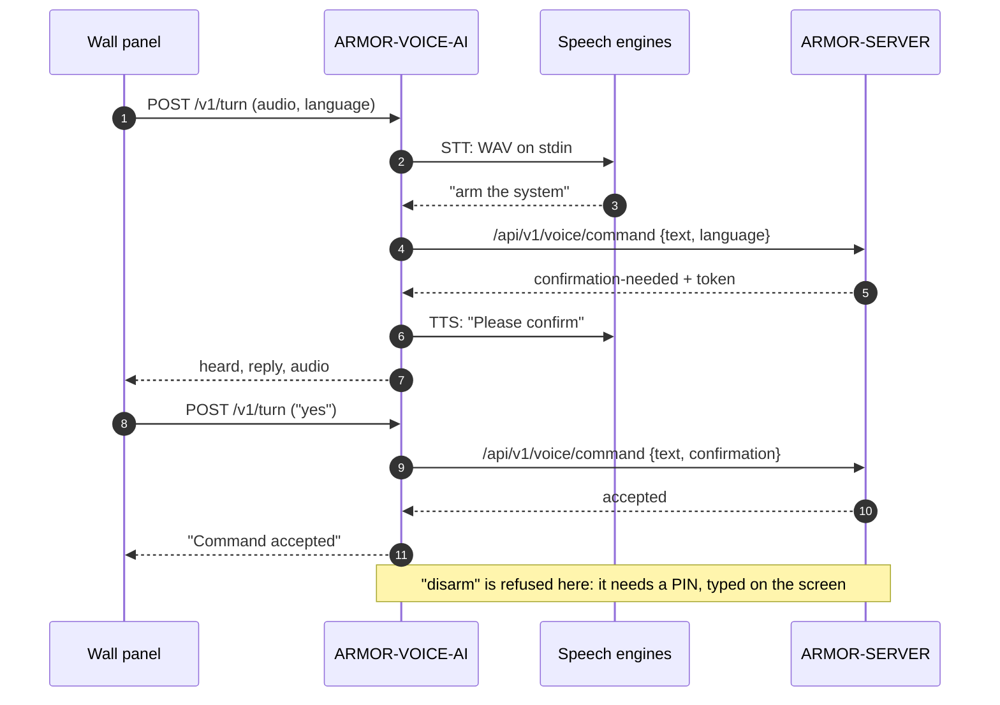

<p align="center">
  
</p>

# 🎙️ ARMOR-VOICE-AI

<p align="center">
  <a href="README.md">🇺🇸 English</a> |
  <a href="README_spa.md">🇪🇸 Español</a> |
  <a href="README_fra.md">🇫🇷 Français</a> |
  🇮🇹 <b>Italiano</b> |
  <a href="README_deu.md">🇩🇪 Deutsch</a> |
  <a href="README_zho.md">🇨🇳 简体中文</a> |
  <a href="README_jpn.md">🇯🇵 日本語</a> |
  <a href="README_por.md">🇵🇹 Português</a>
</p>

### Intenti vocali offline in otto lingue, con una conferma che chi chiama non può falsificare

<p align="center">
  
  
  
  
  
  
  
</p>

---

**Controllo di onestà - cosa funziona oggi:** Le regole degli intenti, le otto lingue, la conferma firmata legata a chi parla, la politica di silenziamento, il servizio locale, l'endpoint dei turni e l'audit sono reali e testati (118 test), e il server interroga il servizio sul banco di prova CM5. **Nessun motore di riconoscimento o di sintesi vocale fa parte di questo repository**: `/v1/turn` esegue i comandi che configuri per questo, e nessuno è stato ancora provato con un vero microfono; il pannello touch che dovrebbe ospitare l'assistente non ha ancora girato su una scheda.

---

## 📋 In breve

| | |
|---|---|
| Versione | `0.3.1` |
| Maturità | Consolidato |
| Ruolo | Gateway vocale e di intenti offline (famiglia: Core Services, genitore: ARMOR-SERVER) |
| Tecnologia | Python 3.11+, solo libreria standard |
| Test | 118 (`python -m unittest discover -s tests`) |
| Comandi | 15 (10 che interrogano, 5 che agiscono), 420 frasi, 8 lingue |
| In ascolto su | `127.0.0.1:18090` (solo loopback), con un token |
| Gira su | Il banco di prova CM5 (come servizio) o qualsiasi computer |
| Su hardware reale | Gira come servizio sul banco di prova CM5, interrogato dal server; nessun microfono né motore vocale è stato provato |
| Licenza | GPL-3.0-or-later |

**Vai a:** [Panoramica](#-panoramica) · [Architettura](#-architettura) · [Funzionalità](#-funzionalità) · [Sicurezza](#-sicurezza-e-protezione) · [Interfacce](#-interfacce) · [Configurazione](#-configurazione) · [Avvio rapido](#-avvio-rapido) · [Test](#-test) · [Problemi](#-risoluzione-dei-problemi) · [Struttura](#-struttura-del-repository) · [Correlati](#-progetti-correlati)

## 🚦 Stato del progetto

Ogni riga è una parte di questo repository e il semaforo dice a che punto è oggi. È scritta in base a ciò che il repository può mostrare (test, compilazioni, esecuzioni), non a ciò che è previsto.

🟢 Fatto e verificato · 🟡 Funziona, con limiti noti · 🟠 Fatto a metà o non ancora verificato · 🔴 Non fatto o non funzionante

| Area | Stato | Cosa significa qui |
|---|---|---|
| Software | 🟡 | Le regole degli intenti, il servizio locale e l'endpoint dei turni girano come servizio sul banco di prova CM5, ma nessun motore di riconoscimento o di sintesi vocale fa parte del repository: esegue i comandi che configuri per questo. |
| Test | 🟢 | Superano 118 test (`python -m unittest discover -s tests`): le regole degli intenti, le otto lingue, la conferma firmata legata a chi parla, la politica di silenziamento, il servizio locale, l'endpoint dei turni e l'audit. |
| Hardware | 🔴 | Nessun microfono né motore vocale è stato provato, e il pannello touch che dovrebbe ospitare l'assistente non ha girato su una scheda. |
| Sicurezza | 🟡 | La conferma è firmata e legata a chi parla, e l'audit è provato sull'host; non c'è stata una revisione indipendente. |
| Integrazione | 🟡 | Il server interroga il servizio sul banco di prova CM5; il flusso vocale con il pannello touch non ha girato. |
| Documentazione | 🟢 | Otto lingue e il registro delle modifiche sono aggiornati. |

## 🎯 Panoramica

ARMOR-VOICE-AI è la parte di A.R.M.O.R. che trasforma **ciò che dice una persona in uno di quindici comandi, oppure in niente**. Non fa mai nulla da sé: decide, e [ARMOR-SERVER](https://github.com/JuanenRac/ARMOR-SERVER) autentica, autorizza ed esegue ciò che è stato accettato, esattamente come farebbe con un clic nella console.

Il testo che esce da un riconoscitore vocale è un *input non attendibile*. Perciò non viene interpretato, né cercato per parole chiave, né inoltrato come comando: viene ripulito (accenti, punteggiatura, formule di cortesia) e deve poi corrispondere **esattamente** a una delle 420 frasi note. Tutto il resto, ogni testo troppo lungo e ogni frase che potrebbe significare due comandi *non viene capito*.

**Cosa fa**

* Capisce quindici comandi in **otto lingue** (inglese, spagnolo, tedesco, francese, italiano, giapponese, cinese e portoghese).
* Fa sì che `arm` e `disarm` richiedano un **secondo turno con un token firmato dal servizio**, legato all'intento e a chi l'ha richiesto.
* Può far sì che `silence` richieda un **PIN** pronunciato o un secondo turno di conferma, quando ARMOR-SERVER lo chiede.
* Gira come **servizio HTTP locale** e come **gateway a righe JSON** per adattatori e test.
* Riceve l'**audio di un turno** dal pannello a parete, esegue i motori vocali che configuri e risponde in testo e, con un sintetizzatore vocale, in audio.
* Registra **decisioni, mai audio né parole**: un SHA-256 della trascrizione.

**Cosa non fa**

* Non riconosce né sintetizza la voce: sono programmi scelti dall'installazione.
* Non inserisce, non disinserisce e non silenzia nulla: un comando accettato è una raccomandazione per ARMOR-SERVER.
* Non disinserisce mai dal pannello a parete: il PIN si digita sullo schermo, non si dice mai ad alta voce.

## 🧩 Ruolo in A.R.M.O.R.

[ARMOR-SERVER](https://github.com/JuanenRac/ARMOR-SERVER) interroga questo servizio, poi autentica e autorizza il comando come farebbe con un clic in [ARMOR-STUDIO](https://github.com/JuanenRac/ARMOR-STUDIO). È pensato per vivere dietro il microfono del pannello a parete [ARMOR-NODE-HMI](https://github.com/JuanenRac/ARMOR-NODE-HMI) (premi per parlare) e risponde all'assistente scritto e vocale di [ARMOR-ANDROID-CONTROL](https://github.com/JuanenRac/ARMOR-ANDROID-CONTROL). Sul banco di prova è installato da [ARMOR-DEVOPS](https://github.com/JuanenRac/ARMOR-DEVOPS) (`scripts/install_cm5.sh --with-voice`).

| Parla con | Come | A che scopo |
|---|---|---|
| ARMOR-SERVER | `POST /v1/command`, `POST /v1/turn` in ingresso; `/api/v1/voice/command` in uscita | Decidere una frase; passare le parole di un turno vocale alla rotta vocale del server |
| ARMOR-NODE-HMI | audio di un turno (PCM mono 16 kHz) | Il microfono e l'altoparlante del pannello a parete |
| ARMOR-ANDROID-CONTROL | tramite il server | L'assistente scritto e vocale |
| Motori vocali | input e output standard | Ascoltare (p. es. whisper.cpp, Vosk) e parlare (p. es. Piper); scelti dall'installazione |

## 🏛️ Architettura

<p align="center">
  
</p>

**Un turno vocale che inserisce il sistema** (al pannello si chiede due volte, e il disinserimento viene rifiutato):

<p align="center">
  
</p>

<details>
<summary>Versione testuale del diagramma (Mermaid)</summary>



</details>

**Perché è costruito così**

* **Perché una lista chiusa e non una classificazione degli intenti.** Un riconoscitore sbaglia e chiunque può parlare vicino a un microfono. Con 420 frasi esatte il peggio che una trascrizione errata possa fare è essere ignorata, e un test verifica che nessuna frase appartenga a due comandi.
* **Perché il servizio si limita a decidere.** Autenticazione, autorizzazione, traccia di audit e azione restano in un solo posto, ARMOR-SERVER; un bug qui può accettare per errore una frase, ma non può toccare un allarme.
* **Perché la conferma è un token firmato emesso dal servizio.** Un flag impostato da chi chiama (`confirmed: true`) non prova nulla, quindi viene rifiutato. Il token è firmato con HMAC-SHA-256, legato al comando e alla persona, valido 30 secondi e utilizzabile una sola volta.
* **Perché i motori vocali sono programmi separati.** I modelli cambiano più in fretta di quanto dovrebbe fare un gateway di sicurezza. Vengono eseguiti senza shell, con un ambiente ridotto e un limite di tempo, e i segreti del servizio non li raggiungono mai.
* **Perché non si conserva nulla.** Il registro mostra cosa è stato deciso senza conservare cosa è stato detto.

## ✨ Funzionalità

### I quindici comandi

| Comando | Tipo | Significato | Conferma |
|---|---|---|---|
| `status` | interroga | Lo stato del sistema | no |
| `alarms` | interroga | Gli allarmi attivi | no |
| `nodes` | interroga | Lo stato dei nodi | no |
| `cameras` | interroga | Lo stato delle telecamere | no |
| `radar` | interroga | Lo stato dei radar | no |
| `solar` | interroga | Lo stato dell'impianto solare | no |
| `electrical` | interroga | Il consumo elettrico | no |
| `network` | interroga | Lo stato della rete | no |
| `time` | interroga | L'ora | no |
| `help` | interroga | Cosa si può dire | no |
| `silence` | agisce | Silenziare (riconoscere) gli allarmi | solo se la politica del server lo richiede (vedi sotto) |
| `lights_on` | agisce | Accendere le luci | no |
| `lights_off` | agisce | Spegnere le luci | no |
| `arm` | agisce | Inserire il perimetro | **sì** |
| `disarm` | agisce | Disinserire il perimetro | **sì** |

I dieci che *interrogano* non cambiano nulla. I cinque che *agiscono* sono eseguiti da ARMOR-SERVER con la sessione di chi ha parlato, mai da questo servizio.

### Otto lingue

Inglese, spagnolo, tedesco, francese, italiano, giapponese, cinese e portoghese europeo: le frasi (420 in tutto), il sì e il no di una conferma, le parole delle cifre di un PIN pronunciato e ogni frase che il servizio dice in risposta. Le frasi sono scritte come le dice una persona e normalizzate al caricamento del modulo con la stessa funzione che normalizza ciò che si sente, così le due non possono divergere. Le formule di cortesia (`please`, `por favor`, `bitte`, `s'il vous plaît`, `per favore`...) vengono scartate prima del confronto; il giapponese e il cinese, scritti senza spazi, elencano le loro frasi con e senza la terminazione cortese.

### La conferma in due turni

1. Il primo turno per `arm` o `disarm` restituisce **nessuna accettazione** e un `confirmation_token`.
2. Il secondo turno ripete quel token per lo stesso intento, **per la stessa persona**, entro 30 secondi.
3. Il token è firmato con un segreto che chi chiama non possiede, così non può essere falsificato, alterato né spostato su un altro intento o un'altra persona; funziona una sola volta e i nonce di quelli non ancora scaduti non vengono mai dimenticati per far posto ai nuovi (quando ce ne sono troppi insieme, il nuovo token viene rifiutato).

### Silenziare con la voce, con PIN facoltativo

«Silence» viene accettato subito, a meno che l'installazione non chieda di più. ARMOR-SERVER conserva l'impostazione `voice.silence_confirmation` e la invia come politica:

| Modalità | Cosa succede con «silence» |
|---|---|
| `off` (predefinita, e quando non arriva alcuna politica) | Inoltrato subito |
| `double_turn` | Non eseguito; il servizio chiede di dire sì, e un sì entro 15 s dallo stesso pannello inoltra il comando originale |
| `pin` | Non eseguito; il servizio chiede il PIN, pronunciato a cifre o a parole nelle otto lingue; il PIN giusto entro 20 s inoltra il comando |
| politica illeggibile o sconosciuta | `double_turn`: un'impostazione guasta non disattiva mai una protezione |

Il PIN (da 4 a 12 cifre, `ARMOR_VOICE_SILENCE_PIN`) è confrontato in tempo costante e non viene mai registrato, conservato né ripetuto. Tre PIN errati bloccano il silenziamento vocale su **tutti** i pannelli per cinque minuti; con la modalità `pin` richiesta e nessun PIN impostato, nulla viene silenziato con la voce. Il contratto completo è in [docs/SILENCE_POLICY.md](docs/SILENCE_POLICY.md).

### Il turno del pannello a parete

`POST /v1/turn` riceve l'audio di un turno, esegue il comando di riconoscimento vocale, passa le parole alla rotta vocale di ARMOR-SERVER e risponde con ciò che è stato sentito, ciò che va detto e, quando è configurato un comando di sintesi vocale, una registrazione della risposta. Il pannello non ha tastiera, quindi la domanda di `arm` viene ricordata per pannello per 30 secondi e il turno successivo che dice *sì* (nella lingua del pannello) la conferma, mentre quello che dice *no* la annulla. Se il server risponde `disarm`, il turno risponde che per disinserire serve il PIN sullo schermo. Oltre i nove secondi di ascolto non si chiede nulla al server (il pannello rinuncia a dodici), così ciò che è stato detto alla persona e ciò che ha fatto la casa non possono contraddirsi.

### Decisioni registrate

Con `--audit-file`, una riga JSON per decisione: ora, intento, esito e SHA-256 della trascrizione. Mai l'audio e mai le parole.

## 🔒 Sicurezza e protezione

| Minaccia | Difesa |
|---|---|
| Una trascrizione errata o ostile | Input non attendibile: normalizzato, corrispondenza esatta con una lista chiusa, al massimo 200 caratteri, l'ambiguo *non viene capito*; mai inoltrato come comando di shell o di dispositivo |
| Chi chiama dichiara una conferma | `confirmed` viene rifiutato; conta solo un token firmato dal servizio |
| Un token viene rubato, riprodotto o riutilizzato | Firmato con HMAC-SHA-256, legato a intento e persona, 30 s, monouso; un token non può sopravvivere al proprio istante di emissione anche se l'orologio torna indietro |
| Un'altra persona usa il token di qualcuno | `wrong-subject` |
| Indovinare il PIN di silenziamento | Confronto in tempo costante, 3 tentativi poi 5 minuti di blocco per tutti i pannelli, fallisce in modo chiuso senza PIN |
| Qualcuno in rete raggiunge il servizio | Solo loopback (rifiuta un altro indirizzo senza `--allow-remote`); token di almeno 16 caratteri confrontato in tempo costante; 2 KB per richiesta; una connessione che si blocca viene chiusa dopo 15 s |
| Un motore vocale divulga o abusa dei segreti | Eseguito senza shell, con un ambiente ridotto (`PATH`, `HOME`, `LANG`, `TMPDIR`, `ARMOR_VOICE_ENGINE_*`), un limite di tempo e uno di dimensione; i token del servizio e del server non lo raggiungono mai |
| Esaurire la macchina | Al massimo due turni alla volta (un terzo riceve 503); audio limitato a 480 000 byte |
| I log rivelano ciò che è stato detto | Mai registrato; l'audit contiene solo un hash |
| Un turno scaduto agisce in ritardo | Oltre i nove secondi non viene eseguito nulla (504) |

Il disinserimento a voce **non** avviene mai dal pannello a parete. Dall'app segue l'`ARMOR_DISARM_PIN` del server (impostalo su `required`). Nulla qui è una funzione di sicurezza certificata: un comando accettato è una raccomandazione che ARMOR-SERVER autentica e autorizza comunque. Leggi [docs/SAFETY.md](docs/SAFETY.md) per le regole complete e [SECURITY.md](SECURITY.md) per segnalare una vulnerabilità.

## 🔌 Interfacce

### Servizio HTTP

| Rotta | Autenticazione | Cosa fa |
|---|---|---|
| `GET /healthz` | nessuna | `{"ok": true, "service": "armor-voice"}` |
| `POST /v1/command` | intestazione `X-Armor-Voice-Token` | Corpo `{text, language?, confirmation?, subject?, policy?, pin?}` (al massimo 2 KB). Risponde con ciò che è stato capito, un `confirmation_token` quando serve un secondo turno e `speech` nella lingua richiesta |
| `POST /v1/turn` | la stessa intestazione | Corpo: PCM grezzo mono a 16 bit e 16 kHz, `Content-Type: audio/L16;rate=16000`, fino a 480 000 byte; intestazioni `X-Armor-Language`, `X-Armor-Client`, `X-Armor-Policy`. Risponde `{heard, reply, audio?}` |
| `POST /v1/speak` | la stessa intestazione | Corpo `{text, language}` (al massimo 300 caratteri). Risponde `{audio}`, la frase pronunciata dal programma di sintesi vocale come base64 di PCM mono a 16 bit e 16 kHz (non fa accadere nulla e non conserva nulla); 501 senza quel programma |

Uno scambio reale (il token è abbreviato):

```json
{"text": "arm the system", "subject": "u-1"}
{"accepted": false, "requires_confirmation": true, "intent": "arm", "outcome": "confirmation-needed", "confirmation_token": "eyJpIjoiYXJt...", "reason": "say it again with the confirmation within 30 s", "speech": "Please confirm"}

{"text": "arm the system", "subject": "u-1", "confirmation": "eyJpIjoiYXJt..."}
{"accepted": true, "requires_confirmation": false, "intent": "arm", "outcome": "accepted", "speech": "Command accepted"}

{"text": "open the garage"}
{"accepted": false, "requires_confirmation": false, "intent": null, "outcome": "not-understood", "reason": "the phrase is not one of the known commands", "speech": "Command not recognised"}
```

Esiti: `accepted`, `confirmation-needed`, `confirmation-refused`, `pin-needed`, `pin-refused`, `not-understood`. Una conferma viene rifiutata come `invalid`, `expired`, `wrong-intent`, `wrong-subject` o `replayed`.

### Codici di stato di `/v1/turn`

| Codice | Errore | Significato |
|---|---|---|
| 200 | | `{heard, reply, audio?}` |
| 401 | `unauthorized` | Token mancante o errato |
| 411 / 413 | `bad audio length` | Nessuna lunghezza, o più di 480 000 byte |
| 415 | | Non è `audio/L16;rate=16000` |
| 422 | `invalid language` | Non è una tra `en es de fr it ja zh pt` |
| 501 | `stt_unavailable` / `server_not_configured` | Nessun comando di riconoscimento vocale, o nessun indirizzo del server |
| 502 | `engine_failed` / `server_<code>` / `server_not_answering` | Un motore vocale o il server ha fallito |
| 503 | `busy` | Ci sono già due turni in corso |
| 504 | `turn_too_slow` | Il motore vocale ci ha messo tanto che il server non è stato interrogato; non è stato eseguito nulla |

### Gateway a righe JSON

`python -m armor_voice_ai.gateway` legge un oggetto JSON per riga dallo standard input e scrive la risposta sullo standard output (2 KB per riga; una riga con byte che non sono UTF-8 è una riga come le altre). È lo stesso gateway chiuso, per adattatori vocali e test.

### Contratto con ARMOR-SERVER

* Il server invia la politica di silenziamento a ogni richiesta: `policy` nel corpo di `/v1/command` (e `pin` per la modalità `pin`), l'intestazione `X-Armor-Policy` (un oggetto JSON di al massimo 256 byte) su `/v1/turn`.
* La rotta vocale del server riceve le parole di un turno vocale su `/api/v1/voice/command` con il token operatore dell'installazione, con il nome di ciascun pannello (`X-Armor-Client`).
* Dettagli: [docs/SERVICE.md](docs/SERVICE.md), [docs/SILENCE_POLICY.md](docs/SILENCE_POLICY.md).

## ⚙️ Configurazione

### Ambiente

| Variabile | Necessaria | Cosa imposta |
|---|---|---|
| `ARMOR_VOICE_TOKEN` | sì (16+ caratteri) | Il token che i chiamanti inviano in `X-Armor-Voice-Token` (o una riga `ARMOR_VOICE_TOKEN=...` nel file di `--token-file`) |
| `ARMOR_VOICE_CONFIRM_SECRET` | consigliata (16+ byte) | Firma le conferme. Senza di essa si usa un segreto casuale e le conferme in sospeso si perdono quando il processo si ferma |
| `ARMOR_VOICE_STT_COMMAND` | per `/v1/turn` | Il programma di riconoscimento vocale: audio (WAV) sullo standard input, le parole sullo standard output |
| `ARMOR_VOICE_TTS_COMMAND` | facoltativa | Il programma di sintesi vocale: testo sullo standard input, un WAV mono a 16 bit e 16 kHz sullo standard output |
| `ARMOR_VOICE_SERVER_URL`, `ARMOR_VOICE_SERVER_TOKEN` | per `/v1/turn` | ARMOR-SERVER e il token operatore della sua rotta vocale |
| `ARMOR_VOICE_SILENCE_PIN` | per la modalità `pin` | Da 4 a 12 cifre. Un valore non valido ferma il servizio all'avvio senza stamparlo |
| `ARMOR_VOICE_ENGINE_*` | facoltativa | Passate ai motori vocali (insieme a `ARMOR_VOICE_LANGUAGE`, impostata a ogni turno) |

### Riga di comando

| Opzione | Predefinito | |
|---|---|---|
| `--host` | `127.0.0.1` | Indirizzo su cui ascoltare; qualunque indirizzo diverso dal loopback viene rifiutato senza `--allow-remote` |
| `--port` | `18090` | |
| `--token-file` | | File con una riga `ARMOR_VOICE_TOKEN=...` |
| `--audit-file` | | Aggiunge una riga per decisione |
| `--allow-remote` | disattivato | Ascolta su un indirizzo non loopback (sconsigliato; solo dietro TLS) |

### Limiti presenti nel codice

| Limite | Valore |
|---|---|
| Validità della conferma | 30 s |
| Domanda vocale ricordata per pannello | 30 s |
| «Sì» dopo una domanda di silenziamento / PIN dopo la richiesta | 15 s / 20 s |
| Tentativi di PIN prima del blocco / durata del blocco | 3 / 5 min |
| Budget del turno / il pannello rinuncia | 9 s / 12 s |
| Limite di tempo di un motore vocale | 25 s |
| Audio massimo / audio di risposta massimo | 480 000 byte / 190 000 byte |
| Corpo della richiesta (`/v1/command`) | 2 KB |
| Lunghezza della trascrizione | 200 caratteri |
| Turni contemporanei | 2 |

Il servizio non scrive mai ciò che è stato detto in un log, qualunque siano le impostazioni.

## 🚀 Avvio rapido

**Requisiti:** Python 3.11+ (solo libreria standard). Facoltativo: un programma di riconoscimento vocale e uno di sintesi vocale per `/v1/turn`.

```powershell
$env:PYTHONPATH = "src"

# 1. i test
python -m unittest discover -s tests                      # 118 test

# 2. il gateway, un oggetto JSON per riga
echo '{"text":"arm the system"}' | python -m armor_voice_ai.gateway

# 3. il servizio HTTP locale (solo loopback)
$env:ARMOR_VOICE_TOKEN = "a-token-of-at-least-16-characters"
python -m armor_voice_ai.service --port 18090
```

```sh
curl -s http://127.0.0.1:18090/v1/command \
  -H "X-Armor-Voice-Token: $ARMOR_VOICE_TOKEN" \
  -d '{"text":"status","language":"de"}'
# {"accepted":true,"requires_confirmation":false,"intent":"status","outcome":"accepted","speech":"Befehl akzeptiert"}
```

Per ascoltare e parlare (`/v1/turn`), punta il servizio ai tuoi motori e al server:

```sh
export ARMOR_VOICE_STT_COMMAND="/opt/armor/bin/hear"        # WAV sull'input, parole sull'output
export ARMOR_VOICE_TTS_COMMAND="/opt/armor/bin/speak"       # testo sull'input, WAV sull'output
export ARMOR_VOICE_SERVER_URL="https://armor-server.local"
export ARMOR_VOICE_SERVER_TOKEN="..."
python -m armor_voice_ai.service --token-file /opt/armor/etc/armor.voice.env
```

Il pannello a parete è un dispositivo della rete e il servizio ascolta solo sul loopback: o un proxy del server inoltra il turno, oppure si usa `--allow-remote` dietro TLS. Il token e l'audio non devono attraversare la rete in chiaro.

`run.bat` / `run.sh` e `build.bat` / `build.sh` avviano il flusso di progetto condiviso di [ARMOR-COMMON](https://github.com/JuanenRac/ARMOR-COMMON) (i repository stanno affiancati). Con pip si ha il comando `armor-voice-gateway`.

## 🧪 Test

```powershell
$env:PYTHONPATH = "src"
python -m unittest discover -s tests
python -I tools/armor_ci_validate.py        # manifesto, versione, registro delle modifiche e parità dei README
```

| File di test | Test | Cosa copre |
|---|---|---|
| `test_silence.py` | 31 | La politica di silenziamento, il PIN pronunciato in otto lingue, il blocco |
| `test_edges.py` | 29 | Il protocollo a righe, le impostazioni del servizio, il collegamento al server (un sostituto sul loopback), i limiti dei motori |
| `test_gateway.py` | 23 | Il gateway, la conferma, i replay e le falsificazioni |
| `test_turn.py` | 15 | Il turno, i motori, il sì e il no pronunciati, il budget di tempo |
| `test_languages.py` | 11 | Frasi in forma normale, nessuna frase per due comandi, ogni lingua inserisce, disinserisce, interroga e silenzia |
| `test_service.py` | 5 | Le rotte HTTP |

GitHub Actions esegue la base A.R.M.O.R. a ogni push e pull request: la validazione del manifesto, della versione, del registro delle modifiche e della parità dei README, poi la compilazione e i test propri del progetto.

## 🏗️ Compilazione e rilascio

È Python puro: nulla da compilare. La versione risiede in `pyproject.toml`, in `armor.project.json` e nel badge del README (letto dal manifesto); ogni versione ha la sua voce in [CHANGELOG.md](CHANGELOG.md). Le versioni sono pubblicate su GitHub.

## 🩺 Risoluzione dei problemi

| Vedi | Perché | Fai |
|---|---|---|
| `refusing to listen on a non-loopback address without --allow-remote` | `--host` non è `127.0.0.1`, `::1` né `localhost` | Mantieni il loopback e lascia che il proxy del server inoltri, oppure aggiungi `--allow-remote` dietro TLS |
| `a token of at least 16 characters is needed` | `ARMOR_VOICE_TOKEN` manca o è corto | Impostalo, oppure usa `--token-file` |
| `ARMOR_VOICE_SILENCE_PIN is not valid` | Non sono da 4 a 12 cifre ASCII | Correggi il valore (non viene mai stampato) |
| `ARMOR_VOICE_CONFIRM_SECRET is not set` (avviso) | Si usa un segreto casuale | Imposta un segreto di 16+ byte se le conferme devono sopravvivere a un riavvio |
| 401 `unauthorized` | `X-Armor-Voice-Token` mancante o errato | Invia il token |
| 501 `stt_unavailable` | `ARMOR_VOICE_STT_COMMAND` non è impostato | Configura un programma di riconoscimento vocale |
| 501 `server_not_configured` | Nessun indirizzo o token del server | Imposta `ARMOR_VOICE_SERVER_URL` e `ARMOR_VOICE_SERVER_TOKEN` |
| 502 `engine_failed` | Il motore ha fallito, è scaduto o ha risposto troppo (o un WAV di sintesi vocale che non è mono a 16 bit e 16 kHz) | Eseguilo a mano con lo stesso input |
| 504 `turn_too_slow` | Il motore vocale ha impiegato più di nove secondi | Usa un modello più veloce; non è stato eseguito nulla |
| «Per disinserire serve il tuo PIN» | Il disinserimento non avviene mai a voce dal pannello | Usa lo schermo |
| Un «sì» pronunciato non fa nulla | La domanda non era stata ricordata (ci ha messo più di 12 s a essere posta, sono passati più di 30 s, o ha risposto un altro pannello) | Ripeti il comando |

## 📂 Struttura del repository

<p align="center">
  
</p>

<details>
<summary>Versione testuale dell'albero</summary>

```text
ARMOR-VOICE-AI/
├── src/armor_voice_ai/        il codice (solo libreria standard)
│   ├── phrases.py             le 420 frasi dei quindici comandi, in otto lingue
│   ├── intent.py              normalizzazione e corrispondenza esatta: la lista consentita chiusa
│   ├── confirmation.py        token di conferma firmati, monouso, per persona
│   ├── silence_policy.py      off / pin / double_turn, il PIN pronunciato, il blocco
│   ├── session.py             la regola dei due turni per ogni comando
│   ├── gateway.py             righe JSON su stdin/stdout, l'audit, le frasi dette in risposta
│   ├── service.py             il servizio HTTP locale (/healthz, /v1/command, /v1/turn)
│   └── turn.py                un turno vocale: motori, sì/no, budget di tempo
├── tests/                     118 test: silenzio, limiti, gateway, turno, lingue, servizio
├── docs/                      SAFETY.md, SERVICE.md, SILENCE_POLICY.md
├── tools/                     i controlli CI condivisi e gli strumenti del progetto
├── images/                    banner e icona
├── .github/                   workflow CI, avviso della dashboard, modelli di issue e di pull request
├── armor.project.json         manifesto: versione, ruolo, maturità, comando di compilazione
├── pyproject.toml             metadati del pacchetto e il comando `armor-voice-gateway`
├── run.sh run.bat             avviano tramite il flusso di progetto condiviso
├── build.sh build.bat         compilano e testano tramite il flusso di progetto condiviso
├── CHANGELOG.md               cosa è cambiato in ogni versione
└── SECURITY.md SUPPORT.md CONTRIBUTING.md CODE_OF_CONDUCT.md LICENSE
```

</details>

## 🗺️ Roadmap e limiti noti

**Limiti noti oggi**

* Non include alcun motore vocale, e nessuno è stato provato con un vero microfono.
* Il pannello touch che dovrebbe ospitare l'assistente non ha girato su una scheda; non c'è una parola di attivazione, è premi per parlare.
* Il turno non dice *quale pannello o quale persona* ha parlato: ARMOR-SERVER decide con il token che gli è stato dato. Aggiungerli alla richiesta è una modifica del contratto tra il server e il pannello.
* Nessuna revisione di sicurezza indipendente.

**Prossimi passi**

* Provare un vero microfono e un vero motore vocale sul banco di prova CM5.
* Eseguire il flusso vocale con il pannello touch una volta che avrà girato su una scheda.
* Conferma facoltativa tramite parlante autenticato o fisica. Un rilascio successivo potrebbe aggiungerla, ma la conferma firmata non verrà rimossa senza una revisione dei rischi documentata.

## 🌍 Lingue

Il README e i testi esistono in inglese, spagnolo, francese, italiano, tedesco, cinese, giapponese e portoghese europeo. Ogni frase che il servizio dice in risposta, ogni comando vocale, ogni sì e no e ogni parola di cifra di un PIN esiste in tutte e otto le lingue.

## 🔗 Progetti correlati

**A.R.M.O.R.** (Autonomous Radar & Multimodal Observation Range) è un sistema di sicurezza perimetrale fatto di repository indipendenti. Ognuno ha la propria versione, i propri test e il proprio README; ecco la famiglia:

* **[ARMOR-COMMON](https://github.com/JuanenRac/ARMOR-COMMON)** - Contratti dei messaggi, validatori, vettori di conformità e tipi generati
* **[ARMOR-NODE-RADAR](https://github.com/JuanenRac/ARMOR-NODE-RADAR)** - Firmware del nodo di campo per ESP32-S3 con tre radar e un proprio pannello web
* **[ARMOR-NODE-SOLAR](https://github.com/JuanenRac/ARMOR-NODE-SOLAR)** - Protocolli di inverter e batterie solari e messaggi di un nodo gateway
* **[ARMOR-NODE-ELECTRICAL](https://github.com/JuanenRac/ARMOR-NODE-ELECTRICAL)** - Nodo elettrico: contatori, il messaggio delle letture della rete e le regole di manovra
* **[ARMOR-NODE-ALARM](https://github.com/JuanenRac/ARMOR-NODE-ALARM)** - Nodo e centrale d'allarme: zone, inserimento, ritardi, sirena e PIN, con il server o senza
* **[ARMOR-NODE-HMI](https://github.com/JuanenRac/ARMOR-NODE-HMI)** - Pannello touch: lo stato del sistema su uno schermo a parete, attivare e riconoscere gli allarmi, e la casa dell'assistente vocale
* **[ARMOR-NETWORK](https://github.com/JuanenRac/ARMOR-NETWORK)** - La rete locale: i suoi dispositivi, internet e ciò che cambia
* **[ARMOR-SERVER](https://github.com/JuanenRac/ARMOR-SERVER)** - Coordinatore centrale: telemetria, allarmi, dispositivi, letture solari e telecamere
* **[ARMOR-STUDIO](https://github.com/JuanenRac/ARMOR-STUDIO)** - Console web: telecamere, radar, allarmi, energia solare e progettista del sito 2D/3D
* **[ARMOR-ANDROID-CONTROL](https://github.com/JuanenRac/ARMOR-ANDROID-CONTROL)** - Client Android dell'operatore con radar 2D/3D in tempo reale
* **[ARMOR-IOS-CONTROL](https://github.com/JuanenRac/ARMOR-IOS-CONTROL)** - Client operatore per iPhone
* **[ARMOR-SERVER-AI](https://github.com/JuanenRac/ARMOR-SERVER-AI)** - Politica di inferenza visiva che spiega le sue decisioni e non agisce mai
* **[ARMOR-VISION](https://github.com/JuanenRac/ARMOR-VISION)** - Zone delle telecamere, maschere e regole di rilevamento per la Jetson Orin NX
* **ARMOR-VOICE-AI** (questo repository) - Intenti vocali offline con una conferma impossibile da falsificare
* **[ARMOR-HARDWARE](https://github.com/JuanenRac/ARMOR-HARDWARE)** - Contenitori, elettronica e matrice di accettazione da banco
* **[ARMOR-DEVOPS](https://github.com/JuanenRac/ARMOR-DEVOPS)** - Distribuzione, banco di prova CM5, backup e TLS
* **[ARMOR-SIMULATOR](https://github.com/JuanenRac/ARMOR-SIMULATOR)** - Simulatore di telemetria offline con guasti ripetibili
* **[ARMOR-UPDATER](https://github.com/JuanenRac/ARMOR-UPDATER)** - Rileva, installa e aggiorna i repository stessi dell'ecosistema
* **[ARMOR-DOCS](https://github.com/JuanenRac/ARMOR-DOCS)** - Architettura, base di sicurezza e matrice delle capacità

## 📚 Documentazione

* [Sicurezza della voce](docs/SAFETY.md): cosa viene capito, la conferma, il turno del pannello a parete, cosa viene registrato
* [Il servizio](docs/SERVICE.md): rotte, codici di stato e impostazioni
* [Silenziare con la voce](docs/SILENCE_POLICY.md): il contratto della politica e il PIN
* [Matrice delle capacità: cosa è provato e cosa no](https://github.com/JuanenRac/ARMOR-DOCS/blob/main/docs/CAPABILITY_MATRIX.md)
* [Catalogo dei progetti: versioni e dipendenze tra i repository](https://github.com/JuanenRac/ARMOR-DOCS/blob/main/docs/PROJECT_CATALOG.md)
* [Cronologia delle modifiche di questo repository](CHANGELOG.md)

## 🤝 Contribuire e comunità

* Prima di una pull request esegui `python -I tools/armor_ci_validate.py` e i test: devono passare entrambi. Vedi [CONTRIBUTING.md](CONTRIBUTING.md) e il [codice di condotta](CODE_OF_CONDUCT.md).
* Il README esiste in otto lingue ed è generato dalle sorgenti in ARMOR-DOCS: una modifica al testo si fa lì.
* Una modifica a un messaggio tra componenti parte da ARMOR-COMMON.
* Non descrivere come funzionante su una scheda ciò che è stato solo compilato.
* Segnala una vulnerabilità in privato: [SECURITY.md](SECURITY.md). Domande, idee e segnalazioni: electrohobby3d@gmail.com ([SUPPORT.md](SUPPORT.md)).

## 👤 AUTORE

**JuanenRac (Electro Hobby 3D)** · electrohobby3d@gmail.com

## 📜 LICENZA

GPL-3.0-or-later - vedi [LICENSE](LICENSE).
