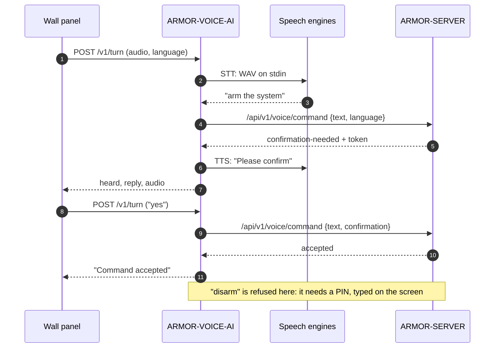

<p align="center">
  
</p>

# 🎙️ ARMOR-VOICE-AI

<p align="center">
  <a href="README.md">🇺🇸 English</a> |
  <a href="README_spa.md">🇪🇸 Español</a> |
  <a href="README_fra.md">🇫🇷 Français</a> |
  <a href="README_ita.md">🇮🇹 Italiano</a> |
  <a href="README_deu.md">🇩🇪 Deutsch</a> |
  <a href="README_zho.md">🇨🇳 简体中文</a> |
  🇯🇵 <b>日本語</b> |
  <a href="README_por.md">🇵🇹 Português</a>
</p>

### 8 言語に対応したオフライン音声インテント。呼び出し側が偽造できない確認つき

<p align="center">
  
  
  
  
  
  
  
</p>

---

**正直さのチェック - 今日動いているもの:** インテントのルール、8 言語、話者に結び付いた署名付き確認、サイレンスのポリシー、ローカルサービス、ターンのエンドポイント、監査は実在し、テストされています（114 件のテスト）。サーバーは CM5 テストベンチ上でこのサービスに問い合わせます。**音声認識・音声合成のエンジンはこのリポジトリに含まれません**：`/v1/turn` は、あなたが設定したコマンドを実行します。そのどれも、実際のマイクではまだ試していません。アシスタントを載せる予定のタッチパネルは、ボード上ではまだ動いていません。

---

## 📋 ひと目で

| | |
|---|---|
| バージョン | `0.3.1` |
| 成熟度 | 確立 |
| 役割 | オフラインの音声・インテントゲートウェイ（ファミリー：Core Services、親：ARMOR-SERVER） |
| 技術 | Python 3.11+、標準ライブラリのみ |
| テスト | 114 (`python -m unittest discover -s tests`) |
| コマンド | 15（問い合わせ 10、操作 5）、420 フレーズ、8 言語 |
| 待ち受け | `127.0.0.1:18090`（ループバックのみ）、トークンつき |
| 動作環境 | CM5 テストベンチ（サービスとして）または任意のコンピューター |
| 実機での確認 | CM5 テストベンチでサービスとして動作し、サーバーから問い合わせを受けています。マイクや音声エンジンは試していません |
| ライセンス | GPL-3.0-or-later |

**移動先：** [概要](#-概要) · [アーキテクチャ](#-アーキテクチャ) · [機能](#-機能) · [セキュリティ](#-セキュリティと安全) · [インターフェース](#-インターフェース) · [設定](#-設定) · [クイックスタート](#-クイックスタート) · [テスト](#-テスト) · [トラブルシューティング](#-トラブルシューティング) · [構成](#-リポジトリの構成) · [関連](#-関連プロジェクト)

## 🚦 プロジェクトの状況

各行はこのリポジトリの一部分で、信号は今日どこまで進んでいるかを示します。計画ではなく、リポジトリが示せるもの（テスト、ビルド、実行）に基づいて書かれています。

🟢 完了・検証済み · 🟡 動作する（既知の制限あり） · 🟠 一部のみ、または未検証 · 🔴 未実装または動作しない

| 領域 | 状態 | ここでの意味 |
|---|---|---|
| ソフトウェア | 🟡 | インテントのルール、ローカルサービス、ターンのエンドポイントは CM5 テストベンチ上でサービスとして動作していますが、音声認識・音声合成のエンジンはリポジトリに含まれません。設定したコマンドを実行します。 |
| テスト | 🟢 | 114 件のテストが通ります（`python -m unittest discover -s tests`）：インテントのルール、8 言語、話者に結び付いた署名付き確認、サイレンスのポリシー、ローカルサービス、ターンのエンドポイント、監査。 |
| ハードウェア | 🔴 | マイクも音声エンジンも試しておらず、アシスタントを載せる予定のタッチパネルもボード上では動いていません。 |
| セキュリティ | 🟡 | 確認は署名され話者に結び付いており、監査はホスト上でテストされています。独立したレビューはありません。 |
| 連携 | 🟡 | サーバーは CM5 テストベンチ上でこのサービスに問い合わせます。タッチパネルとの音声フローはまだ動いていません。 |
| ドキュメント | 🟢 | 8 言語と変更履歴は最新です。 |

## 🎯 概要

ARMOR-VOICE-AI は A.R.M.O.R. の一部で、**人が話したことを 15 のコマンドのどれか、または何でもないもの**に変換します。自分では何も実行しません。判断するだけで、受け入れられたものは [ARMOR-SERVER](https://github.com/JuanenRac/ARMOR-SERVER) がコンソールでのクリックと同じように認証、認可、実行します。

音声認識器から出てくるテキストは*信頼できない入力*です。そのため解釈もキーワード検索もコマンドとしての転送もしません。まず整形（アクセント、句読点、丁寧な前置き）してから、既知の 420 フレーズのどれかと**完全に一致**しなければなりません。それ以外のもの、長すぎるもの、2 つのコマンドに取れるフレーズは*理解されません*。

**できること**

* 15 のコマンドを **8 言語**（英語、スペイン語、ドイツ語、フランス語、イタリア語、日本語、中国語、ポルトガル語）で理解します。
* `arm` と `disarm` には、インテントと依頼した人に結び付いた、**サービスが署名したトークンを伴う 2 回目のターン**を必要とします。
* ARMOR-SERVER が求めたとき、`silence` に音声での **PIN** または確認の 2 回目のターンを必要とさせることができます。
* **ローカル HTTP サービス**として、またアダプターとテスト用の **JSON Lines ゲートウェイ**として動作します。
* 壁面パネルから **1 ターン分の音声**を受け取り、設定した音声エンジンを実行して、テキストで、音声合成器があれば音声でも応答します。
* 記録するのは**判断だけで、音声も言葉も残しません**：書き起こしの SHA-256 のみです。

**できないこと**

* 音声の認識も合成もしません。それは設備が選ぶプログラムです。
* 警戒、解除、サイレンスは一切しません。受け入れられたコマンドは ARMOR-SERVER への推奨です。
* 壁面パネルからの解除は一切行いません。PIN は画面で入力するもので、声には出しません。

## 🧩 A.R.M.O.R. での役割

[ARMOR-SERVER](https://github.com/JuanenRac/ARMOR-SERVER) がこのサービスに問い合わせ、その後 [ARMOR-STUDIO](https://github.com/JuanenRac/ARMOR-STUDIO) でのクリックと同じようにコマンドを認証、認可します。[ARMOR-NODE-HMI](https://github.com/JuanenRac/ARMOR-NODE-HMI) 壁面パネルのマイクの後ろ（プッシュトゥトーク）に置く想定で、[ARMOR-ANDROID-CONTROL](https://github.com/JuanenRac/ARMOR-ANDROID-CONTROL) の文字・音声アシスタントにも応答します。テストベンチでは [ARMOR-DEVOPS](https://github.com/JuanenRac/ARMOR-DEVOPS)（`scripts/install_cm5.sh --with-voice`）がインストールします。

| 連携先 | 方法 | 目的 |
|---|---|---|
| ARMOR-SERVER | 受信：`POST /v1/command`、`POST /v1/turn`。送信：`/api/v1/voice/command` | フレーズの判断。音声ターンの言葉をサーバー自身の音声ルートへ渡す |
| ARMOR-NODE-HMI | 1 ターン分の音声（16 kHz モノラル PCM） | 壁面パネルのマイクとスピーカー |
| ARMOR-ANDROID-CONTROL | サーバー経由 | 文字・音声アシスタント |
| 音声エンジン | 標準入力と標準出力 | 聞く（例：whisper.cpp、Vosk）と話す（例：Piper）。設備が選ぶ |

## 🏛️ アーキテクチャ

<p align="center">
  
</p>

**システムを警戒状態にする音声ターン**（パネルには 2 回尋ね、解除は拒否されます）：

<p align="center">
  
</p>

<details>
<summary>図のテキスト版（Mermaid）</summary>



</details>

**この作りにした理由**

* **インテント分類ではなく閉じたリストにする理由。** 認識器は間違えますし、マイクの近くでは誰でも話せます。420 の正確なフレーズなら、誤った書き起こしが起こせる最悪の事態は無視されることだけで、どのフレーズも 2 つのコマンドに属さないことはテストで確認しています。
* **サービスが判断だけをする理由。** 認証、認可、監査記録、アクションは ARMOR-SERVER の 1 か所にあります。ここのバグはフレーズを誤って受け入れることはあっても、警報には触れられません。
* **確認をサービスが発行する署名付きトークンにする理由。** 呼び出し側が立てるフラグ（`confirmed: true`）は何も証明しないので拒否されます。トークンは HMAC-SHA-256 で署名され、コマンドと人に結び付き、30 秒間有効で、一度だけ使えます。
* **音声エンジンを別プログラムにする理由。** モデルはセキュリティゲートウェイが変わるべき速度より速く変わります。シェルなし、短い環境変数、時間制限つきで実行し、サービス自身のシークレットは決して渡しません。
* **何も保存しない理由。** ログには何が判断されたかが残り、何が話されたかは残りません。

## ✨ 機能

### 15 のコマンド

| コマンド | 種類 | 意味 | 確認 |
|---|---|---|---|
| `status` | 問い合わせ | システムの状態 | なし |
| `alarms` | 問い合わせ | 有効な警報 | なし |
| `nodes` | 問い合わせ | ノードの状態 | なし |
| `cameras` | 問い合わせ | カメラの状態 | なし |
| `radar` | 問い合わせ | レーダーの状態 | なし |
| `solar` | 問い合わせ | ソーラーシステムの状態 | なし |
| `electrical` | 問い合わせ | 電気の消費量 | なし |
| `network` | 問い合わせ | ネットワークの状態 | なし |
| `time` | 問い合わせ | 時刻 | なし |
| `help` | 問い合わせ | 言えること | なし |
| `silence` | 操作 | 警報をサイレンス（確認応答）する | サーバーのポリシーが求める場合のみ（下記参照） |
| `lights_on` | 操作 | 照明をつける | なし |
| `lights_off` | 操作 | 照明を消す | なし |
| `arm` | 操作 | 境界を警戒状態にする | **あり** |
| `disarm` | 操作 | 境界の警戒を解除する | **あり** |

*問い合わせ*の 10 個は何も変更しません。*操作*の 5 個は、このサービスではなく ARMOR-SERVER が、話した人のセッションで実行します。

### 8 言語

英語、スペイン語、ドイツ語、フランス語、イタリア語、日本語、中国語、ヨーロッパポルトガル語：フレーズ（合計 420）、確認の「はい」と「いいえ」、音声 PIN の数字の言葉、そしてサービスが返すすべての文。フレーズは人が言う形で書かれ、モジュールの読み込み時に、聞き取った内容を整形するのと同じ関数で整形されるため、両者がずれることはありません。丁寧な前置き（`please`、`por favor`、`bitte`、`s'il vous plaît`、`per favore`…）は比較の前に取り除かれます。スペースなしで書く日本語と中国語は、丁寧な語尾ありとなしの両方のフレーズを並べています。

### 2 ターンの確認

1. `arm` または `disarm` の最初のターンは**受け入れを返さず**、`confirmation_token` を返します。
2. 2 回目のターンは、同じインテントについて、**同じ人**が、30 秒以内にそのトークンを返します。
3. トークンは呼び出し側が持たないシークレットで署名されるため、偽造も改ざんも、別のインテントや別の人への流用もできません。一度しか使えず、期限内のトークンのノンスは新しいものの場所を空けるために忘れられることはありません（同時に多すぎる場合は、新しいトークンが拒否されます）。

### 音声でのサイレンス、任意の PIN

設備がそれ以上を求めない限り、「Silence」はすぐに受け入れられます。ARMOR-SERVER は設定 `voice.silence_confirmation` を保持し、ポリシーとして送ります：

| モード | 「silence」で起きること |
|---|---|
| `off`（既定。ポリシーが届かないときも） | すぐに渡す |
| `double_turn` | 実行しない。サービスが「はい」と言うよう求め、同じパネルから 15 秒以内の「はい」で元のコマンドを渡す |
| `pin` | 実行しない。サービスが PIN を求め、数字または 8 言語の数字の言葉で話す。20 秒以内の正しい PIN でコマンドを渡す |
| 読み取れない、または未知のポリシー | `double_turn`：壊れた設定が保護をオフにすることはありません |

PIN（4〜12 桁、`ARMOR_VOICE_SILENCE_PIN`）は一定時間で比較され、記録も保存も復唱もされません。PIN を 3 回間違えると、**すべての**パネルで音声によるサイレンスが 5 分間ロックされます。`pin` が求められているのに PIN が設定されていない場合、音声では何もサイレンスされません。完全な仕様は [docs/SILENCE_POLICY.md](docs/SILENCE_POLICY.md) にあります。

### 壁面パネルのターン

`POST /v1/turn` は 1 ターン分の音声を受け取り、音声からテキストへのコマンドを実行し、その言葉を ARMOR-SERVER の音声ルートへ渡して、聞き取った内容、返すべき言葉、そしてテキストから音声へのコマンドが設定されていればその録音を返します。パネルにはキーボードがないため、`arm` の質問はパネルごとに 30 秒間記憶され、次に*はい*（パネルの言語で）と言うターンが確認し、*いいえ*と言うターンが取り消します。サーバーが `disarm` と答えた場合、そのターンは、解除には画面での PIN が必要だと返します。聞き取りに 9 秒を超えるとサーバーには何も問い合わせません（パネルは 12 秒で諦めます）。そのため、人に伝えた内容と家が実際にしたことが食い違うことはありません。

### 判断の記録

`--audit-file` を指定すると、判断ごとに 1 行の JSON を残します：時刻、インテント、結果、書き起こしの SHA-256。音声も言葉も決して残しません。

## 🔒 セキュリティと安全

| 脅威 | 防御 |
|---|---|
| 誤った、または悪意のある書き起こし | 信頼できない入力：整形し、閉じたリストと完全一致、最大 200 文字、曖昧なら*理解しない*。シェルやデバイスのコマンドとして転送することはありません |
| 呼び出し側が確認を主張する | `confirmed` は拒否。サービスが署名したトークンだけが有効 |
| トークンの盗用、リプレイ、再利用 | HMAC-SHA-256 で署名、インテントと人に結び付け、30 秒、一度だけ。時計が戻ってもトークンは発行時刻より長く生きられません |
| 別の人が誰かのトークンを使う | `wrong-subject` |
| サイレンス PIN の推測 | 一定時間での比較、3 回失敗で全パネルを 5 分ロック、PIN がなければフェイルクローズ |
| ネットワーク上の誰かがサービスに到達する | ループバックのみ（`--allow-remote` なしでは他のアドレスを拒否）。16 文字以上のトークンを一定時間で比較。1 リクエスト 2 KB。止まった接続は 15 秒で閉じる |
| 音声エンジンがシークレットを漏らす、悪用する | シェルなし、短い環境変数（`PATH`、`HOME`、`LANG`、`TMPDIR`、`ARMOR_VOICE_ENGINE_*`）、時間制限とサイズ制限。サービスとサーバーのトークンは決して渡さない |
| マシンの枯渇 | 同時に最大 2 ターン（3 つ目は 503）。音声は 480 000 バイトまで |
| ログから話した内容が分かる | 記録しない。監査にはハッシュのみ |
| 古くなったターンが遅れて動く | 9 秒を超えたら何も実行しない（504） |

音声での解除は、壁面パネルからは**決して**行いません。アプリからはサーバーの `ARMOR_DISARM_PIN` に従います（`required` に設定してください）。ここにある何ものも安全機能ではありません。受け入れられたコマンドは推奨であり、ARMOR-SERVER が引き続き認証と認可を行います。完全なルールは [docs/SAFETY.md](docs/SAFETY.md)、脆弱性の報告は [SECURITY.md](SECURITY.md) をお読みください。

## 🔌 インターフェース

### HTTP サービス

| ルート | 認証 | 内容 |
|---|---|---|
| `GET /healthz` | なし | `{"ok": true, "service": "armor-voice"}` |
| `POST /v1/command` | ヘッダー `X-Armor-Voice-Token` | ボディ `{text, language?, confirmation?, subject?, policy?, pin?}`（最大 2 KB）。理解した内容、2 回目のターンが必要なときの `confirmation_token`、要求された言語の `speech` を返す |
| `POST /v1/turn` | 同じヘッダー | ボディ：生の 16 kHz 16 ビットモノラル PCM、`Content-Type: audio/L16;rate=16000`、最大 480 000 バイト。ヘッダー `X-Armor-Language`、`X-Armor-Client`、`X-Armor-Policy`。`{heard, reply, audio?}` を返す |

実際のやり取りの例（トークンは短縮しています）：

```json
{"text": "arm the system", "subject": "u-1"}
{"accepted": false, "requires_confirmation": true, "intent": "arm", "outcome": "confirmation-needed", "confirmation_token": "eyJpIjoiYXJt...", "reason": "say it again with the confirmation within 30 s", "speech": "Please confirm"}

{"text": "arm the system", "subject": "u-1", "confirmation": "eyJpIjoiYXJt..."}
{"accepted": true, "requires_confirmation": false, "intent": "arm", "outcome": "accepted", "speech": "Command accepted"}

{"text": "open the garage"}
{"accepted": false, "requires_confirmation": false, "intent": null, "outcome": "not-understood", "reason": "the phrase is not one of the known commands", "speech": "Command not recognised"}
```

結果：`accepted`、`confirmation-needed`、`confirmation-refused`、`pin-needed`、`pin-refused`、`not-understood`。確認は `invalid`、`expired`、`wrong-intent`、`wrong-subject`、`replayed` として拒否されます。

### `/v1/turn` のステータスコード

| コード | エラー | 意味 |
|---|---|---|
| 200 | | `{heard, reply, audio?}` |
| 401 | `unauthorized` | トークンがない、または誤り |
| 411 / 413 | `bad audio length` | 長さがない、または 480 000 バイト超 |
| 415 | | `audio/L16;rate=16000` ではない |
| 422 | `invalid language` | `en es de fr it ja zh pt` のどれでもない |
| 501 | `stt_unavailable` / `server_not_configured` | 音声からテキストへのコマンドがない、またはサーバーのアドレスがない |
| 502 | `engine_failed` / `server_<code>` / `server_not_answering` | 音声エンジンまたはサーバーが失敗した |
| 503 | `busy` | すでに 2 ターンが実行中 |
| 504 | `turn_too_slow` | 音声エンジンに時間がかかりすぎてサーバーに問い合わせなかった。何も実行されていない |

### JSON Lines ゲートウェイ

`python -m armor_voice_ai.gateway` は標準入力から 1 行に 1 つの JSON オブジェクトを読み、応答を標準出力に書きます（1 行 2 KB。UTF-8 でないバイトを含む行も他の行と同じ扱いです）。これは同じ閉じたゲートウェイで、音声アダプターとテスト用です。

### ARMOR-SERVER とのコントラクト

* サーバーはすべてのリクエストでサイレンスのポリシーを送ります：`/v1/command` ではボディの `policy`（`pin` モードでは `pin` も）、`/v1/turn` ではヘッダー `X-Armor-Policy`（最大 256 バイトの JSON オブジェクト）です。
* サーバーの音声ルートは、音声ターンの言葉を `/api/v1/voice/command` で、設備のオペレータートークンを使い、各パネルの名前（`X-Armor-Client`）で受け取ります。
* 詳細：[docs/SERVICE.md](docs/SERVICE.md)、[docs/SILENCE_POLICY.md](docs/SILENCE_POLICY.md)。

## ⚙️ 設定

### 環境変数

| 変数 | 必要 | 設定する内容 |
|---|---|---|
| `ARMOR_VOICE_TOKEN` | はい（16 文字以上） | 呼び出し側が `X-Armor-Voice-Token` で送るトークン（または `--token-file` のファイル内の `ARMOR_VOICE_TOKEN=...` という行） |
| `ARMOR_VOICE_CONFIRM_SECRET` | 推奨（16 バイト以上） | 確認に署名する。ない場合はランダムなシークレットが使われ、保留中の確認はプロセス停止時に失われる |
| `ARMOR_VOICE_STT_COMMAND` | `/v1/turn` に必要 | 音声からテキストへのプログラム：標準入力に音声（WAV）、標準出力に言葉 |
| `ARMOR_VOICE_TTS_COMMAND` | 任意 | テキストから音声へのプログラム：標準入力にテキスト、標準出力に 16 kHz 16 ビットモノラルの WAV |
| `ARMOR_VOICE_SERVER_URL`, `ARMOR_VOICE_SERVER_TOKEN` | `/v1/turn` に必要 | ARMOR-SERVER と、その音声ルート用のオペレータートークン |
| `ARMOR_VOICE_SILENCE_PIN` | `pin` モードに必要 | 4〜12 桁。無効な値だと値を出力せずに起動時にサービスが停止する |
| `ARMOR_VOICE_ENGINE_*` | 任意 | 音声エンジンへ渡される（ターンごとに設定される `ARMOR_VOICE_LANGUAGE` とともに） |

### コマンドライン

| フラグ | 既定値 | |
|---|---|---|
| `--host` | `127.0.0.1` | 待ち受けるアドレス。ループバック以外は `--allow-remote` なしでは拒否される |
| `--port` | `18090` | |
| `--token-file` | | `ARMOR_VOICE_TOKEN=...` の行を持つファイル |
| `--audit-file` | | 判断ごとに 1 行を追記する |
| `--allow-remote` | オフ | ループバック以外のアドレスで待ち受ける（非推奨。TLS の背後でのみ） |

### コードにある制限

| 制限 | 値 |
|---|---|
| 確認の有効期間 | 30 s |
| パネルごとに記憶される音声の質問 | 30 s |
| サイレンスの質問後の「はい」 / 求めた後の PIN | 15 s / 20 s |
| ロックまでの PIN 試行回数 / ロック時間 | 3 / 5 min |
| ターンの持ち時間 / パネルが諦めるまで | 9 s / 12 s |
| 音声エンジンの時間制限 | 25 s |
| 最大の音声 / 最大の応答音声 | 480 000 バイト / 190 000 バイト |
| リクエストボディ（`/v1/command`） | 2 KB |
| 書き起こしの長さ | 200 文字 |
| 同時ターン数 | 2 |

設定にかかわらず、サービスは話された内容をログに書きません。

## 🚀 クイックスタート

**要件：** Python 3.11+（標準ライブラリのみ）。任意：`/v1/turn` 用の音声からテキストへのプログラムとテキストから音声へのプログラム。

```powershell
$env:PYTHONPATH = "src"

# 1. テスト
python -m unittest discover -s tests                      # 114 件のテスト

# 2. ゲートウェイ、1 行に 1 つの JSON オブジェクト
echo '{"text":"arm the system"}' | python -m armor_voice_ai.gateway

# 3. ローカル HTTP サービス（ループバックのみ）
$env:ARMOR_VOICE_TOKEN = "a-token-of-at-least-16-characters"
python -m armor_voice_ai.service --port 18090
```

```sh
curl -s http://127.0.0.1:18090/v1/command \
  -H "X-Armor-Voice-Token: $ARMOR_VOICE_TOKEN" \
  -d '{"text":"status","language":"de"}'
# {"accepted":true,"requires_confirmation":false,"intent":"status","outcome":"accepted","speech":"Befehl akzeptiert"}
```

聞いて話す（`/v1/turn`）には、サービスを自分のエンジンとサーバーに向けます：

```sh
export ARMOR_VOICE_STT_COMMAND="/opt/armor/bin/hear"        # 標準入力に WAV、標準出力に言葉
export ARMOR_VOICE_TTS_COMMAND="/opt/armor/bin/speak"       # 標準入力にテキスト、標準出力に WAV
export ARMOR_VOICE_SERVER_URL="https://armor-server.local"
export ARMOR_VOICE_SERVER_TOKEN="..."
python -m armor_voice_ai.service --token-file /opt/armor/etc/armor.voice.env
```

壁面パネルはネットワーク上のデバイスで、サービスはループバックでしか待ち受けません。サーバーのプロキシがターンを転送するか、TLS の背後で `--allow-remote` を使います。トークンと音声は平文でネットワークを通してはいけません。

`run.bat` / `run.sh` と `build.bat` / `build.sh` は、[ARMOR-COMMON](https://github.com/JuanenRac/ARMOR-COMMON) の共通プロジェクトワークフローを起動します（リポジトリは並べて置きます）。pip を使う場合は `armor-voice-gateway` コマンドが使えます。

## 🧪 テスト

```powershell
$env:PYTHONPATH = "src"
python -m unittest discover -s tests
python -I tools/armor_ci_validate.py        # マニフェスト、バージョン、変更履歴、README の整合
```

| テストファイル | テスト数 | 対象 |
|---|---|---|
| `test_silence.py` | 31 | サイレンスのポリシー、8 言語の音声 PIN、ロック |
| `test_edges.py` | 29 | 行プロトコル、サービスの設定、サーバーとの接続（ループバック上の代役）、エンジンの制限 |
| `test_gateway.py` | 23 | ゲートウェイ、確認、リプレイと偽造 |
| `test_turn.py` | 15 | ターン、エンジン、音声の「はい」と「いいえ」、時間の持ち時間 |
| `test_languages.py` | 11 | 正規形のフレーズ、2 つのコマンドに属するフレーズがないこと、各言語で警戒、解除、問い合わせ、サイレンスができること |
| `test_service.py` | 5 | HTTP ルート |

GitHub Actions は、push と pull request のたびに A.R.M.O.R. のベースラインを実行します：マニフェスト、バージョン、変更履歴、README の整合の検証に続き、プロジェクト自身のビルドとテストです。

## 🏗️ ビルドとリリース

純粋な Python なので、コンパイルするものはありません。バージョンは `pyproject.toml`、`armor.project.json`、README のバッジ（マニフェストから読み取り）にあり、各バージョンには [CHANGELOG.md](CHANGELOG.md) にエントリーがあります。リリースは GitHub で公開されます。

## 🩺 トラブルシューティング

| 表示 | 原因 | 対処 |
|---|---|---|
| `refusing to listen on a non-loopback address without --allow-remote` | `--host` が `127.0.0.1`、`::1`、`localhost` ではない | ループバックのままにしてサーバーのプロキシに転送させるか、TLS の背後で `--allow-remote` を追加する |
| `a token of at least 16 characters is needed` | `ARMOR_VOICE_TOKEN` がない、または短い | 設定するか、`--token-file` を使う |
| `ARMOR_VOICE_SILENCE_PIN is not valid` | 4〜12 桁の ASCII 数字ではない | 値を直す（出力されることはありません） |
| `ARMOR_VOICE_CONFIRM_SECRET is not set`（警告） | ランダムなシークレットが使われている | 確認を再起動後も残したいなら、16 バイト以上のシークレットを設定する |
| 401 `unauthorized` | `X-Armor-Voice-Token` がない、または誤り | トークンを送る |
| 501 `stt_unavailable` | `ARMOR_VOICE_STT_COMMAND` が未設定 | 音声からテキストへのプログラムを設定する |
| 501 `server_not_configured` | サーバーのアドレスまたはトークンがない | `ARMOR_VOICE_SERVER_URL` と `ARMOR_VOICE_SERVER_TOKEN` を設定する |
| 502 `engine_failed` | エンジンが失敗した、タイムアウトした、または出力が多すぎた（あるいはテキストから音声への WAV が 16 kHz 16 ビットモノラルではない） | 同じ入力で手動実行してみる |
| 504 `turn_too_slow` | 音声エンジンが 9 秒以上かかった | より速いモデルを使う。何も実行されていない |
| "Disarming needs your PIN" | パネルからの音声による解除は一切行われない | 画面を使う |
| 話した「はい」が何も起こさない | 質問が記憶されていなかった（質問に 12 秒超かかった、30 秒以上経過した、または別のパネルが答えた） | コマンドをもう一度言う |

## 📂 リポジトリの構成

<p align="center">
  
</p>

<details>
<summary>ツリーのテキスト版</summary>

```text
ARMOR-VOICE-AI/
├── src/armor_voice_ai/        コード（標準ライブラリのみ）
│   ├── phrases.py             15 のコマンドの 420 フレーズ、8 言語
│   ├── intent.py              整形と完全一致：閉じた許可リスト
│   ├── confirmation.py        署名付き・一度限り・人ごとの確認トークン
│   ├── silence_policy.py      off / pin / double_turn、音声 PIN、ロック
│   ├── session.py             コマンドごとの 2 ターンのルール
│   ├── gateway.py             stdin/stdout の JSON Lines、監査、返す文
│   ├── service.py             ローカル HTTP サービス（/healthz、/v1/command、/v1/turn）
│   └── turn.py                1 回の音声ターン：エンジン、はい/いいえ、時間の持ち時間
├── tests/                     114 件のテスト：サイレンス、エッジ、ゲートウェイ、ターン、言語、サービス
├── docs/                      SAFETY.md, SERVICE.md, SILENCE_POLICY.md
├── tools/                     共通の CI チェックとプロジェクトのツール
├── images/                    バナーとアイコン
├── .github/                   CI ワークフロー、ダッシュボード通知、Issue と Pull Request のテンプレート
├── armor.project.json         マニフェスト：バージョン、役割、成熟度、ビルドコマンド
├── pyproject.toml             パッケージのメタデータと `armor-voice-gateway` コマンド
├── run.sh run.bat             共通プロジェクトワークフローで起動
├── build.sh build.bat         共通プロジェクトワークフローでビルドとテスト
├── CHANGELOG.md               各バージョンの変更点
└── SECURITY.md SUPPORT.md CONTRIBUTING.md CODE_OF_CONDUCT.md LICENSE
```

</details>

## 🗺️ ロードマップと既知の制限

**現時点の既知の制限**

* 音声エンジンは同梱されておらず、実際のマイクでどれも試していません。
* アシスタントを載せる予定のタッチパネルはボード上でまだ動いていません。ウェイクワードはなく、プッシュトゥトークです。
* ターンは*どのパネルか、誰か*が話したかを伝えません。ARMOR-SERVER は渡されたトークンで判断します。これらをリクエストに加えるのは、サーバーとパネルの間のコントラクトの変更です。
* 独立したセキュリティレビューはありません。

**今後**

* CM5 テストベンチで、実際のマイクと実際の音声エンジンを試す。
* タッチパネルがボード上で動いたら、それとの音声フローを動かす。
* 任意の認証済み話者または物理的な確認。将来の導入で追加されるかもしれませんが、署名付き確認は、文書化されたリスクレビューなしには取り除きません。

## 🌍 言語

README とテキストは、英語、スペイン語、フランス語、イタリア語、ドイツ語、中国語、日本語、ヨーロッパポルトガル語で提供されています。サービスが返すすべての文、すべての音声コマンド、すべての「はい」と「いいえ」、PIN のすべての数字の言葉が、8 言語すべてに存在します。

## 🔗 関連プロジェクト

**A.R.M.O.R.**（Autonomous Radar & Multimodal Observation Range）は、独立したリポジトリで構成される境界セキュリティシステムです。各リポジトリは独自のバージョン、テスト、README を持ちます。ファミリーは次のとおりです：

* **[ARMOR-COMMON](https://github.com/JuanenRac/ARMOR-COMMON)** - メッセージのコントラクト、バリデーター、適合ベクトル、生成された型
* **[ARMOR-NODE-RADAR](https://github.com/JuanenRac/ARMOR-NODE-RADAR)** - 3 つのレーダーと独自の Web パネルを備えた ESP32-S3 向けフィールドノードのファームウェア
* **[ARMOR-NODE-SOLAR](https://github.com/JuanenRac/ARMOR-NODE-SOLAR)** - ソーラーインバーターとバッテリーのプロトコル、ゲートウェイノードのメッセージ
* **[ARMOR-NODE-ELECTRICAL](https://github.com/JuanenRac/ARMOR-NODE-ELECTRICAL)** - 電気ノード：メーター、系統の読み取り値のメッセージ、切り替えのルール
* **[ARMOR-NODE-ALARM](https://github.com/JuanenRac/ARMOR-NODE-ALARM)** - 警報ノードとパネル：ゾーン、警戒、遅延、サイレン、PIN。サーバーありでもなしでも動作
* **[ARMOR-NODE-HMI](https://github.com/JuanenRac/ARMOR-NODE-HMI)** - タッチパネル：壁面画面でのシステムの状態、警戒と確認応答、そして音声アシスタントの置き場
* **[ARMOR-NETWORK](https://github.com/JuanenRac/ARMOR-NETWORK)** - ローカルネットワーク：そのデバイス、インターネット、そして変化
* **[ARMOR-SERVER](https://github.com/JuanenRac/ARMOR-SERVER)** - 中央コーディネーター：テレメトリ、警報、デバイス、ソーラーの読み取り値、カメラ
* **[ARMOR-STUDIO](https://github.com/JuanenRac/ARMOR-STUDIO)** - Web コンソール：カメラ、レーダー、警報、太陽光エネルギー、2D/3D のサイトデザイナー
* **[ARMOR-ANDROID-CONTROL](https://github.com/JuanenRac/ARMOR-ANDROID-CONTROL)** - ライブの 2D/3D レーダーを備えた Android オペレータークライアント
* **[ARMOR-IOS-CONTROL](https://github.com/JuanenRac/ARMOR-IOS-CONTROL)** - iPhone オペレータークライアント
* **[ARMOR-SERVER-AI](https://github.com/JuanenRac/ARMOR-SERVER-AI)** - 判断を説明し、決して作動させない視覚推論ポリシー
* **[ARMOR-VISION](https://github.com/JuanenRac/ARMOR-VISION)** - Jetson Orin NX 向けのカメラゾーン、マスク、検出ルール
* **ARMOR-VOICE-AI**（このリポジトリ） - 偽造できない確認つきのオフライン音声インテント
* **[ARMOR-HARDWARE](https://github.com/JuanenRac/ARMOR-HARDWARE)** - 筐体、電子回路、ベンチ受け入れマトリクス
* **[ARMOR-DEVOPS](https://github.com/JuanenRac/ARMOR-DEVOPS)** - デプロイ、CM5 テストベンチ、バックアップ、TLS
* **[ARMOR-SIMULATOR](https://github.com/JuanenRac/ARMOR-SIMULATOR)** - 再現可能な障害を持つオフラインのテレメトリシミュレーター
* **[ARMOR-UPDATER](https://github.com/JuanenRac/ARMOR-UPDATER)** - エコシステム自身のリポジトリを検出、インストール、更新
* **[ARMOR-DOCS](https://github.com/JuanenRac/ARMOR-DOCS)** - アーキテクチャ、セキュリティのベースライン、機能マトリクス

## 📚 ドキュメント

* [音声の安全性](docs/SAFETY.md)：何が理解されるか、確認、壁面パネルのターン、何が記録されるか
* [サービス](docs/SERVICE.md)：ルート、ステータスコード、設定
* [音声でのサイレンス](docs/SILENCE_POLICY.md)：ポリシーのコントラクトと PIN
* [機能マトリクス：何が証明され、何が証明されていないか](https://github.com/JuanenRac/ARMOR-DOCS/blob/main/docs/CAPABILITY_MATRIX.md)
* [プロジェクトカタログ：バージョンと、リポジトリ同士の依存関係](https://github.com/JuanenRac/ARMOR-DOCS/blob/main/docs/PROJECT_CATALOG.md)
* [このリポジトリの変更履歴](CHANGELOG.md)

## 🤝 コントリビュートとコミュニティ

* Pull Request の前に `python -I tools/armor_ci_validate.py` とテストを実行してください。どちらも通る必要があります。[CONTRIBUTING.md](CONTRIBUTING.md) と[行動規範](CODE_OF_CONDUCT.md)を参照してください。
* README は 8 言語で提供され、ARMOR-DOCS のソースから生成されます。文面の変更はそちらで行います。
* コンポーネント間のメッセージの変更は ARMOR-COMMON から始めます。
* ビルドしただけのものを、ボード上で動いているかのように書かないでください。
* 脆弱性は非公開で報告してください：[SECURITY.md](SECURITY.md)。質問、アイデア、報告：electrohobby3d@gmail.com（[SUPPORT.md](SUPPORT.md)）。

## 👤 作者

**JuanenRac (Electro Hobby 3D)** · electrohobby3d@gmail.com

## 📜 ライセンス

GPL-3.0-or-later - [LICENSE](LICENSE) を参照してください。
