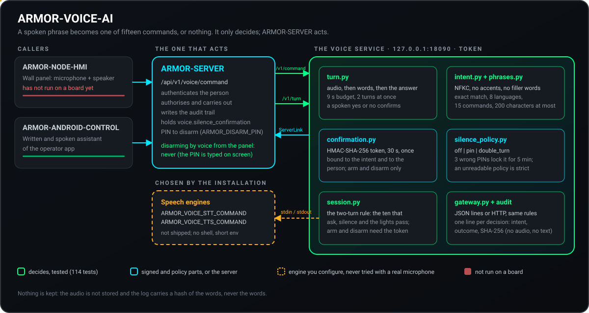
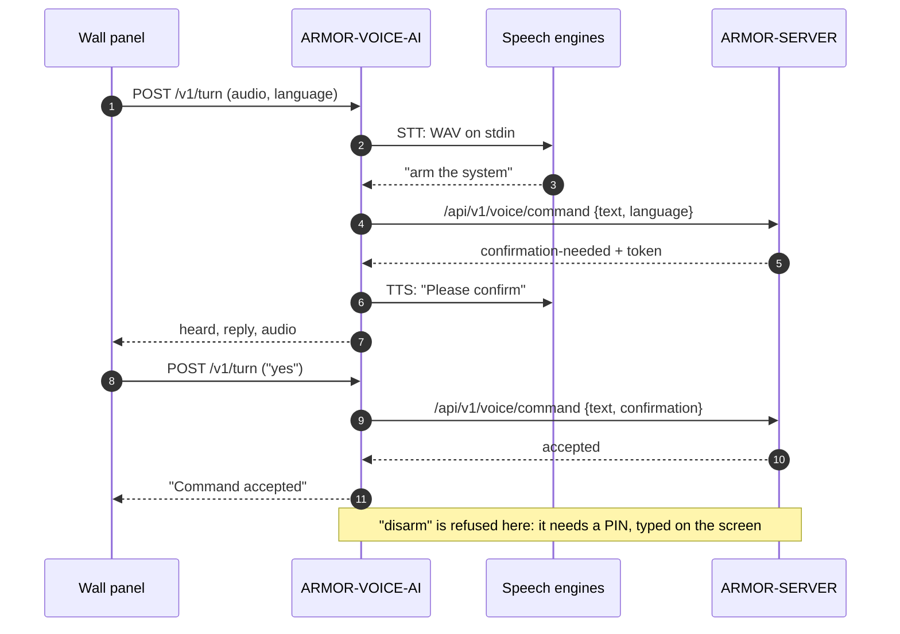
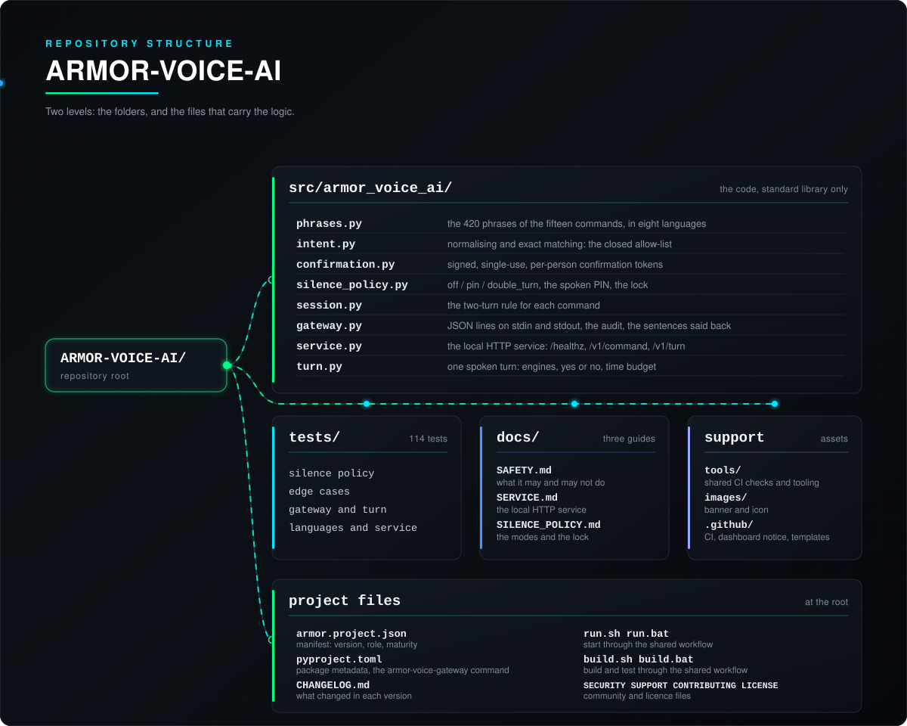

<p align="center">
  
</p>

# 🎙️ ARMOR-VOICE-AI

<p align="center">
  <a href="README.md">🇺🇸 English</a> |
  <a href="README_spa.md">🇪🇸 Español</a> |
  <a href="README_fra.md">🇫🇷 Français</a> |
  <a href="README_ita.md">🇮🇹 Italiano</a> |
  <a href="README_deu.md">🇩🇪 Deutsch</a> |
  <a href="README_zho.md">🇨🇳 简体中文</a> |
  <a href="README_jpn.md">🇯🇵 日本語</a> |
  🇵🇹 <b>Português</b>
</p>

### Intenções de voz offline em oito idiomas, com uma confirmação que quem chama não consegue falsificar

<p align="center">
  
  
  
  
  
  
  
</p>

---

**Verificação de honestidade - o que funciona hoje:** As regras de intenção, os oito idiomas, a confirmação assinada ligada a quem fala, a política de silenciamento, o serviço local, o ponto de entrada de turnos e a auditoria são reais e estão testados (118 testes), e o servidor consulta o serviço na bancada de testes do CM5. **Nenhum motor de reconhecimento ou de síntese de voz faz parte deste repositório**: o `/v1/turn` executa os comandos que configurar para isso, e nenhum foi ainda experimentado com um microfone real; o painel tátil que deverá acolher o assistente não funcionou numa placa.

---

## 📋 Num relance

| | |
|---|---|
| Versão | `0.3.1` |
| Maturidade | Estabelecido |
| Função | Porta de ligação de voz e intenções offline (família: Core Services, pai: ARMOR-SERVER) |
| Tecnologia | Python 3.11+, apenas biblioteca padrão |
| Testes | 118 (`python -m unittest discover -s tests`) |
| Comandos | 15 (10 que consultam, 5 que atuam), 420 frases, 8 idiomas |
| Escuta em | `127.0.0.1:18090` (apenas loopback), com token |
| Funciona em | A bancada de testes do CM5 (como serviço) ou em qualquer computador |
| Em hardware real | Funciona como serviço na bancada do CM5, consultado pelo servidor; não se experimentou nenhum microfone nem motor de voz |
| Licença | GPL-3.0-or-later |

**Ir para:** [Visão geral](#-visão-geral) · [Arquitetura](#-arquitetura) · [Funcionalidades](#-funcionalidades) · [Segurança](#-segurança-e-proteção) · [Interfaces](#-interfaces) · [Configuração](#-configuração) · [Início rápido](#-início-rápido) · [Testes](#-testes) · [Problemas](#-resolução-de-problemas) · [Estrutura](#-estrutura-do-repositório) · [Relacionados](#-projetos-relacionados)

## 🚦 Estado do projeto

Cada linha é uma parte deste repositório e a luz diz até onde chega hoje. É escrita com o que o repositório consegue demonstrar (testes, compilações, execuções), não com o que está previsto.

🟢 Feito e verificado · 🟡 Funciona, com limites conhecidos · 🟠 Feito a meio ou ainda por verificar · 🔴 Por fazer ou a não funcionar

| Área | Estado | O que significa aqui |
|---|---|---|
| Software | 🟡 | As regras de intenção, o serviço local e o ponto de entrada de turnos funcionam como serviço na bancada de testes do CM5, mas nenhum motor de reconhecimento ou de síntese de voz faz parte do repositório: executa os comandos que configurar para isso. |
| Testes | 🟢 | Passam 118 testes (`python -m unittest discover -s tests`): as regras de intenção, os oito idiomas, a confirmação assinada ligada a quem fala, a política de silenciamento, o serviço local, o ponto de entrada de turnos e a auditoria. |
| Hardware | 🔴 | Não se experimentou nenhum microfone nem motor de voz, e o painel tátil que deverá acolher o assistente não funcionou numa placa. |
| Segurança | 🟡 | A confirmação é assinada e ligada a quem fala, e a auditoria é testada no equipamento anfitrião; não houve revisão independente. |
| Integração | 🟡 | O servidor consulta o serviço na bancada de testes do CM5; o fluxo de voz com o painel tátil não funcionou. |
| Documentação | 🟢 | Os oito idiomas e o registo de alterações estão atualizados. |

## 🎯 Visão geral

O ARMOR-VOICE-AI é a parte do A.R.M.O.R. que transforma **o que uma pessoa diz num de quinze comandos, ou em nada**. Nunca faz nada por si: decide, e o [ARMOR-SERVER](https://github.com/JuanenRac/ARMOR-SERVER) autentica, autoriza e executa o que foi aceite, exatamente como faria com um clique na consola.

O texto que sai de um reconhecedor de voz é *entrada não fiável*. Por isso não é interpretado, não se procuram palavras-chave nele nem é reenviado como comando: é limpo (acentos, pontuação, fórmulas de cortesia) e tem então de ser **exatamente** uma de 420 frases conhecidas. Qualquer outra coisa, qualquer texto demasiado longo e qualquer frase que pudesse significar dois comandos *não é compreendida*.

**O que faz**

* Compreende quinze comandos em **oito idiomas** (inglês, espanhol, alemão, francês, italiano, japonês, chinês e português).
* Faz com que `arm` e `disarm` precisem de um **segundo turno com um token que o serviço assinou**, ligado à intenção e a quem a pediu.
* Pode fazer com que `silence` precise de um **PIN** falado ou de um segundo turno de confirmação, quando o ARMOR-SERVER o pede.
* Funciona como **serviço HTTP local** e como **porta de ligação de linhas JSON** para adaptadores e testes.
* Recebe o **áudio de um turno** do painel de parede, executa os motores de voz que configurar e responde em texto e, com um sintetizador, em áudio.
* Regista **decisões, nunca áudio nem palavras**: um SHA-256 da transcrição.

**O que não faz**

* Não reconhece nem sintetiza voz: são programas que a instalação escolhe.
* Não arma, não desarma nem silencia nada: um comando aceite é uma recomendação para o ARMOR-SERVER.
* Não desarma de todo a partir do painel de parede: o PIN digita-se no ecrã, nunca se diz em voz alta.

## 🧩 Papel no A.R.M.O.R.

O [ARMOR-SERVER](https://github.com/JuanenRac/ARMOR-SERVER) consulta este serviço e depois autentica e autoriza o comando como faria com um clique no [ARMOR-STUDIO](https://github.com/JuanenRac/ARMOR-STUDIO). Destina-se a viver atrás do microfone do painel de parede [ARMOR-NODE-HMI](https://github.com/JuanenRac/ARMOR-NODE-HMI) (premir para falar) e responde ao assistente escrito e falado do [ARMOR-ANDROID-CONTROL](https://github.com/JuanenRac/ARMOR-ANDROID-CONTROL). Na bancada de testes é instalado pelo [ARMOR-DEVOPS](https://github.com/JuanenRac/ARMOR-DEVOPS) (`scripts/install_cm5.sh --with-voice`).

| Fala com | Como | Para quê |
|---|---|---|
| ARMOR-SERVER | entram `POST /v1/command` e `POST /v1/turn`; sai `/api/v1/voice/command` | Decidir uma frase; passar as palavras de um turno falado à rota de voz do servidor |
| ARMOR-NODE-HMI | áudio de um turno (PCM mono a 16 kHz) | O microfone e o altifalante do painel de parede |
| ARMOR-ANDROID-CONTROL | através do servidor | O assistente escrito e falado |
| Motores de voz | entrada e saída padrão | Ouvir (p. ex. whisper.cpp, Vosk) e falar (p. ex. Piper); escolhidos pela instalação |

## 🏛️ Arquitetura

<p align="center">
  
</p>

**Um turno falado que arma o sistema** (ao painel pergunta-se duas vezes, e desarmar é recusado):

<p align="center">
  
</p>

<details>
<summary>Versão em texto do diagrama (Mermaid)</summary>



</details>

**Porque é construído assim**

* **Porquê uma lista fechada e não classificação de intenções.** Um reconhecedor engana-se e qualquer pessoa pode falar perto de um microfone. Com 420 frases exatas, o pior que uma transcrição errada pode fazer é ser ignorada, e um teste verifica que nenhuma frase pertence a dois comandos.
* **Porquê o serviço apenas decide.** A autenticação, a autorização, o registo de auditoria e a ação ficam num único sítio, o ARMOR-SERVER; uma falha aqui pode aceitar mal uma frase, mas não consegue tocar num alarme.
* **Porquê a confirmação é um token assinado emitido pelo serviço.** Uma marca que quem chama define (`confirmed: true`) não prova nada, pelo que é recusada. O token é assinado com HMAC-SHA-256, ligado ao comando e à pessoa, válido durante 30 segundos e utilizável uma só vez.
* **Porquê os motores de voz são programas separados.** Os modelos mudam mais depressa do que uma porta de ligação de segurança deve mudar. Executam-se sem shell, com um ambiente reduzido e um limite de tempo, e os segredos do próprio serviço nunca lhes chegam.
* **Porquê não se guarda nada.** O registo mostra o que foi decidido sem guardar o que foi dito.

## ✨ Funcionalidades

### Os quinze comandos

| Comando | Tipo | Significado | Confirmação |
|---|---|---|---|
| `status` | consulta | O estado do sistema | não |
| `alarms` | consulta | Os alarmes que estão ativos | não |
| `nodes` | consulta | O estado dos nós | não |
| `cameras` | consulta | O estado das câmaras | não |
| `radar` | consulta | O estado dos radares | não |
| `solar` | consulta | O estado do sistema solar | não |
| `electrical` | consulta | O consumo elétrico | não |
| `network` | consulta | O estado da rede | não |
| `time` | consulta | A hora | não |
| `help` | consulta | O que se pode dizer | não |
| `silence` | atua | Silenciar (reconhecer) os alarmes | só se a política do servidor o pedir (ver abaixo) |
| `lights_on` | atua | Ligar as luzes | não |
| `lights_off` | atua | Desligar as luzes | não |
| `arm` | atua | Armar o perímetro | **sim** |
| `disarm` | atua | Desarmar o perímetro | **sim** |

Os dez que *consultam* não alteram nada. Os cinco que *atuam* são executados pelo ARMOR-SERVER com a sessão da pessoa que falou, nunca por este serviço.

### Oito idiomas

Inglês, espanhol, alemão, francês, italiano, japonês, chinês e português europeu: as frases (420 no total), o sim e o não de uma confirmação, as palavras dos dígitos de um PIN falado e cada frase que o serviço diz em resposta. As frases escrevem-se como uma pessoa as diz e normalizam-se quando o módulo carrega, com a mesma função que normaliza o que se ouve, para que as duas não se possam afastar. As fórmulas de cortesia (`please`, `por favor`, `bitte`, `s'il vous plaît`, `per favore`...) são descartadas antes de comparar; o japonês e o chinês, escritos sem espaços, listam as suas frases com e sem a terminação cortês.

### A confirmação em dois turnos

1. O primeiro turno de `arm` ou `disarm` devolve **nenhuma aceitação** e um `confirmation_token`.
2. O segundo turno repete esse token para a mesma intenção, **da mesma pessoa**, em 30 segundos.
3. O token é assinado com um segredo que quem chama não tem, pelo que não pode ser falsificado, alterado nem passado para outra intenção ou outra pessoa; funciona uma só vez e os identificadores únicos dos que ainda não expiraram nunca são esquecidos para dar lugar a novos (quando há demasiados em simultâneo, o novo token é recusado).

### Silenciar por voz, com PIN opcional

"Silence" é aceite de imediato, a menos que a instalação peça mais. O ARMOR-SERVER guarda a definição `voice.silence_confirmation` e envia-a como política:

| Modo | O que acontece com "silence" |
|---|---|
| `off` (por omissão, e quando não chega política) | Passa-se de imediato |
| `double_turn` | Não se executa; o serviço pede para dizer sim, e um sim em 15 s vindo do mesmo painel passa o comando original |
| `pin` | Não se executa; o serviço pede o PIN, dito em dígitos ou em palavras de dígitos nos oito idiomas; o PIN certo em 20 s passa o comando |
| política ilegível ou desconhecida | `double_turn`: uma definição estragada nunca desliga uma proteção |

O PIN (de 4 a 12 dígitos, `ARMOR_VOICE_SILENCE_PIN`) é comparado em tempo constante e nunca é registado, guardado nem repetido. Três PIN errados bloqueiam o silenciamento por voz em **todos** os painéis durante cinco minutos; com o modo `pin` pedido e nenhum PIN configurado, nada é silenciado por voz. O contrato completo está em [docs/SILENCE_POLICY.md](docs/SILENCE_POLICY.md).

### O turno do painel de parede

`POST /v1/turn` recebe o áudio de um turno, executa o comando de voz para texto, entrega as palavras à rota de voz do ARMOR-SERVER e responde com o que foi ouvido, o que há a dizer e, quando há um comando de texto para voz configurado, uma gravação da resposta. O painel não tem teclado, pelo que a pergunta de `arm` é recordada por painel durante 30 segundos e o turno seguinte que disser *sim* (no idioma do painel) confirma-a e o que disser *não* cancela-a. Se o servidor responder `disarm`, o turno responde que desarmar precisa do PIN no ecrã. Passados nove segundos de escuta não se consulta o servidor (o painel desiste aos doze), pelo que o que se disse à pessoa e o que a casa fez não se podem contradizer.

### Decisões registadas

Com `--audit-file`, uma linha JSON por decisão: hora, intenção, resultado e o SHA-256 da transcrição. Nunca áudio e nunca as palavras.

## 🔒 Segurança e proteção

| Ameaça | Defesa |
|---|---|
| Uma transcrição errada ou hostil | Entrada não fiável: normalizada, correspondência exata com uma lista fechada, 200 carateres no máximo, o ambíguo *não é compreendido*; nunca é reenviada como comando de shell ou de dispositivo |
| Quem chama alega uma confirmação | `confirmed` é recusado; só conta um token que o serviço assinou |
| Um token é roubado, repetido ou reutilizado | Assinado com HMAC-SHA-256, ligado à intenção e à pessoa, 30 s, uso único; um token não pode viver mais do que a sua emissão, mesmo que o relógio recue |
| Outra pessoa usa o token de alguém | `wrong-subject` |
| Adivinhar o PIN de silenciamento | Comparação em tempo constante, 3 tentativas e depois 5 minutos de bloqueio em todos os painéis, falha em segurança sem PIN |
| Alguém na rede alcança o serviço | Apenas loopback (recusa outro endereço sem `--allow-remote`); token de pelo menos 16 carateres comparado em tempo constante; 2 KB por pedido; uma ligação que bloqueia é fechada ao fim de 15 s |
| Um motor de voz divulga ou abusa de segredos | Executado sem shell, com ambiente reduzido (`PATH`, `HOME`, `LANG`, `TMPDIR`, `ARMOR_VOICE_ENGINE_*`), limite de tempo e de tamanho; os tokens do serviço e do servidor nunca lhe chegam |
| Esgotar a máquina | No máximo dois turnos em simultâneo (um terceiro recebe 503); áudio limitado a 480 000 bytes |
| Os registos revelam o que foi dito | Nunca se regista; a auditoria só tem um hash |
| Um turno antigo atua tarde | Passados nove segundos não se executa nada (504) |

Desarmar por voz **nunca** se faz a partir do painel de parede. A partir da app segue o `ARMOR_DISARM_PIN` do servidor (defina-o como `required`). Nada disto é uma função de segurança: um comando aceite é uma recomendação que o ARMOR-SERVER ainda autentica e autoriza. Leia [docs/SAFETY.md](docs/SAFETY.md) para as regras completas e [SECURITY.md](SECURITY.md) para comunicar uma vulnerabilidade.

## 🔌 Interfaces

### Serviço HTTP

| Rota | Autenticação | O que faz |
|---|---|---|
| `GET /healthz` | nenhuma | `{"ok": true, "service": "armor-voice"}` |
| `POST /v1/command` | cabeçalho `X-Armor-Voice-Token` | Corpo `{text, language?, confirmation?, subject?, policy?, pin?}` (2 KB no máximo). Responde o que foi compreendido, um `confirmation_token` quando é preciso um segundo turno e `speech` no idioma pedido |
| `POST /v1/turn` | o mesmo cabeçalho | Corpo: PCM bruto mono de 16 bits a 16 kHz, `Content-Type: audio/L16;rate=16000`, até 480 000 bytes; cabeçalhos `X-Armor-Language`, `X-Armor-Client`, `X-Armor-Policy`. Responde `{heard, reply, audio?}` |
| `POST /v1/speak` | o mesmo cabeçalho | Corpo `{text, language}` (no máximo 300 carateres). Responde `{audio}`, a frase dita pelo programa de texto para voz como base64 de PCM mono de 16 bits a 16 kHz (não faz nada acontecer e não guarda nada); 501 sem esse programa |

Uma troca real (o token está abreviado):

```json
{"text": "arm the system", "subject": "u-1"}
{"accepted": false, "requires_confirmation": true, "intent": "arm", "outcome": "confirmation-needed", "confirmation_token": "eyJpIjoiYXJt...", "reason": "say it again with the confirmation within 30 s", "speech": "Please confirm"}

{"text": "arm the system", "subject": "u-1", "confirmation": "eyJpIjoiYXJt..."}
{"accepted": true, "requires_confirmation": false, "intent": "arm", "outcome": "accepted", "speech": "Command accepted"}

{"text": "open the garage"}
{"accepted": false, "requires_confirmation": false, "intent": null, "outcome": "not-understood", "reason": "the phrase is not one of the known commands", "speech": "Command not recognised"}
```

Resultados: `accepted`, `confirmation-needed`, `confirmation-refused`, `pin-needed`, `pin-refused`, `not-understood`. Uma confirmação é recusada como `invalid`, `expired`, `wrong-intent`, `wrong-subject` ou `replayed`.

### Códigos de estado de `/v1/turn`

| Código | Erro | Significado |
|---|---|---|
| 200 | | `{heard, reply, audio?}` |
| 401 | `unauthorized` | Falta o token ou está errado |
| 411 / 413 | `bad audio length` | Sem comprimento, ou mais de 480 000 bytes |
| 415 | | Não é `audio/L16;rate=16000` |
| 422 | `invalid language` | Não é um de `en es de fr it ja zh pt` |
| 501 | `stt_unavailable` / `server_not_configured` | Não há comando de voz para texto, ou não há endereço do servidor |
| 502 | `engine_failed` / `server_<code>` / `server_not_answering` | Falhou um motor de voz ou o servidor |
| 503 | `busy` | Já estão a decorrer dois turnos |
| 504 | `turn_too_slow` | O motor de voz demorou tanto que o servidor não foi consultado; não se executou nada |

### Porta de ligação de linhas JSON

`python -m armor_voice_ai.gateway` lê um objeto JSON por linha na entrada padrão e escreve a resposta na saída padrão (2 KB por linha; uma linha com bytes que não são UTF-8 é uma linha como outra qualquer). É a mesma porta de ligação fechada, para adaptadores de voz e testes.

### Contrato com o ARMOR-SERVER

* O servidor envia a política de silenciamento em cada pedido: `policy` no corpo de `/v1/command` (e `pin` para o modo `pin`), o cabeçalho `X-Armor-Policy` (um objeto JSON de 256 bytes no máximo) em `/v1/turn`.
* A rota de voz do servidor recebe as palavras de um turno falado em `/api/v1/voice/command` com o token de operador da instalação, com o nome de cada painel (`X-Armor-Client`).
* Detalhes: [docs/SERVICE.md](docs/SERVICE.md), [docs/SILENCE_POLICY.md](docs/SILENCE_POLICY.md).

## ⚙️ Configuração

### Ambiente

| Variável | Necessária | O que define |
|---|---|---|
| `ARMOR_VOICE_TOKEN` | sim (16+ carateres) | O token que os clientes enviam em `X-Armor-Voice-Token` (ou uma linha `ARMOR_VOICE_TOKEN=...` no ficheiro de `--token-file`) |
| `ARMOR_VOICE_CONFIRM_SECRET` | recomendada (16+ bytes) | Assina as confirmações. Sem ela usa-se um segredo aleatório e as confirmações pendentes perdem-se quando o processo pára |
| `ARMOR_VOICE_STT_COMMAND` | para `/v1/turn` | O programa de voz para texto: áudio (WAV) na entrada padrão, as palavras na saída padrão |
| `ARMOR_VOICE_TTS_COMMAND` | opcional | O programa de texto para voz: texto na entrada padrão, um WAV mono de 16 bits a 16 kHz na saída padrão |
| `ARMOR_VOICE_SERVER_URL`, `ARMOR_VOICE_SERVER_TOKEN` | para `/v1/turn` | O ARMOR-SERVER e o token de operador da sua rota de voz |
| `ARMOR_VOICE_SILENCE_PIN` | para o modo `pin` | De 4 a 12 dígitos. Um valor inválido pára o serviço no arranque sem o imprimir |
| `ARMOR_VOICE_ENGINE_*` | opcional | Passadas aos motores de voz (juntamente com `ARMOR_VOICE_LANGUAGE`, definida em cada turno) |

### Linha de comandos

| Opção | Por omissão | |
|---|---|---|
| `--host` | `127.0.0.1` | Endereço em que escutar; qualquer um que não seja loopback é recusado sem `--allow-remote` |
| `--port` | `18090` | |
| `--token-file` | | Ficheiro com uma linha `ARMOR_VOICE_TOKEN=...` |
| `--audit-file` | | Acrescenta uma linha por decisão |
| `--allow-remote` | desativada | Escuta num endereço que não é loopback (não recomendado; só atrás de TLS) |

### Limites que estão no código

| Limite | Valor |
|---|---|
| Validade da confirmação | 30 s |
| Pergunta falada recordada por painel | 30 s |
| "Sim" após uma pergunta de silenciamento / PIN após o pedir | 15 s / 20 s |
| Tentativas de PIN antes do bloqueio / duração do bloqueio | 3 / 5 min |
| Orçamento do turno / o painel desiste | 9 s / 12 s |
| Limite de tempo de um motor de voz | 25 s |
| Áudio máximo / áudio de resposta máximo | 480 000 bytes / 190 000 bytes |
| Corpo do pedido (`/v1/command`) | 2 KB |
| Comprimento da transcrição | 200 carateres |
| Turnos em simultâneo | 2 |

O serviço nunca escreve o que foi dito num registo, sejam quais forem as definições.

## 🚀 Início rápido

**Requisitos:** Python 3.11+ (apenas biblioteca padrão). Opcional: um programa de voz para texto e outro de texto para voz para `/v1/turn`.

```powershell
$env:PYTHONPATH = "src"

# 1. os testes
python -m unittest discover -s tests                      # 118 testes

# 2. a porta de ligação, um objeto JSON por linha
echo '{"text":"arm the system"}' | python -m armor_voice_ai.gateway

# 3. o serviço HTTP local (apenas loopback)
$env:ARMOR_VOICE_TOKEN = "a-token-of-at-least-16-characters"
python -m armor_voice_ai.service --port 18090
```

```sh
curl -s http://127.0.0.1:18090/v1/command \
  -H "X-Armor-Voice-Token: $ARMOR_VOICE_TOKEN" \
  -d '{"text":"status","language":"de"}'
# {"accepted":true,"requires_confirmation":false,"intent":"status","outcome":"accepted","speech":"Befehl akzeptiert"}
```

Para ouvir e falar (`/v1/turn`), aponte o serviço para os seus motores e para o servidor:

```sh
export ARMOR_VOICE_STT_COMMAND="/opt/armor/bin/hear"        # WAV na entrada, palavras na saída
export ARMOR_VOICE_TTS_COMMAND="/opt/armor/bin/speak"       # texto na entrada, WAV na saída
export ARMOR_VOICE_SERVER_URL="https://armor-server.local"
export ARMOR_VOICE_SERVER_TOKEN="..."
python -m armor_voice_ai.service --token-file /opt/armor/etc/armor.voice.env
```

O painel de parede é um dispositivo da rede e o serviço escuta apenas em loopback: ou um proxy do servidor reencaminha o turno, ou se usa `--allow-remote` atrás de TLS. O token e o áudio não devem atravessar a rede em claro.

`run.bat` / `run.sh` e `build.bat` / `build.sh` iniciam o fluxo de projeto partilhado do [ARMOR-COMMON](https://github.com/JuanenRac/ARMOR-COMMON) (os repositórios estão lado a lado). Quem usa pip fica com o comando `armor-voice-gateway`.

## 🧪 Testes

```powershell
$env:PYTHONPATH = "src"
python -m unittest discover -s tests
python -I tools/armor_ci_validate.py        # manifesto, versão, registo de alterações e paridade do README
```

| Ficheiro de testes | Testes | O que cobre |
|---|---|---|
| `test_silence.py` | 31 | A política de silenciamento, o PIN falado em oito idiomas, o bloqueio |
| `test_edges.py` | 29 | O protocolo de linhas, as definições do serviço, a ligação ao servidor (um substituto em loopback), os limites dos motores |
| `test_gateway.py` | 23 | A porta de ligação, a confirmação, repetições e falsificações |
| `test_turn.py` | 15 | O turno, os motores, o sim e o não falados, o orçamento de tempo |
| `test_languages.py` | 11 | Frases na forma normal, nenhuma frase para dois comandos, cada idioma arma, desarma, consulta e silencia |
| `test_service.py` | 5 | As rotas HTTP |

O GitHub Actions executa a base do A.R.M.O.R. em cada push e pull request: a validação do manifesto, da versão, do registo de alterações e da paridade do README, e depois a compilação e os testes do próprio projeto.

## 🏗️ Compilação e publicação

É Python puro: não há nada para compilar. A versão está em `pyproject.toml`, em `armor.project.json` e no emblema do README (lido do manifesto); cada versão tem a sua entrada em [CHANGELOG.md](CHANGELOG.md). As versões são publicadas no GitHub.

## 🩺 Resolução de problemas

| Vê | Porque | Faça |
|---|---|---|
| `refusing to listen on a non-loopback address without --allow-remote` | `--host` não é `127.0.0.1`, `::1` nem `localhost` | Mantenha o loopback e deixe o proxy do servidor reencaminhar, ou acrescente `--allow-remote` atrás de TLS |
| `a token of at least 16 characters is needed` | Falta `ARMOR_VOICE_TOKEN` ou é curto | Defina-o, ou use `--token-file` |
| `ARMOR_VOICE_SILENCE_PIN is not valid` | Não são 4 a 12 dígitos ASCII | Corrija o valor (nunca é impresso) |
| `ARMOR_VOICE_CONFIRM_SECRET is not set` (aviso) | Está a usar-se um segredo aleatório | Defina um segredo de 16+ bytes se as confirmações tiverem de sobreviver a um reinício |
| 401 `unauthorized` | Falta `X-Armor-Voice-Token` ou está errado | Envie o token |
| 501 `stt_unavailable` | `ARMOR_VOICE_STT_COMMAND` não está definido | Configure um programa de voz para texto |
| 501 `server_not_configured` | Falta o endereço ou o token do servidor | Defina `ARMOR_VOICE_SERVER_URL` e `ARMOR_VOICE_SERVER_TOKEN` |
| 502 `engine_failed` | O motor falhou, esgotou o tempo ou respondeu demasiado (ou um WAV de texto para voz que não é mono de 16 bits a 16 kHz) | Execute-o à mão com a mesma entrada |
| 504 `turn_too_slow` | O motor de voz demorou mais de nove segundos | Use um modelo mais rápido; não se executou nada |
| "Disarming needs your PIN" | Desarmar nunca se faz por voz a partir do painel | Use o ecrã |
| Um "sim" falado não faz nada | A pergunta não foi recordada (demorou mais de 12 s a fazer-se, passaram mais de 30 s, ou respondeu outro painel) | Diga o comando outra vez |

## 📂 Estrutura do repositório

<p align="center">
  
</p>

<details>
<summary>Versão em texto da árvore</summary>

```text
ARMOR-VOICE-AI/
├── src/armor_voice_ai/        o código (apenas biblioteca padrão)
│   ├── phrases.py             as 420 frases dos quinze comandos, em oito idiomas
│   ├── intent.py              normalização e correspondência exata: a lista fechada
│   ├── confirmation.py        tokens de confirmação assinados, de uso único e por pessoa
│   ├── silence_policy.py      off / pin / double_turn, o PIN falado, o bloqueio
│   ├── session.py             a regra de dois turnos de cada comando
│   ├── gateway.py             linhas JSON em stdin/stdout, a auditoria, as frases dadas em resposta
│   ├── service.py             o serviço HTTP local (/healthz, /v1/command, /v1/turn)
│   └── turn.py                um turno falado: motores, sim/não, orçamento de tempo
├── tests/                     118 testes: silêncio, limites, porta de ligação, turno, idiomas, serviço
├── docs/                      SAFETY.md, SERVICE.md, SILENCE_POLICY.md
├── tools/                     as verificações de CI partilhadas e as ferramentas do projeto
├── images/                    faixa e ícone
├── .github/                   fluxo de CI, aviso do painel, modelos de issues e de pull requests
├── armor.project.json         manifesto: versão, função, maturidade, comando de compilação
├── pyproject.toml             metadados do pacote e o comando `armor-voice-gateway`
├── run.sh run.bat             arrancam pelo fluxo de projeto partilhado
├── build.sh build.bat         compilam e testam pelo fluxo de projeto partilhado
├── CHANGELOG.md               o que mudou em cada versão
└── SECURITY.md SUPPORT.md CONTRIBUTING.md CODE_OF_CONDUCT.md LICENSE
```

</details>

## 🗺️ Roteiro e limites conhecidos

**Limites conhecidos hoje**

* Não inclui nenhum motor de voz, e nenhum foi experimentado com um microfone real.
* O painel tátil que deverá acolher o assistente não funcionou numa placa; não há palavra de ativação, é premir para falar.
* O turno não diz *que painel nem que pessoa* falou: o ARMOR-SERVER decide com o token que lhe foi dado. Acrescentá-los ao pedido é uma alteração do contrato entre o servidor e o painel.
* Não há revisão de segurança independente.

**A seguir**

* Experimentar um microfone real e um motor de voz real na bancada de testes do CM5.
* Executar o fluxo de voz com o painel tátil quando este tiver funcionado numa placa.
* Confirmação opcional por interlocutor autenticado ou física. Uma implantação posterior pode acrescentá-la, mas a confirmação assinada não será removida sem uma revisão de riscos documentada.

## 🌍 Idiomas

O README e os textos existem em inglês, espanhol, francês, italiano, alemão, chinês, japonês e português europeu. Cada frase que o serviço diz em resposta, cada comando falado, cada sim e não e cada palavra de dígito de um PIN existe nos oito idiomas.

## 🔗 Projetos relacionados

O **A.R.M.O.R.** (Autonomous Radar & Multimodal Observation Range) é um sistema de segurança perimetral feito de repositórios independentes. Cada um tem a sua própria versão, os seus próprios testes e o seu próprio README; esta é a família:

* **[ARMOR-COMMON](https://github.com/JuanenRac/ARMOR-COMMON)** - Contratos de mensagens, validadores, vetores de conformidade e tipos gerados
* **[ARMOR-NODE-RADAR](https://github.com/JuanenRac/ARMOR-NODE-RADAR)** - Firmware de nó de campo para ESP32-S3 com três radares e o seu próprio painel web
* **[ARMOR-NODE-SOLAR](https://github.com/JuanenRac/ARMOR-NODE-SOLAR)** - Protocolos de inversores e baterias solares e as mensagens de um nó porta de ligação
* **[ARMOR-NODE-ELECTRICAL](https://github.com/JuanenRac/ARMOR-NODE-ELECTRICAL)** - Nó elétrico: contadores, a mensagem das leituras da rede e as regras de comutação
* **[ARMOR-NODE-ALARM](https://github.com/JuanenRac/ARMOR-NODE-ALARM)** - Nó e painel de alarme: zonas, armar, atrasos, sirene e PIN, com o servidor ou sem ele
* **[ARMOR-NODE-HMI](https://github.com/JuanenRac/ARMOR-NODE-HMI)** - Painel tátil: o estado do sistema num ecrã de parede, armar e reconhecer, e a casa do assistente de voz
* **[ARMOR-NETWORK](https://github.com/JuanenRac/ARMOR-NETWORK)** - A rede local: os seus dispositivos, a internet e o que muda
* **[ARMOR-SERVER](https://github.com/JuanenRac/ARMOR-SERVER)** - Coordenador central: telemetria, alarmes, dispositivos, leituras solares e câmaras
* **[ARMOR-STUDIO](https://github.com/JuanenRac/ARMOR-STUDIO)** - Consola web: câmaras, radar, alarmes, energia solar e o desenhador 2D/3D do local
* **[ARMOR-ANDROID-CONTROL](https://github.com/JuanenRac/ARMOR-ANDROID-CONTROL)** - Cliente de operador Android com radar 2D/3D em direto
* **[ARMOR-IOS-CONTROL](https://github.com/JuanenRac/ARMOR-IOS-CONTROL)** - Cliente de operador para iPhone
* **[ARMOR-SERVER-AI](https://github.com/JuanenRac/ARMOR-SERVER-AI)** - Política de inferência visual que explica as suas decisões e nunca atua
* **[ARMOR-VISION](https://github.com/JuanenRac/ARMOR-VISION)** - Zonas de câmara, máscaras e regras de deteção para o Jetson Orin NX
* **ARMOR-VOICE-AI** (este repositório) - Intenções de voz offline com uma confirmação que não pode ser falsificada
* **[ARMOR-HARDWARE](https://github.com/JuanenRac/ARMOR-HARDWARE)** - Caixas, eletrónica e a matriz de aceitação em bancada
* **[ARMOR-DEVOPS](https://github.com/JuanenRac/ARMOR-DEVOPS)** - Implantação, a bancada de testes do CM5, cópias de segurança e TLS
* **[ARMOR-SIMULATOR](https://github.com/JuanenRac/ARMOR-SIMULATOR)** - Simulador de telemetria offline com falhas repetíveis
* **[ARMOR-UPDATER](https://github.com/JuanenRac/ARMOR-UPDATER)** - Deteta, instala e atualiza os repositórios do próprio ecossistema
* **[ARMOR-DOCS](https://github.com/JuanenRac/ARMOR-DOCS)** - Arquitetura, base de segurança e a matriz de capacidades

## 📚 Documentação

* [Segurança da voz](docs/SAFETY.md): o que é compreendido, a confirmação, o turno do painel de parede, o que se regista
* [O serviço](docs/SERVICE.md): rotas, códigos de estado e definições
* [Silenciar por voz](docs/SILENCE_POLICY.md): o contrato da política e o PIN
* [Matriz de capacidades: o que está demonstrado e o que não está](https://github.com/JuanenRac/ARMOR-DOCS/blob/main/docs/CAPABILITY_MATRIX.md)
* [Catálogo de projetos: versões e como os repositórios dependem uns dos outros](https://github.com/JuanenRac/ARMOR-DOCS/blob/main/docs/PROJECT_CATALOG.md)
* [Registo de alterações deste repositório](CHANGELOG.md)

## 🤝 Contribuir e comunidade

* Antes de um pull request execute `python -I tools/armor_ci_validate.py` e os testes: ambos têm de passar. Consulte [CONTRIBUTING.md](CONTRIBUTING.md) e o [código de conduta](CODE_OF_CONDUCT.md).
* O README existe em oito idiomas e é gerado a partir das fontes do ARMOR-DOCS: uma alteração ao texto faz-se lá.
* Uma alteração a uma mensagem entre componentes começa no ARMOR-COMMON.
* Não descreva como a funcionar numa placa aquilo que só foi compilado.
* Comunique uma vulnerabilidade em privado: [SECURITY.md](SECURITY.md). Perguntas, ideias e relatórios: electrohobby3d@gmail.com ([SUPPORT.md](SUPPORT.md)).

## 👤 AUTOR

**JuanenRac (Electro Hobby 3D)** · electrohobby3d@gmail.com

## 📜 LICENÇA

GPL-3.0-or-later - consulte [LICENSE](LICENSE).
