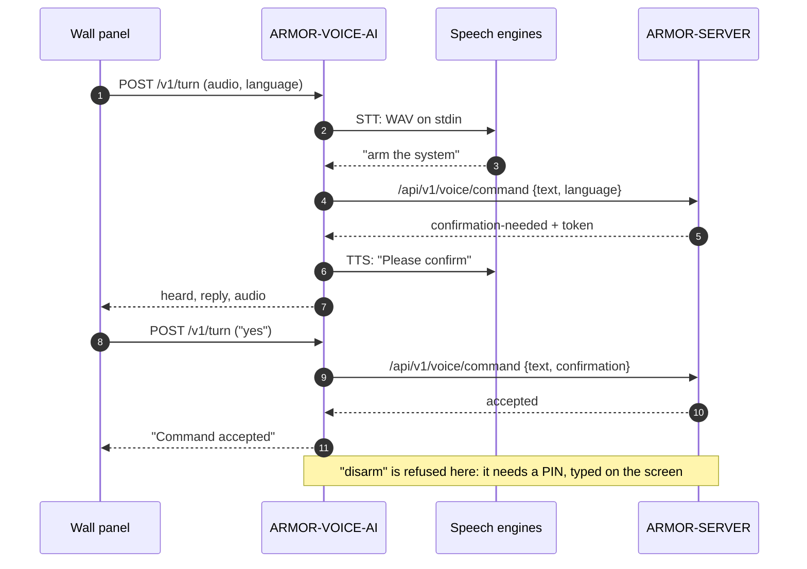

<p align="center">
  
</p>

# 🎙️ ARMOR-VOICE-AI

<p align="center">
  <a href="README.md">🇺🇸 English</a> |
  🇪🇸 <b>Español</b> |
  <a href="README_fra.md">🇫🇷 Français</a> |
  <a href="README_ita.md">🇮🇹 Italiano</a> |
  <a href="README_deu.md">🇩🇪 Deutsch</a> |
  <a href="README_zho.md">🇨🇳 简体中文</a> |
  <a href="README_jpn.md">🇯🇵 日本語</a> |
  <a href="README_por.md">🇵🇹 Português</a>
</p>

### Intenciones de voz sin conexión en ocho idiomas, con una confirmación que quien llama no puede falsificar

<p align="center">
  
  
  
  
  
  
  
</p>

---

**Comprobación de honestidad - qué funciona hoy:** Las reglas de intención, los ocho idiomas, la confirmación firmada ligada a quien habla, la política de silenciado, el servicio local, el punto de entrada de turnos y la auditoría son reales y están probados (118 pruebas), y el servidor consulta al servicio en el banco de pruebas de la CM5. **Ningún motor de reconocimiento ni de síntesis de voz forma parte de este repositorio**: `/v1/turn` ejecuta los comandos que tú configures para ello, y ninguno se ha probado todavía con un micrófono real; el panel táctil que debe llevar al asistente no ha funcionado en una placa.

---

## 📋 De un vistazo

| | |
|---|---|
| Versión | `0.3.1` |
| Madurez | Establecido |
| Función | Pasarela de voz e intenciones sin conexión (familia: Core Services, padre: ARMOR-SERVER) |
| Tecnología | Python 3.11+, solo biblioteca estándar |
| Pruebas | 118 (`python -m unittest discover -s tests`) |
| Comandos | 15 (10 que preguntan, 5 que actúan), 420 frases, 8 idiomas |
| Escucha en | `127.0.0.1:18090` (solo bucle local), con token |
| Funciona en | El banco de pruebas de la CM5 (como servicio) o cualquier ordenador |
| En hardware real | Funciona como servicio en el banco de la CM5, consultado por el servidor; no se ha probado ningún micrófono ni motor de voz |
| Licencia | GPL-3.0-or-later |

**Ir a:** [Resumen](#-resumen) · [Arquitectura](#-arquitectura) · [Funciones](#-funciones) · [Seguridad](#-seguridad-y-protección) · [Interfaces](#-interfaces) · [Configuración](#-configuración) · [Inicio rápido](#-inicio-rápido) · [Pruebas](#-pruebas) · [Problemas](#-resolución-de-problemas) · [Estructura](#-estructura-del-repositorio) · [Relacionados](#-proyectos-relacionados)

## 🚦 Estado del proyecto

Cada línea es una parte de este repositorio y la luz dice hasta dónde llega hoy. Está escrito con lo que el repositorio puede demostrar (pruebas, compilaciones, ejecuciones), no con lo que está planeado.

🟢 Hecho y verificado · 🟡 Funciona, con límites conocidos · 🟠 Parcial o sin verificar todavía · 🔴 No hecho o no funciona

| Área | Estado | Qué significa aquí |
|---|---|---|
| Software | 🟡 | Las reglas de intención, el servicio local y el punto de entrada de turnos funcionan como servicio en el banco de la CM5, pero ningún motor de reconocimiento ni síntesis de voz forma parte del repositorio: ejecuta los comandos que configures para ello. |
| Pruebas | 🟢 | Pasan 118 pruebas (`python -m unittest discover -s tests`): las reglas de intención, los ocho idiomas, la confirmación firmada ligada a quien habla, la política de silenciado, el servicio local, el punto de entrada de turnos y la auditoría. |
| Hardware | 🔴 | No se ha probado ningún micrófono ni motor de voz, y el panel táctil que debe llevar al asistente no ha funcionado en una placa. |
| Seguridad | 🟡 | La confirmación está firmada y ligada a quien habla, y la auditoría se prueba en el equipo anfitrión; no ha habido revisión independiente. |
| Integración | 🟡 | El servidor consulta al servicio en el banco de la CM5; el flujo de voz con el panel táctil no ha funcionado. |
| Documentación | 🟢 | Los ocho idiomas y el registro de cambios están al día. |

## 🎯 Resumen

ARMOR-VOICE-AI es la parte de A.R.M.O.R. que convierte **lo que dice una persona en uno de quince comandos, o en nada**. Nunca hace nada por sí misma: decide, y [ARMOR-SERVER](https://github.com/JuanenRac/ARMOR-SERVER) autentica, autoriza y ejecuta lo aceptado, igual que haría con un clic en la consola.

El texto que sale de un reconocedor de voz es *entrada no fiable*. Por eso no se interpreta, ni se buscan palabras clave, ni se reenvía como comando: se limpia (acentos, puntuación, cortesías) y entonces debe ser **exactamente** una de 420 frases conocidas. Cualquier otra cosa, cualquier texto demasiado largo y cualquier frase que pudiera significar dos comandos *no se entiende*.

**Qué hace**

* Entiende quince comandos en **ocho idiomas** (inglés, español, alemán, francés, italiano, japonés, chino y portugués).
* Hace que `arm` y `disarm` necesiten un **segundo turno con un token que firmó el servicio**, ligado a la orden y a quien la pidió.
* Puede hacer que `silence` necesite un **PIN** hablado o un segundo turno de confirmación, cuando ARMOR-SERVER lo pide.
* Funciona como **servicio HTTP local** y como **pasarela de líneas JSON** para adaptadores y pruebas.
* Recibe el **audio de un turno** del panel de pared, ejecuta los motores de voz que configures y responde en texto y, con un sintetizador, en audio.
* Registra **decisiones, nunca audio ni palabras**: un SHA-256 de la transcripción.

**Qué no hace**

* No reconoce ni sintetiza voz: son programas que elige la instalación.
* No arma, desarma ni silencia nada: una orden aceptada es una recomendación para ARMOR-SERVER.
* No desarma desde el panel de pared en ningún caso: el PIN se teclea en la pantalla, nunca se dice en voz alta.

## 🧩 Papel en A.R.M.O.R.

[ARMOR-SERVER](https://github.com/JuanenRac/ARMOR-SERVER) consulta a este servicio y luego autentica y autoriza el comando como haría con un clic en [ARMOR-STUDIO](https://github.com/JuanenRac/ARMOR-STUDIO). Está pensado para vivir tras el micrófono del panel de pared [ARMOR-NODE-HMI](https://github.com/JuanenRac/ARMOR-NODE-HMI) (pulsar para hablar) y responde al asistente escrito y hablado de [ARMOR-ANDROID-CONTROL](https://github.com/JuanenRac/ARMOR-ANDROID-CONTROL). En el banco de pruebas lo instala [ARMOR-DEVOPS](https://github.com/JuanenRac/ARMOR-DEVOPS) (`scripts/install_cm5.sh --with-voice`).

| Habla con | Cómo | Para qué |
|---|---|---|
| ARMOR-SERVER | entra `POST /v1/command` y `POST /v1/turn`; sale `/api/v1/voice/command` | Decidir una frase; pasar las palabras de un turno hablado a la ruta de voz del servidor |
| ARMOR-NODE-HMI | audio de un turno (PCM mono 16 kHz) | El micrófono y el altavoz del panel de pared |
| ARMOR-ANDROID-CONTROL | a través del servidor | El asistente escrito y hablado |
| Motores de voz | entrada y salida estándar | Oír (p. ej. whisper.cpp, Vosk) y hablar (p. ej. Piper); los elige la instalación |

## 🏛️ Arquitectura

<p align="center">
  
</p>

**Un turno hablado que arma el sistema** (al panel se le pregunta dos veces, y desarmar se rechaza):

<p align="center">
  
</p>

<details>
<summary>Versión en texto del diagrama (Mermaid)</summary>



</details>

**Por qué está construido así**

* **Por qué una lista cerrada y no clasificación de intenciones.** Un reconocedor se equivoca y cualquiera puede hablar cerca de un micrófono. Con 420 frases exactas lo peor que puede hacer una transcripción errónea es ser ignorada, y una prueba comprueba que ninguna frase pertenece a dos comandos.
* **Por qué el servicio solo decide.** La autenticación, la autorización, el registro de auditoría y la acción están en un único sitio, ARMOR-SERVER; un fallo aquí puede aceptar mal una frase, pero no puede tocar una alarma.
* **Por qué la confirmación es un token firmado que emite el servicio.** Una marca que pone quien llama (`confirmed: true`) no demuestra nada, así que se rechaza. El token va firmado con HMAC-SHA-256, ligado al comando y a la persona, vale 30 segundos y sirve una vez.
* **Por qué los motores de voz son programas aparte.** Los modelos cambian más deprisa de lo que debe cambiar una pasarela de seguridad. Se ejecutan sin shell, con un entorno corto y un límite de tiempo, y los secretos del propio servicio nunca les llegan.
* **Por qué no se guarda nada.** El registro muestra qué se decidió sin guardar qué se dijo.

## ✨ Funciones

### Los quince comandos

| Comando | Tipo | Significado | Confirmación |
|---|---|---|---|
| `status` | pregunta | El estado del sistema | no |
| `alarms` | pregunta | Las alarmas activas | no |
| `nodes` | pregunta | El estado de los nodos | no |
| `cameras` | pregunta | El estado de las cámaras | no |
| `radar` | pregunta | El estado de los radares | no |
| `solar` | pregunta | El estado del sistema solar | no |
| `electrical` | pregunta | El consumo eléctrico | no |
| `network` | pregunta | El estado de la red | no |
| `time` | pregunta | La hora | no |
| `help` | pregunta | Qué se puede decir | no |
| `silence` | actúa | Silenciar (reconocer) las alarmas | solo si la política del servidor lo pide (ver abajo) |
| `lights_on` | actúa | Encender las luces | no |
| `lights_off` | actúa | Apagar las luces | no |
| `arm` | actúa | Armar el perímetro | **sí** |
| `disarm` | actúa | Desarmar el perímetro | **sí** |

Los diez que *preguntan* no cambian nada. Los cinco que *actúan* los ejecuta ARMOR-SERVER con la sesión de quien habló, nunca este servicio.

### Ocho idiomas

Inglés, español, alemán, francés, italiano, japonés, chino y portugués de Portugal: las frases (420 en total), el sí y el no de una confirmación, las palabras de los dígitos de un PIN hablado y cada frase que el servicio responde. Las frases se escriben como las dice una persona y se normalizan al cargar el módulo con la misma función que normaliza lo que se oye, así que no pueden separarse. Las cortesías (`please`, `por favor`, `bitte`, `s'il vous plaît`, `per favore`...) se descartan antes de comparar; el japonés y el chino, que se escriben sin espacios, listan sus frases con y sin la terminación cortés.

### La confirmación en dos turnos

1. El primer turno de `arm` o `disarm` devuelve **ninguna aceptación** y un `confirmation_token`.
2. El segundo turno repite ese token para la misma orden, **de la misma persona**, en 30 segundos.
3. El token va firmado con un secreto que quien llama no tiene, así que no se puede falsificar, alterar ni pasar a otra orden o a otra persona; funciona una sola vez y los identificadores de los que aún no han caducado nunca se olvidan para hacer sitio (si hay demasiados a la vez, se rechaza el nuevo).

### Silenciar por voz, con PIN opcional

"Silence" se acepta al instante salvo que la instalación pida más. ARMOR-SERVER guarda el ajuste `voice.silence_confirmation` y lo envía como política:

| Modo | Qué pasa con "silence" |
|---|---|
| `off` (por defecto, y si no llega política) | Se pasa al instante |
| `double_turn` | No se ejecuta; el servicio pide decir sí, y un sí en 15 s desde el mismo panel pasa la orden original |
| `pin` | No se ejecuta; el servicio pide el PIN, dicho en dígitos o en palabras en los ocho idiomas; el PIN correcto en 20 s pasa la orden |
| política ilegible o desconocida | `double_turn`: un ajuste roto nunca apaga una protección |

El PIN (de 4 a 12 dígitos, `ARMOR_VOICE_SILENCE_PIN`) se compara en tiempo constante y nunca se registra, guarda ni repite. Tres PIN erróneos bloquean el silenciado por voz en **todos** los paneles durante cinco minutos; con el modo `pin` pedido y sin PIN configurado, nada se silencia por voz. El contrato completo está en [docs/SILENCE_POLICY.md](docs/SILENCE_POLICY.md).

### El turno del panel de pared

`POST /v1/turn` recibe el audio de un turno, ejecuta el comando de voz a texto, entrega las palabras a la ruta de voz de ARMOR-SERVER y responde con lo oído, lo que hay que decir y, si hay un comando de texto a voz configurado, una grabación de la respuesta. El panel no tiene teclado, así que la pregunta de `arm` se recuerda por panel durante 30 segundos y el siguiente turno que diga *sí* (en el idioma del panel) la confirma y el que diga *no* la cancela. Si el servidor responde `disarm`, el turno contesta que para desarmar hace falta el PIN en la pantalla. Pasados nueve segundos de escucha no se consulta al servidor (el panel se rinde a los doce), así que lo que se le dijo a la persona y lo que hizo la casa no pueden contradecirse.

### Decisiones registradas

Con `--audit-file`, una línea JSON por decisión: hora, intención, resultado y el SHA-256 de la transcripción. Nunca audio y nunca las palabras.

## 🔒 Seguridad y protección

| Amenaza | Defensa |
|---|---|
| Una transcripción errónea u hostil | Entrada no fiable: se normaliza, coincidencia exacta con una lista cerrada, 200 caracteres como máximo, lo ambiguo *no se entiende*; nunca se reenvía como orden de shell o de dispositivo |
| Quien llama afirma una confirmación | `confirmed` se rechaza; solo cuenta un token que firmó el servicio |
| Un token robado, repetido o reutilizado | Firmado con HMAC-SHA-256, ligado a orden y persona, 30 s, un solo uso; un token no puede vivir más que su emisión aunque el reloj retroceda |
| Otra persona usa el token de alguien | `wrong-subject` |
| Adivinar el PIN de silenciado | Comparación en tiempo constante, 3 intentos y luego 5 minutos de bloqueo en todos los paneles, falla cerrado sin PIN |
| Alguien en la red alcanza el servicio | Solo bucle local (rechaza otra dirección sin `--allow-remote`); token de al menos 16 caracteres comparado en tiempo constante; 2 KB por petición; una conexión que se cuelga se cierra a los 15 s |
| Un motor de voz filtra o abusa de secretos | Se ejecuta sin shell, con entorno corto (`PATH`, `HOME`, `LANG`, `TMPDIR`, `ARMOR_VOICE_ENGINE_*`), límite de tiempo y de tamaño; los tokens del servicio y del servidor nunca le llegan |
| Agotar la máquina | Dos turnos a la vez como máximo (un tercero recibe 503); audio limitado a 480 000 bytes |
| Los registros revelan lo dicho | Nunca se registra; la auditoría solo tiene un hash |
| Un turno rancio actúa tarde | Pasados nueve segundos no se ejecuta nada (504) |

Desarmar por voz **nunca** se hace desde el panel de pared. Desde la app sigue el `ARMOR_DISARM_PIN` del servidor (ponlo en `required`). Nada de esto es una función de seguridad certificada: una orden aceptada es una recomendación que ARMOR-SERVER aún autentica y autoriza. Lee [docs/SAFETY.md](docs/SAFETY.md) para las reglas completas y [SECURITY.md](SECURITY.md) para informar de una vulnerabilidad.

## 🔌 Interfaces

### Servicio HTTP

| Ruta | Autenticación | Qué hace |
|---|---|---|
| `GET /healthz` | ninguna | `{"ok": true, "service": "armor-voice"}` |
| `POST /v1/command` | cabecera `X-Armor-Voice-Token` | Cuerpo `{text, language?, confirmation?, subject?, policy?, pin?}` (2 KB como máximo). Responde qué se entendió, un `confirmation_token` cuando hace falta un segundo turno y `speech` en el idioma pedido |
| `POST /v1/turn` | la misma cabecera | Cuerpo: PCM crudo mono de 16 bits a 16 kHz, `Content-Type: audio/L16;rate=16000`, hasta 480 000 bytes; cabeceras `X-Armor-Language`, `X-Armor-Client`, `X-Armor-Policy`. Responde `{heard, reply, audio?}` |
| `POST /v1/speak` | la misma cabecera | Cuerpo `{text, language}` (300 caracteres como máximo). Responde `{audio}`, la frase dicha por el programa de texto a voz como base64 de PCM mono de 16 bits a 16 kHz (no hace que nada ocurra y no guarda nada); 501 sin ese programa |

Un intercambio real (el token está acortado):

```json
{"text": "arm the system", "subject": "u-1"}
{"accepted": false, "requires_confirmation": true, "intent": "arm", "outcome": "confirmation-needed", "confirmation_token": "eyJpIjoiYXJt...", "reason": "say it again with the confirmation within 30 s", "speech": "Please confirm"}

{"text": "arm the system", "subject": "u-1", "confirmation": "eyJpIjoiYXJt..."}
{"accepted": true, "requires_confirmation": false, "intent": "arm", "outcome": "accepted", "speech": "Command accepted"}

{"text": "open the garage"}
{"accepted": false, "requires_confirmation": false, "intent": null, "outcome": "not-understood", "reason": "the phrase is not one of the known commands", "speech": "Command not recognised"}
```

Resultados: `accepted`, `confirmation-needed`, `confirmation-refused`, `pin-needed`, `pin-refused`, `not-understood`. Una confirmación se rechaza como `invalid`, `expired`, `wrong-intent`, `wrong-subject` o `replayed`.

### Códigos de estado de `/v1/turn`

| Código | Error | Significado |
|---|---|---|
| 200 | | `{heard, reply, audio?}` |
| 401 | `unauthorized` | Falta el token o es incorrecto |
| 411 / 413 | `bad audio length` | Sin longitud, o más de 480 000 bytes |
| 415 | | No es `audio/L16;rate=16000` |
| 422 | `invalid language` | No es uno de `en es de fr it ja zh pt` |
| 501 | `stt_unavailable` / `server_not_configured` | No hay comando de voz a texto, o no hay dirección de servidor |
| 502 | `engine_failed` / `server_<código>` / `server_not_answering` | Falló un motor de voz o el servidor |
| 503 | `busy` | Ya hay dos turnos en marcha |
| 504 | `turn_too_slow` | El motor de voz tardó tanto que no se consultó al servidor; no se ejecutó nada |

### Pasarela de líneas JSON

`python -m armor_voice_ai.gateway` lee un objeto JSON por línea por la entrada estándar y escribe la respuesta por la salida estándar (2 KB por línea; una línea con bytes que no son UTF-8 es una línea como otra cualquiera). Es la misma pasarela cerrada, para adaptadores de voz y pruebas.

### Contrato con ARMOR-SERVER

* El servidor envía la política de silenciado en cada petición: `policy` en el cuerpo de `/v1/command` (y `pin` para el modo `pin`), la cabecera `X-Armor-Policy` (un objeto JSON de 256 bytes como máximo) en `/v1/turn`.
* La ruta de voz del servidor recibe las palabras de un turno hablado en `/api/v1/voice/command` con el token de operador de la instalación, con el nombre de cada panel (`X-Armor-Client`).
* Detalles: [docs/SERVICE.md](docs/SERVICE.md), [docs/SILENCE_POLICY.md](docs/SILENCE_POLICY.md).

## ⚙️ Configuración

### Entorno

| Variable | Necesaria | Qué fija |
|---|---|---|
| `ARMOR_VOICE_TOKEN` | sí (16+ caracteres) | El token que los clientes envían en `X-Armor-Voice-Token` (o una línea `ARMOR_VOICE_TOKEN=...` en el fichero de `--token-file`) |
| `ARMOR_VOICE_CONFIRM_SECRET` | recomendada (16+ bytes) | Firma las confirmaciones. Sin ella se usa un secreto aleatorio y las confirmaciones pendientes se pierden al parar el proceso |
| `ARMOR_VOICE_STT_COMMAND` | para `/v1/turn` | El programa de voz a texto: audio (WAV) por la entrada estándar, las palabras por la salida |
| `ARMOR_VOICE_TTS_COMMAND` | opcional | El programa de texto a voz: texto por la entrada estándar, un WAV mono de 16 bits a 16 kHz por la salida |
| `ARMOR_VOICE_SERVER_URL`, `ARMOR_VOICE_SERVER_TOKEN` | para `/v1/turn` | ARMOR-SERVER y el token de operador de su ruta de voz |
| `ARMOR_VOICE_SILENCE_PIN` | para el modo `pin` | De 4 a 12 dígitos. Un valor no válido detiene el servicio al arrancar sin imprimirlo |
| `ARMOR_VOICE_ENGINE_*` | opcional | Se pasan a los motores de voz (junto con `ARMOR_VOICE_LANGUAGE`, que se fija en cada turno) |

### Línea de órdenes

| Opción | Por defecto | |
|---|---|---|
| `--host` | `127.0.0.1` | Dirección en la que escuchar; cualquiera que no sea el bucle local se rechaza sin `--allow-remote` |
| `--port` | `18090` | |
| `--token-file` | | Fichero con una línea `ARMOR_VOICE_TOKEN=...` |
| `--audit-file` | | Añade una línea por decisión |
| `--allow-remote` | desactivado | Escucha en una dirección que no es de bucle local (no recomendado; solo tras TLS) |

### Límites que están en el código

| Límite | Valor |
|---|---|
| Validez de la confirmación | 30 s |
| Pregunta hablada que se recuerda por panel | 30 s |
| "Sí" tras una pregunta de silenciado / PIN tras pedirlo | 15 s / 20 s |
| Intentos de PIN antes del bloqueo / duración del bloqueo | 3 / 5 min |
| Presupuesto del turno / el panel se rinde | 9 s / 12 s |
| Límite de tiempo de un motor de voz | 25 s |
| Audio máximo / audio de respuesta máximo | 480 000 bytes / 190 000 bytes |
| Cuerpo de la petición (`/v1/command`) | 2 KB |
| Longitud de la transcripción | 200 caracteres |
| Turnos a la vez | 2 |

El servicio nunca escribe lo dicho en un registro, sean cuales sean los ajustes.

## 🚀 Inicio rápido

**Requisitos:** Python 3.11+ (solo biblioteca estándar). Opcional: un programa de voz a texto y otro de texto a voz para `/v1/turn`.

```powershell
$env:PYTHONPATH = "src"

# 1. las pruebas
python -m unittest discover -s tests                      # 118 pruebas

# 2. la pasarela, un objeto JSON por línea
echo '{"text":"arm the system"}' | python -m armor_voice_ai.gateway

# 3. el servicio HTTP local (solo bucle local)
$env:ARMOR_VOICE_TOKEN = "un-token-de-al-menos-16-caracteres"
python -m armor_voice_ai.service --port 18090
```

```sh
curl -s http://127.0.0.1:18090/v1/command \
  -H "X-Armor-Voice-Token: $ARMOR_VOICE_TOKEN" \
  -d '{"text":"status","language":"de"}'
# {"accepted":true,"requires_confirmation":false,"intent":"status","outcome":"accepted","speech":"Befehl akzeptiert"}
```

Para oír y hablar (`/v1/turn`), apunta el servicio a tus motores y al servidor:

```sh
export ARMOR_VOICE_STT_COMMAND="/opt/armor/bin/hear"        # WAV por la entrada, palabras por la salida
export ARMOR_VOICE_TTS_COMMAND="/opt/armor/bin/speak"       # texto por la entrada, WAV por la salida
export ARMOR_VOICE_SERVER_URL="https://armor-server.local"
export ARMOR_VOICE_SERVER_TOKEN="..."
python -m armor_voice_ai.service --token-file /opt/armor/etc/armor.voice.env
```

El panel de pared es un dispositivo de la red y el servicio escucha solo en el bucle local: o bien un proxy del servidor reenvía el turno, o se usa `--allow-remote` tras TLS. El token y el audio no deben cruzar la red en claro.

`run.bat` / `run.sh` y `build.bat` / `build.sh` lanzan el flujo de proyecto compartido de [ARMOR-COMMON](https://github.com/JuanenRac/ARMOR-COMMON) (los repositorios están uno junto a otro). Con pip se dispone del comando `armor-voice-gateway`.

## 🧪 Pruebas

```powershell
$env:PYTHONPATH = "src"
python -m unittest discover -s tests
python -I tools/armor_ci_validate.py        # manifiesto, versión, registro de cambios y paridad del README
```

| Fichero de pruebas | Pruebas | Qué cubre |
|---|---|---|
| `test_silence.py` | 31 | La política de silenciado, el PIN hablado en ocho idiomas, el bloqueo |
| `test_edges.py` | 29 | El protocolo de líneas, los ajustes del servicio, el enlace con el servidor (un doble en el bucle local), los límites de los motores |
| `test_gateway.py` | 23 | La pasarela, la confirmación, repeticiones y falsificaciones |
| `test_turn.py` | 15 | El turno, los motores, el sí y el no hablados, el presupuesto de tiempo |
| `test_languages.py` | 11 | Frases en forma normal, ninguna frase para dos comandos, cada idioma arma, desarma, pregunta y silencia |
| `test_service.py` | 5 | Las rutas HTTP |

GitHub Actions ejecuta la base de A.R.M.O.R. en cada push y pull request: la validación del manifiesto, la versión, el registro de cambios y la paridad del README, y después la compilación y las pruebas propias del proyecto.

## 🏗️ Compilación y publicación

Es Python puro: no hay nada que compilar. La versión vive en `pyproject.toml`, en `armor.project.json` y en la insignia del README (leída del manifiesto); cada versión tiene su entrada en [CHANGELOG.md](CHANGELOG.md). Las versiones se publican en GitHub.

## 🩺 Resolución de problemas

| Ves | Porque | Haz |
|---|---|---|
| `refusing to listen on a non-loopback address without --allow-remote` | `--host` no es `127.0.0.1`, `::1` ni `localhost` | Mantén el bucle local y deja que el proxy del servidor reenvíe, o añade `--allow-remote` tras TLS |
| `a token of at least 16 characters is needed` | Falta `ARMOR_VOICE_TOKEN` o es corto | Defínelo, o usa `--token-file` |
| `ARMOR_VOICE_SILENCE_PIN is not valid` | No son de 4 a 12 dígitos ASCII | Corrige el valor (nunca se imprime) |
| `ARMOR_VOICE_CONFIRM_SECRET is not set` (aviso) | Se usa un secreto aleatorio | Define un secreto de 16+ bytes si las confirmaciones deben sobrevivir a un reinicio |
| 401 `unauthorized` | Falta `X-Armor-Voice-Token` o es incorrecto | Envía el token |
| 501 `stt_unavailable` | `ARMOR_VOICE_STT_COMMAND` no está definido | Configura un programa de voz a texto |
| 501 `server_not_configured` | Falta la dirección o el token del servidor | Define `ARMOR_VOICE_SERVER_URL` y `ARMOR_VOICE_SERVER_TOKEN` |
| 502 `engine_failed` | El motor falló, agotó el tiempo o respondió demasiado (o un WAV de texto a voz que no es mono de 16 bits a 16 kHz) | Ejecútalo a mano con la misma entrada |
| 504 `turn_too_slow` | El motor de voz tardó más de nueve segundos | Usa un modelo más rápido; no se ejecutó nada |
| "Para desarmar hace falta tu PIN" | Desarmar nunca se hace por voz desde el panel | Usa la pantalla |
| Un "sí" hablado no hace nada | No se recordaba la pregunta (tardó más de 12 s en hacerse, pasaron más de 30 s, o contestó otro panel) | Di de nuevo la orden |

## 📂 Estructura del repositorio

<p align="center">
  
</p>

<details>
<summary>Versión en texto del árbol</summary>

```text
ARMOR-VOICE-AI/
├── src/armor_voice_ai/        el código (solo biblioteca estándar)
│   ├── phrases.py             las 420 frases de los quince comandos, en ocho idiomas
│   ├── intent.py              normalización y coincidencia exacta: la lista cerrada
│   ├── confirmation.py        tokens de confirmación firmados, de un solo uso y por persona
│   ├── silence_policy.py      off / pin / double_turn, el PIN hablado, el bloqueo
│   ├── session.py             la regla de dos turnos de cada comando
│   ├── gateway.py             líneas JSON por stdin/stdout, la auditoría, las frases que se responden
│   ├── service.py             el servicio HTTP local (/healthz, /v1/command, /v1/turn)
│   └── turn.py                un turno hablado: motores, sí/no, presupuesto de tiempo
├── tests/                     118 pruebas: silencio, bordes, pasarela, turno, idiomas, servicio
├── docs/                      SAFETY.md, SERVICE.md, SILENCE_POLICY.md
├── tools/                     las comprobaciones de CI compartidas y la herramienta de proyecto
├── images/                    banner e icono
├── .github/                   flujo de CI, aviso al panel, plantillas de incidencias y de pull request
├── armor.project.json         manifiesto: versión, función, madurez, orden de compilación
├── pyproject.toml             metadatos del paquete y el comando `armor-voice-gateway`
├── run.sh run.bat             arrancan con el flujo de proyecto compartido
├── build.sh build.bat         compilan y prueban con el flujo de proyecto compartido
├── CHANGELOG.md               qué cambió en cada versión
└── SECURITY.md SUPPORT.md CONTRIBUTING.md CODE_OF_CONDUCT.md LICENSE
```

</details>

## 🗺️ Hoja de ruta y límites conocidos

**Límites conocidos hoy**

* No incluye ningún motor de voz, y ninguno se ha probado con un micrófono real.
* El panel táctil que debe llevar al asistente no ha funcionado en una placa; no hay palabra de activación, es pulsar para hablar.
* El turno no dice *qué panel ni qué persona* habló: ARMOR-SERVER decide con el token que se le dio. Añadirlos a la petición es un cambio del contrato entre el servidor y el panel.
* No hay revisión de seguridad independiente.

**Lo siguiente**

* Probar un micrófono real y un motor de voz real en el banco de la CM5.
* Ejecutar el flujo de voz con el panel táctil cuando haya funcionado en una placa.
* Confirmación opcional por hablante autenticado o física. Un despliegue posterior puede añadirla, pero la confirmación firmada no se quitará sin una revisión de riesgos documentada.

## 🌍 Idiomas

El README y los textos existen en inglés, español, francés, italiano, alemán, chino, japonés y portugués de Portugal. Cada frase que el servicio responde, cada comando hablado, cada sí y no y cada palabra de dígito de un PIN existe en los ocho idiomas.

## 🔗 Proyectos relacionados

**A.R.M.O.R.** (Autonomous Radar & Multimodal Observation Range) es un sistema de seguridad perimetral hecho de repositorios independientes. Cada uno tiene su propia versión, sus propias pruebas y su propio README; esta es la familia:

* **[ARMOR-COMMON](https://github.com/JuanenRac/ARMOR-COMMON)** - Contratos de mensajes, validadores, vectores de conformidad y tipos generados
* **[ARMOR-NODE-RADAR](https://github.com/JuanenRac/ARMOR-NODE-RADAR)** - Firmware de nodo de campo para ESP32-S3 con tres radares y su propio panel web
* **[ARMOR-NODE-SOLAR](https://github.com/JuanenRac/ARMOR-NODE-SOLAR)** - Protocolos de inversores y baterías solares y los mensajes de un nodo pasarela
* **[ARMOR-NODE-ELECTRICAL](https://github.com/JuanenRac/ARMOR-NODE-ELECTRICAL)** - Nodo eléctrico: medidores, el mensaje de las lecturas de la red y las reglas de maniobra
* **[ARMOR-NODE-ALARM](https://github.com/JuanenRac/ARMOR-NODE-ALARM)** - Nodo y panel de alarma: zonas, armado, retardos, sirena y PIN, con el servidor o sin él
* **[ARMOR-NODE-HMI](https://github.com/JuanenRac/ARMOR-NODE-HMI)** - Panel táctil: el estado del sistema en una pantalla de pared, armar y reconocer, y el hogar del asistente de voz
* **[ARMOR-NETWORK](https://github.com/JuanenRac/ARMOR-NETWORK)** - La red local: sus dispositivos, internet y lo que cambia
* **[ARMOR-SERVER](https://github.com/JuanenRac/ARMOR-SERVER)** - Coordinador central: telemetría, alarmas, dispositivos, lecturas solares y cámaras
* **[ARMOR-STUDIO](https://github.com/JuanenRac/ARMOR-STUDIO)** - Consola web: cámaras, radar, alarmas, energía solar y el diseñador 2D/3D del emplazamiento
* **[ARMOR-ANDROID-CONTROL](https://github.com/JuanenRac/ARMOR-ANDROID-CONTROL)** - Cliente de operador Android con radar 2D/3D en vivo
* **[ARMOR-IOS-CONTROL](https://github.com/JuanenRac/ARMOR-IOS-CONTROL)** - Cliente de operador para iPhone
* **[ARMOR-SERVER-AI](https://github.com/JuanenRac/ARMOR-SERVER-AI)** - Política de inferencia visual que explica sus decisiones y nunca actúa
* **[ARMOR-VISION](https://github.com/JuanenRac/ARMOR-VISION)** - Zonas de cámara, máscaras y reglas de detección para la Jetson Orin NX
* **ARMOR-VOICE-AI** (este repositorio) - Intenciones de voz sin conexión con una confirmación que no se puede falsificar
* **[ARMOR-HARDWARE](https://github.com/JuanenRac/ARMOR-HARDWARE)** - Cajas, electrónica y la matriz de aceptación en banco
* **[ARMOR-DEVOPS](https://github.com/JuanenRac/ARMOR-DEVOPS)** - Despliegue, el banco de pruebas de la CM5, copias de seguridad y TLS
* **[ARMOR-SIMULATOR](https://github.com/JuanenRac/ARMOR-SIMULATOR)** - Simulador de telemetría sin conexión con fallos repetibles
* **[ARMOR-UPDATER](https://github.com/JuanenRac/ARMOR-UPDATER)** - Detecta, instala y actualiza los repositorios del propio ecosistema
* **[ARMOR-DOCS](https://github.com/JuanenRac/ARMOR-DOCS)** - Arquitectura, base de seguridad y la matriz de capacidades

## 📚 Documentación

* [Seguridad de la voz](docs/SAFETY.md): qué se entiende, la confirmación, el turno del panel de pared, qué se registra
* [El servicio](docs/SERVICE.md): rutas, códigos de estado y ajustes
* [Silenciar por voz](docs/SILENCE_POLICY.md): el contrato de la política y el PIN
* [Matriz de capacidades: qué está demostrado y qué no](https://github.com/JuanenRac/ARMOR-DOCS/blob/main/docs/CAPABILITY_MATRIX.md)
* [Catálogo de proyectos: versiones y cómo dependen unos repositorios de otros](https://github.com/JuanenRac/ARMOR-DOCS/blob/main/docs/PROJECT_CATALOG.md)
* [Registro de cambios de este repositorio](CHANGELOG.md)

## 🤝 Contribuir y comunidad

* Antes de un pull request ejecuta `python -I tools/armor_ci_validate.py` y las pruebas: ambos deben pasar. Mira [CONTRIBUTING.md](CONTRIBUTING.md) y el [código de conducta](CODE_OF_CONDUCT.md).
* El README existe en ocho idiomas y se genera desde las fuentes de ARMOR-DOCS: un cambio de texto se hace allí.
* Un cambio en un mensaje entre componentes empieza en ARMOR-COMMON.
* No describas como funcionando en una placa lo que solo se ha compilado.
* Informa de una vulnerabilidad en privado: [SECURITY.md](SECURITY.md). Preguntas, ideas e informes: electrohobby3d@gmail.com ([SUPPORT.md](SUPPORT.md)).

## 👤 AUTOR

**JuanenRac (Electro Hobby 3D)** · electrohobby3d@gmail.com

## 📜 LICENCIA

GPL-3.0-or-later - véase [LICENSE](LICENSE).
