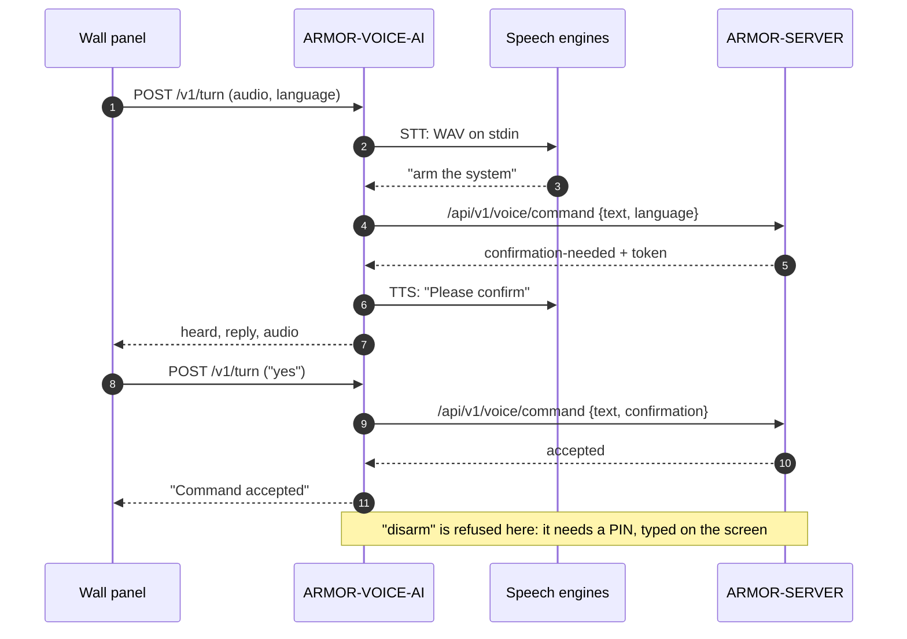

<p align="center">
  
</p>

# 🎙️ ARMOR-VOICE-AI

<p align="center">
  <a href="README.md">🇺🇸 English</a> |
  <a href="README_spa.md">🇪🇸 Español</a> |
  <a href="README_fra.md">🇫🇷 Français</a> |
  <a href="README_ita.md">🇮🇹 Italiano</a> |
  <a href="README_deu.md">🇩🇪 Deutsch</a> |
  🇨🇳 <b>简体中文</b> |
  <a href="README_jpn.md">🇯🇵 日本語</a> |
  <a href="README_por.md">🇵🇹 Português</a>
</p>

### 八种语言的离线语音意图，附带调用方无法伪造的确认

<p align="center">
  
  
  
  
  
  
  
</p>

---

**诚实性检查 - 今天真正能运行的部分：** 意图规则、八种语言、与说话人绑定的签名确认、静音策略、本地服务、轮次接口和审计都是真实的，并有测试覆盖（118 项测试），服务器在 CM5 测试台上会向该服务发起查询。**本仓库不包含任何语音识别或语音合成引擎**：`/v1/turn` 运行的是你为它们配置的命令，目前没有任何一个用真实麦克风试过；用来承载该助手的触摸面板还没有在板子上运行过。

---

## 📋 速览

| | |
|---|---|
| 版本 | `0.3.2` |
| 成熟度 | 成熟 |
| 角色 | 离线语音与意图网关（系列：Core Services，上级：ARMOR-SERVER） |
| 技术栈 | Python 3.11+，仅使用标准库 |
| 测试 | 118 (`python -m unittest discover -s tests`) |
| 命令 | 15 个（10 个查询类，5 个执行类），420 个短语，8 种语言 |
| 监听地址 | `127.0.0.1:18090`（仅限本机回环），需要令牌 |
| 运行位置 | CM5 测试台（作为服务）或任意计算机 |
| 真实硬件 | 在 CM5 测试台上作为服务运行，由服务器查询；尚未试过任何麦克风或语音引擎 |
| 许可证 | GPL-3.0-or-later |

**跳转到：** [概述](#-概述) · [架构](#-架构) · [功能](#-功能) · [安全](#-安全与防护) · [接口](#-接口) · [配置](#-配置) · [快速开始](#-快速开始) · [测试](#-测试) · [故障排除](#-故障排除) · [结构](#-仓库结构) · [相关项目](#-相关项目)

## 🚦 项目状态

每一行是本仓库的一个部分，灯号表示它今天做到了哪一步。内容依据仓库能够展示的证据（测试、构建、运行），而不是计划。

🟢 已完成并验证 · 🟡 可用，有已知限制 · 🟠 部分完成或尚未验证 · 🔴 未完成或不可用

| 领域 | 状态 | 在这里的含义 |
|---|---|---|
| 软件 | 🟡 | 意图规则、本地服务和轮次接口在 CM5 测试台上作为服务运行，但本仓库不包含任何语音识别或语音合成引擎：它运行的是你为此配置的命令。 |
| 测试 | 🟢 | 118 项测试通过（`python -m unittest discover -s tests`）：意图规则、八种语言、与说话人绑定的签名确认、静音策略、本地服务、轮次接口和审计。 |
| 硬件 | 🔴 | 没有试过任何麦克风或语音引擎，用来承载该助手的触摸面板也还没有在板子上运行过。 |
| 安全 | 🟡 | 确认经过签名并与说话人绑定，审计已在主机上测试；没有经过独立审查。 |
| 集成 | 🟡 | 服务器在 CM5 测试台上查询该服务；与触摸面板配合的语音流程尚未运行。 |
| 文档 | 🟢 | 八种语言和更新日志均为最新。 |

## 🎯 概述

ARMOR-VOICE-AI 是 A.R.M.O.R. 中负责把**人说的话转换为十五个命令之一，或者什么都不转换**的部分。它自己从不做任何事：它只负责判定，由 [ARMOR-SERVER](https://github.com/JuanenRac/ARMOR-SERVER) 对被接受的内容进行认证、授权并执行，就像处理控制台上的一次点击一样。

语音识别器输出的文字是*不可信输入*。因此它不会被解释、不会按关键词搜索，也不会作为命令转发：它先被清理（重音、标点、客套用语），之后必须与 420 个已知短语之一**完全一致**。其他任何内容、任何过长的内容，以及任何可能对应两个命令的短语，都*不会被理解*。

**它做什么**

* 用**八种语言**（英语、西班牙语、德语、法语、意大利语、日语、汉语和葡萄牙语）理解十五个命令。
* 让 `arm` 和 `disarm` 需要**带有服务签名令牌的第二个轮次**，该令牌与意图以及提出请求的人绑定。
* 当 ARMOR-SERVER 要求时，可让 `silence` 需要口述的 **PIN** 或第二个确认轮次。
* 既作为**本地 HTTP 服务**运行，也作为面向适配器和测试的 **JSON 行网关**运行。
* 从壁挂面板接收**一个轮次的音频**，运行你配置的语音引擎，并以文字回答；配有语音合成器时还以音频回答。
* 记录**决策，绝不记录音频或原话**：只保存转写文本的 SHA-256。

**它不做什么**

* 它不识别也不合成语音：这些是由安装方选择的程序。
* 它不布防、不撤防，也不静音任何东西：被接受的命令只是对 ARMOR-SERVER 的一个建议。
* 它绝不从壁挂面板撤防：PIN 在屏幕上输入，绝不口述。

## 🧩 在 A.R.M.O.R. 中的角色

[ARMOR-SERVER](https://github.com/JuanenRac/ARMOR-SERVER) 先查询本服务，然后像处理 [ARMOR-STUDIO](https://github.com/JuanenRac/ARMOR-STUDIO) 中的一次点击那样，对命令进行认证和授权。它设计为放在 [ARMOR-NODE-HMI](https://github.com/JuanenRac/ARMOR-NODE-HMI) 壁挂面板的麦克风之后（按键说话），并为 [ARMOR-ANDROID-CONTROL](https://github.com/JuanenRac/ARMOR-ANDROID-CONTROL) 的文字和语音助手提供应答。在测试台上，它由 [ARMOR-DEVOPS](https://github.com/JuanenRac/ARMOR-DEVOPS) 安装（`scripts/install_cm5.sh --with-voice`）。

| 对话对象 | 方式 | 用途 |
|---|---|---|
| ARMOR-SERVER | 入：`POST /v1/command`、`POST /v1/turn`；出：`/api/v1/voice/command` | 判定一个短语；把语音轮次的文字交给服务器自己的语音路由 |
| ARMOR-NODE-HMI | 一个轮次的音频（16 kHz 单声道 PCM） | 壁挂面板的麦克风和扬声器 |
| ARMOR-ANDROID-CONTROL | 经由服务器 | 文字和语音助手 |
| 语音引擎 | 标准输入和输出 | 听（例如 whisper.cpp、Vosk）和说（例如 Piper）；由安装方选择 |

## 🏛️ 架构

<p align="center">
  
</p>

**一个完成布防的语音轮次**（面板会被询问两次，撤防会被拒绝）：

<p align="center">
  
</p>

<details>
<summary>图表的文本版本（Mermaid）</summary>



</details>

**为什么这样构建**

* **为什么用封闭列表而不是意图分类。** 识别器会出错，任何人都可以在麦克风附近说话。有了 420 个精确短语，错误的转写最坏也只是被忽略，并且有一项测试检查没有任何短语同时属于两个命令。
* **为什么服务只负责判定。** 认证、授权、审计记录和动作都集中在 ARMOR-SERVER 一处；这里的缺陷可能错误地接受一个短语，但无法触碰报警。
* **为什么确认是服务签发的签名令牌。** 调用方自己设置的标记（`confirmed: true`）什么也证明不了，所以会被拒绝。令牌使用 HMAC-SHA-256 签名，与命令和人绑定，有效期 30 秒，且只能使用一次。
* **为什么语音引擎是独立的程序。** 模型的变化比安全网关应有的变化速度更快。它们在没有 shell、环境变量精简并带时间限制的条件下运行，服务自身的机密永远不会传给它们。
* **为什么什么都不保存。** 日志显示做出了什么决策，但不保存说过什么。

## ✨ 功能

### 十五个命令

| 命令 | 类型 | 含义 | 确认 |
|---|---|---|---|
| `status` | 查询 | 系统状态 | 否 |
| `alarms` | 查询 | 当前处于激活状态的报警 | 否 |
| `nodes` | 查询 | 节点状态 | 否 |
| `cameras` | 查询 | 摄像头状态 | 否 |
| `radar` | 查询 | 雷达状态 | 否 |
| `solar` | 查询 | 太阳能系统状态 | 否 |
| `electrical` | 查询 | 用电情况 | 否 |
| `network` | 查询 | 网络状态 | 否 |
| `time` | 查询 | 时间 | 否 |
| `help` | 查询 | 可以说什么 | 否 |
| `silence` | 执行 | 静音（确认）报警 | 仅当服务器策略要求时（见下文） |
| `lights_on` | 执行 | 开灯 | 否 |
| `lights_off` | 执行 | 关灯 | 否 |
| `arm` | 执行 | 对周界布防 | **是** |
| `disarm` | 执行 | 对周界撤防 | **是** |

十个*查询*类命令不会改变任何东西。五个*执行*类命令由 ARMOR-SERVER 使用说话人的会话来执行，绝不由本服务执行。

### 八种语言

英语、西班牙语、德语、法语、意大利语、日语、汉语和欧洲葡萄牙语：短语（共 420 个）、确认时的“是”和“否”、口述 PIN 的数字词，以及服务回应的每一句话。短语按人们的说法书写，并在模块加载时用与规范化听到内容相同的函数进行规范化，因此两者不会产生偏差。客套用语（`please`、`por favor`、`bitte`、`s'il vous plaît`、`per favore`……）在比较前会被丢弃；日语和汉语书写时没有空格，会分别列出带礼貌结尾和不带礼貌结尾的短语。

### 两轮确认

1. `arm` 或 `disarm` 的第一个轮次**不返回接受**，而是返回一个 `confirmation_token`。
2. 第二个轮次必须在 30 秒内，为同一个意图、**同一个人**回传该令牌。
3. 令牌用调用方没有的密钥签名，因此无法伪造、篡改，也无法转用于另一个意图或另一个人；它只能使用一次，且未过期令牌的随机数绝不会为腾出空间而被遗忘（同时存在过多时，新令牌会被拒绝）。

### 语音静音，可选 PIN

除非安装方要求更多，“Silence”会被立即接受。ARMOR-SERVER 保存设置 `voice.silence_confirmation`，并将其作为策略发送：

| 模式 | 对“silence”会发生什么 |
|---|---|
| `off`（默认，且在没有收到策略时） | 立即转交 |
| `double_turn` | 不执行；服务要求说“是”，来自同一面板的 15 秒内的“是”会转交原始命令 |
| `pin` | 不执行；服务要求 PIN，可用数字或八种语言的数字词说出；20 秒内说出正确的 PIN 即转交命令 |
| 无法读取或未知的策略 | `double_turn`：损坏的设置绝不会关闭防护 |

PIN（4 到 12 位数字，`ARMOR_VOICE_SILENCE_PIN`）以恒定时间比较，绝不会被记录、保存或回显。连续三次输错 PIN 会使**所有**面板的语音静音锁定五分钟；如果要求 `pin` 而没有设置 PIN，则任何东西都不会被语音静音。完整约定见 [docs/SILENCE_POLICY.md](docs/SILENCE_POLICY.md)。

### 壁挂面板轮次

`POST /v1/turn` 接收一个轮次的音频，运行语音转文字命令，把文字交给 ARMOR-SERVER 的语音路由，并返回听到的内容、要说的话，以及在配置了文字转语音命令时的一段录音。面板没有键盘，所以 `arm` 的询问会按面板记住 30 秒，之后说*是*（使用面板的语言）的下一个轮次会确认它，说*否*的下一个轮次会取消它。如果服务器回答 `disarm`，该轮次会回答撤防需要在屏幕上输入 PIN。收听超过九秒后不再询问服务器（面板在十二秒时放弃），因此对人说的话和房子实际做的事不会相互矛盾。

### 决策记录

使用 `--audit-file` 时，每个决策一行 JSON：时间、意图、结果以及转写文本的 SHA-256。绝不记录音频，也绝不记录原话。

## 🔒 安全与防护

| 威胁 | 防御 |
|---|---|
| 错误或恶意的转写 | 不可信输入：规范化后与封闭列表精确匹配，最多 200 个字符，有歧义即*不理解*；绝不作为 shell 或设备命令转发 |
| 调用方声称已确认 | `confirmed` 会被拒绝；只有服务签名的令牌才算数 |
| 令牌被窃取、重放或重复使用 | 使用 HMAC-SHA-256 签名，绑定意图和人，30 秒，一次性；即使时钟回拨，令牌的存活时间也不会超过其签发时间 |
| 另一个人使用某人的令牌 | `wrong-subject` |
| 猜测静音 PIN | 恒定时间比较，3 次尝试后对所有面板锁定 5 分钟，没有 PIN 时默认拒绝 |
| 网络上的人访问到服务 | 仅限本机回环（没有 `--allow-remote` 时拒绝其他地址）；至少 16 个字符的令牌以恒定时间比较；每个请求 2 KB；停滞的连接在 15 秒后关闭 |
| 语音引擎泄露或滥用机密 | 无 shell，环境变量精简（`PATH`、`HOME`、`LANG`、`TMPDIR`、`ARMOR_VOICE_ENGINE_*`），有时间限制和大小限制；服务和服务器的令牌永远不会传给它 |
| 耗尽机器资源 | 同时最多两个轮次（第三个收到 503）；音频上限 480 000 字节 |
| 日志泄露说过的话 | 绝不记录；审计中只有哈希 |
| 过期的轮次延迟执行 | 超过九秒后不执行任何东西（504） |

语音撤防**绝不会**从壁挂面板进行。从应用发起时，则遵循服务器的 `ARMOR_DISARM_PIN`（将其设为 `required`）。这里的一切都不是安全功能：被接受的命令只是一个建议，ARMOR-SERVER 仍会对其认证和授权。完整规则请阅读 [docs/SAFETY.md](docs/SAFETY.md)，报告漏洞请见 [SECURITY.md](SECURITY.md)。

## 🔌 接口

### HTTP 服务

| 路由 | 认证 | 作用 |
|---|---|---|
| `GET /healthz` | 无 | `{"ok": true, "service": "armor-voice"}` |
| `POST /v1/command` | 请求头 `X-Armor-Voice-Token` | 请求体 `{text, language?, confirmation?, subject?, policy?, pin?}`（最多 2 KB）。返回理解的内容、需要第二个轮次时的 `confirmation_token`，以及所请求语言的 `speech` |
| `POST /v1/turn` | 同一个请求头 | 请求体：原始 16 kHz 16 位单声道 PCM，`Content-Type: audio/L16;rate=16000`，最多 480 000 字节；请求头 `X-Armor-Language`、`X-Armor-Client`、`X-Armor-Policy`。返回 `{heard, reply, audio?}` |
| `POST /v1/speak` | 同一个请求头 | 请求体 `{text, language}`（最多 300 个字符）。返回 `{audio}`，即文字转语音程序说出的句子，为 16 kHz 16 位单声道 PCM 的 base64（不会触发任何操作，也不保存任何内容）；没有该程序时返回 501 |

一次真实的交互（令牌已缩短）：

```json
{"text": "arm the system", "subject": "u-1"}
{"accepted": false, "requires_confirmation": true, "intent": "arm", "outcome": "confirmation-needed", "confirmation_token": "eyJpIjoiYXJt...", "reason": "say it again with the confirmation within 30 s", "speech": "Please confirm"}

{"text": "arm the system", "subject": "u-1", "confirmation": "eyJpIjoiYXJt..."}
{"accepted": true, "requires_confirmation": false, "intent": "arm", "outcome": "accepted", "speech": "Command accepted"}

{"text": "open the garage"}
{"accepted": false, "requires_confirmation": false, "intent": null, "outcome": "not-understood", "reason": "the phrase is not one of the known commands", "speech": "Command not recognised"}
```

结果：`accepted`、`confirmation-needed`、`confirmation-refused`、`pin-needed`、`pin-refused`、`not-understood`。确认被拒绝的原因为 `invalid`、`expired`、`wrong-intent`、`wrong-subject` 或 `replayed`。

### `/v1/turn` 的状态码

| 代码 | 错误 | 含义 |
|---|---|---|
| 200 | | `{heard, reply, audio?}` |
| 401 | `unauthorized` | 缺少令牌或令牌错误 |
| 411 / 413 | `bad audio length` | 没有长度，或超过 480 000 字节 |
| 415 | | 不是 `audio/L16;rate=16000` |
| 422 | `invalid language` | 不是 `en es de fr it ja zh pt` 之一 |
| 501 | `stt_unavailable` / `server_not_configured` | 没有语音转文字命令，或没有服务器地址 |
| 502 | `engine_failed` / `server_<code>` / `server_not_answering` | 语音引擎或服务器失败 |
| 503 | `busy` | 已有两个轮次在运行 |
| 504 | `turn_too_slow` | 语音引擎耗时太长，以至于没有询问服务器；没有执行任何东西 |

### JSON 行网关

`python -m armor_voice_ai.gateway` 从标准输入每行读取一个 JSON 对象，并把应答写到标准输出（每行 2 KB；包含非 UTF-8 字节的行与其他行一样处理）。它是同一个封闭网关，供语音适配器和测试使用。

### 与 ARMOR-SERVER 的约定

* 服务器在每个请求中发送静音策略：在 `/v1/command` 的请求体中为 `policy`（`pin` 模式下还有 `pin`），在 `/v1/turn` 中为请求头 `X-Armor-Policy`（最多 256 字节的 JSON 对象）。
* 服务器的语音路由在 `/api/v1/voice/command` 接收语音轮次的文字，使用安装方的操作员令牌，并以每个面板的名称（`X-Armor-Client`）标识。
* 详情：[docs/SERVICE.md](docs/SERVICE.md)、[docs/SILENCE_POLICY.md](docs/SILENCE_POLICY.md)。

## ⚙️ 配置

### 环境变量

| 变量 | 是否必需 | 设置内容 |
|---|---|---|
| `ARMOR_VOICE_TOKEN` | 是（16 个以上字符） | 调用方在 `X-Armor-Voice-Token` 中发送的令牌（或 `--token-file` 所指文件中的一行 `ARMOR_VOICE_TOKEN=...`） |
| `ARMOR_VOICE_CONFIRM_SECRET` | 推荐（16 个以上字节） | 为确认签名。没有它时会使用随机密钥，进程停止时待处理的确认会丢失 |
| `ARMOR_VOICE_STT_COMMAND` | `/v1/turn` 需要 | 语音转文字程序：标准输入为音频（WAV），标准输出为文字 |
| `ARMOR_VOICE_TTS_COMMAND` | 可选 | 文字转语音程序：标准输入为文字，标准输出为 16 kHz 16 位单声道 WAV |
| `ARMOR_VOICE_SERVER_URL`, `ARMOR_VOICE_SERVER_TOKEN` | `/v1/turn` 需要 | ARMOR-SERVER 以及其语音路由的操作员令牌 |
| `ARMOR_VOICE_SILENCE_PIN` | `pin` 模式需要 | 4 到 12 位数字。无效值会使服务在启动时停止，且不会打印该值 |
| `ARMOR_VOICE_ENGINE_*` | 可选 | 传给语音引擎（连同每个轮次设置的 `ARMOR_VOICE_LANGUAGE`） |

### 命令行

| 选项 | 默认值 | |
|---|---|---|
| `--host` | `127.0.0.1` | 监听地址；没有 `--allow-remote` 时，回环以外的地址都会被拒绝 |
| `--port` | `18090` | |
| `--token-file` | | 包含一行 `ARMOR_VOICE_TOKEN=...` 的文件 |
| `--audit-file` | | 每个决策追加一行 |
| `--allow-remote` | 关闭 | 在非回环地址上监听（不推荐；仅限 TLS 之后） |

### 代码中的限制

| 限制 | 值 |
|---|---|
| 确认有效期 | 30 s |
| 每个面板记住的语音询问 | 30 s |
| 静音询问之后的“是” / 要求之后的 PIN | 15 s / 20 s |
| 锁定前的 PIN 尝试次数 / 锁定时间 | 3 / 5 min |
| 轮次预算 / 面板放弃 | 9 s / 12 s |
| 语音引擎时间限制 | 25 s |
| 最大音频 / 最大应答音频 | 480 000 字节 / 190 000 字节 |
| 请求体（`/v1/command`） | 2 KB |
| 转写长度 | 200 个字符 |
| 同时轮次数 | 2 |

无论如何设置，服务都不会把说过的话写入日志。

## 🚀 快速开始

**要求：** Python 3.11+（仅使用标准库）。可选：用于 `/v1/turn` 的语音转文字程序和文字转语音程序。

```powershell
$env:PYTHONPATH = "src"

# 1. 测试
python -m unittest discover -s tests                      # 118 项测试

# 2. 网关，每行一个 JSON 对象
echo '{"text":"arm the system"}' | python -m armor_voice_ai.gateway

# 3. 本地 HTTP 服务（仅限本机回环）
$env:ARMOR_VOICE_TOKEN = "a-token-of-at-least-16-characters"
python -m armor_voice_ai.service --port 18090
```

```sh
curl -s http://127.0.0.1:18090/v1/command \
  -H "X-Armor-Voice-Token: $ARMOR_VOICE_TOKEN" \
  -d '{"text":"status","language":"de"}'
# {"accepted":true,"requires_confirmation":false,"intent":"status","outcome":"accepted","speech":"Befehl akzeptiert"}
```

要听和说（`/v1/turn`），请把服务指向你的引擎和服务器：

```sh
export ARMOR_VOICE_STT_COMMAND="/opt/armor/bin/hear"        # 标准输入为 WAV，标准输出为文字
export ARMOR_VOICE_TTS_COMMAND="/opt/armor/bin/speak"       # 标准输入为文字，标准输出为 WAV
export ARMOR_VOICE_SERVER_URL="https://armor-server.local"
export ARMOR_VOICE_SERVER_TOKEN="..."
python -m armor_voice_ai.service --token-file /opt/armor/etc/armor.voice.env
```

壁挂面板是网络上的设备，而服务只监听本机回环：要么由服务器的代理转发该轮次，要么在 TLS 之后使用 `--allow-remote`。令牌和音频不得在网络中明文传输。

`run.bat` / `run.sh` 和 `build.bat` / `build.sh` 会启动 [ARMOR-COMMON](https://github.com/JuanenRac/ARMOR-COMMON) 的共享项目工作流（各仓库并排放置）。使用 pip 的用户可获得命令 `armor-voice-gateway`。

## 🧪 测试

```powershell
$env:PYTHONPATH = "src"
python -m unittest discover -s tests
python -I tools/armor_ci_validate.py        # 清单、版本、更新日志和 README 一致性
```

| 测试文件 | 测试数 | 覆盖内容 |
|---|---|---|
| `test_silence.py` | 31 | 静音策略、八种语言的口述 PIN、锁定 |
| `test_edges.py` | 29 | 行协议、服务设置、与服务器的连接（回环上的替身）、引擎的限制 |
| `test_gateway.py` | 23 | 网关、确认、重放和伪造 |
| `test_turn.py` | 15 | 轮次、引擎、口述的“是”和“否”、时间预算 |
| `test_languages.py` | 11 | 规范形式的短语、没有短语对应两个命令、每种语言都能布防、撤防、查询和静音 |
| `test_service.py` | 5 | HTTP 路由 |

GitHub Actions 在每次 push 和 pull request 时运行 A.R.M.O.R. 基线：先验证清单、版本、更新日志和 README 一致性，再运行项目自身的构建和测试。

## 🏗️ 构建与发布

这是纯 Python：无需编译。版本记录在 `pyproject.toml`、`armor.project.json` 和 README 徽章中（读取自清单）；每个版本在 [CHANGELOG.md](CHANGELOG.md) 中都有对应条目。发布版本发布在 GitHub 上。

## 🩺 故障排除

| 你看到 | 原因 | 处理 |
|---|---|---|
| `refusing to listen on a non-loopback address without --allow-remote` | `--host` 不是 `127.0.0.1`、`::1` 或 `localhost` | 保持回环，让服务器的代理转发，或在 TLS 之后添加 `--allow-remote` |
| `a token of at least 16 characters is needed` | 缺少 `ARMOR_VOICE_TOKEN` 或其过短 | 设置它，或使用 `--token-file` |
| `ARMOR_VOICE_SILENCE_PIN is not valid` | 不是 4 到 12 位 ASCII 数字 | 修正该值（它绝不会被打印） |
| `ARMOR_VOICE_CONFIRM_SECRET is not set`（警告） | 正在使用随机密钥 | 如果确认需要在重启后保留，请设置 16 个以上字节的密钥 |
| 401 `unauthorized` | 缺少 `X-Armor-Voice-Token` 或其错误 | 发送令牌 |
| 501 `stt_unavailable` | 未设置 `ARMOR_VOICE_STT_COMMAND` | 配置一个语音转文字程序 |
| 501 `server_not_configured` | 没有服务器地址或令牌 | 设置 `ARMOR_VOICE_SERVER_URL` 和 `ARMOR_VOICE_SERVER_TOKEN` |
| 502 `engine_failed` | 引擎失败、超时或输出过多（或文字转语音的 WAV 不是 16 kHz 16 位单声道） | 用相同的输入手动运行它 |
| 504 `turn_too_slow` | 语音引擎耗时超过九秒 | 使用更快的模型；没有执行任何东西 |
| “Disarming needs your PIN” | 撤防绝不能通过面板上的语音完成 | 使用屏幕 |
| 说出的“是”没有任何反应 | 询问没有被记住（询问耗时超过 12 秒、已超过 30 秒，或由另一个面板作答） | 重新说一遍命令 |

## 📂 仓库结构

<p align="center">
  
</p>

<details>
<summary>目录树的文本版本</summary>

```text
ARMOR-VOICE-AI/
├── src/armor_voice_ai/        代码（仅使用标准库）
│   ├── phrases.py             十五个命令的 420 个短语，八种语言
│   ├── intent.py              规范化与精确匹配：封闭的允许列表
│   ├── confirmation.py        签名的、一次性的、按人区分的确认令牌
│   ├── silence_policy.py      off / pin / double_turn、口述 PIN、锁定
│   ├── session.py             每个命令的两轮规则
│   ├── gateway.py             stdin/stdout 上的 JSON 行、审计、回应的语句
│   ├── service.py             本地 HTTP 服务（/healthz、/v1/command、/v1/turn）
│   └── turn.py                一个语音轮次：引擎、是/否、时间预算
├── tests/                     118 项测试：静音、边界、网关、轮次、语言、服务
├── docs/                      SAFETY.md, SERVICE.md, SILENCE_POLICY.md
├── tools/                     共享的 CI 检查和项目工具
├── images/                    横幅和图标
├── .github/                   CI 工作流、仪表板通知、issue 和 pull request 模板
├── armor.project.json         清单：版本、角色、成熟度、构建命令
├── pyproject.toml             包元数据和 `armor-voice-gateway` 命令
├── run.sh run.bat             通过共享项目工作流启动
├── build.sh build.bat         通过共享项目工作流构建和测试
├── CHANGELOG.md               每个版本的变更
└── SECURITY.md SUPPORT.md CONTRIBUTING.md CODE_OF_CONDUCT.md LICENSE
```

</details>

## 🗺️ 路线图与已知限制

**当前已知限制**

* 没有随附任何语音引擎，也没有任何一个用真实麦克风试过。
* 用来承载该助手的触摸面板还没有在板子上运行过；没有唤醒词，采用按键说话。
* 轮次不会说明是*哪个面板或哪个人*在说话：ARMOR-SERVER 根据拿到的令牌做出决定。把它们加入请求属于服务器与面板之间约定的变更。
* 没有独立的安全审查。

**下一步**

* 在 CM5 测试台上试用真实麦克风和真实语音引擎。
* 触摸面板在板子上运行之后，运行与它配合的语音流程。
* 可选的已认证说话人或实体确认。以后的部署可以加入它，但在没有记录在案的风险评审之前，不会移除签名确认。

## 🌍 语言

README 和文本提供英语、西班牙语、法语、意大利语、德语、汉语、日语和欧洲葡萄牙语版本。服务回应的每一句话、每个语音命令、每个“是”和“否”以及 PIN 的每个数字词，都有这八种语言。

## 🔗 相关项目

**A.R.M.O.R.**（Autonomous Radar & Multimodal Observation Range）是一个由相互独立的仓库组成的周界安全系统。每个仓库都有自己的版本、自己的测试和自己的 README；这是整个系列：

* **[ARMOR-COMMON](https://github.com/JuanenRac/ARMOR-COMMON)** - 消息契约、验证器、一致性向量和生成的类型
* **[ARMOR-NODE-RADAR](https://github.com/JuanenRac/ARMOR-NODE-RADAR)** - 面向 ESP32-S3 的现场节点固件，配三个雷达和自带的网页面板
* **[ARMOR-NODE-SOLAR](https://github.com/JuanenRac/ARMOR-NODE-SOLAR)** - 太阳能逆变器和电池的协议，以及网关节点的消息
* **[ARMOR-NODE-ELECTRICAL](https://github.com/JuanenRac/ARMOR-NODE-ELECTRICAL)** - 电气节点：电表、电网读数的消息和切换规则
* **[ARMOR-NODE-ALARM](https://github.com/JuanenRac/ARMOR-NODE-ALARM)** - 报警节点与面板：防区、布防、延时、警笛和 PIN，可配合服务器也可独立使用
* **[ARMOR-NODE-HMI](https://github.com/JuanenRac/ARMOR-NODE-HMI)** - 触摸面板：壁挂屏幕上的系统状态、布防与确认，以及语音助手的所在
* **[ARMOR-NETWORK](https://github.com/JuanenRac/ARMOR-NETWORK)** - 本地网络：其设备、互联网以及变化
* **[ARMOR-SERVER](https://github.com/JuanenRac/ARMOR-SERVER)** - 中央协调器：遥测、报警、设备、太阳能读数和摄像头
* **[ARMOR-STUDIO](https://github.com/JuanenRac/ARMOR-STUDIO)** - 网页控制台：摄像头、雷达、报警、太阳能以及 2D/3D 场地设计器
* **[ARMOR-ANDROID-CONTROL](https://github.com/JuanenRac/ARMOR-ANDROID-CONTROL)** - 带实时 2D/3D 雷达的 Android 操作员客户端
* **[ARMOR-IOS-CONTROL](https://github.com/JuanenRac/ARMOR-IOS-CONTROL)** - iPhone 操作员客户端
* **[ARMOR-SERVER-AI](https://github.com/JuanenRac/ARMOR-SERVER-AI)** - 视觉推理策略，会解释其决策且从不驱动设备
* **[ARMOR-VISION](https://github.com/JuanenRac/ARMOR-VISION)** - 面向 Jetson Orin NX 的摄像头区域、遮罩和检测规则
* **ARMOR-VOICE-AI**（本仓库） - 离线语音意图，附带无法伪造的确认
* **[ARMOR-HARDWARE](https://github.com/JuanenRac/ARMOR-HARDWARE)** - 外壳、电子器件和台架验收矩阵
* **[ARMOR-DEVOPS](https://github.com/JuanenRac/ARMOR-DEVOPS)** - 部署、CM5 测试台、备份和 TLS
* **[ARMOR-SIMULATOR](https://github.com/JuanenRac/ARMOR-SIMULATOR)** - 带可重复故障的离线遥测模拟器
* **[ARMOR-UPDATER](https://github.com/JuanenRac/ARMOR-UPDATER)** - 检测、安装和更新生态系统自身的仓库
* **[ARMOR-DOCS](https://github.com/JuanenRac/ARMOR-DOCS)** - 架构、安全基线和能力矩阵

## 📚 文档

* [语音安全](docs/SAFETY.md)：能理解什么、确认、壁挂面板轮次、记录什么
* [服务](docs/SERVICE.md)：路由、状态码和设置
* [语音静音](docs/SILENCE_POLICY.md)：策略约定和 PIN
* [能力矩阵：哪些已被证明，哪些没有](https://github.com/JuanenRac/ARMOR-DOCS/blob/main/docs/CAPABILITY_MATRIX.md)
* [项目目录：版本以及各仓库之间如何相互依赖](https://github.com/JuanenRac/ARMOR-DOCS/blob/main/docs/PROJECT_CATALOG.md)
* [本仓库的更新日志](CHANGELOG.md)

## 🤝 参与贡献与社区

* 提交 pull request 之前，请运行 `python -I tools/armor_ci_validate.py` 和测试：两者都必须通过。请参阅 [CONTRIBUTING.md](CONTRIBUTING.md) 和[行为准则](CODE_OF_CONDUCT.md)。
* README 提供八种语言，由 ARMOR-DOCS 中的源文件生成：文本的修改在那里进行。
* 组件之间消息的变更从 ARMOR-COMMON 开始。
* 不要把仅仅构建过的东西描述为已在板子上运行。
* 请私下报告漏洞：[SECURITY.md](SECURITY.md)。问题、想法和报告：electrohobby3d@gmail.com（[SUPPORT.md](SUPPORT.md)）。

## 👤 作者

**JuanenRac (Electro Hobby 3D)** · electrohobby3d@gmail.com

## 📜 许可证

GPL-3.0-or-later - 见 [LICENSE](LICENSE)。
